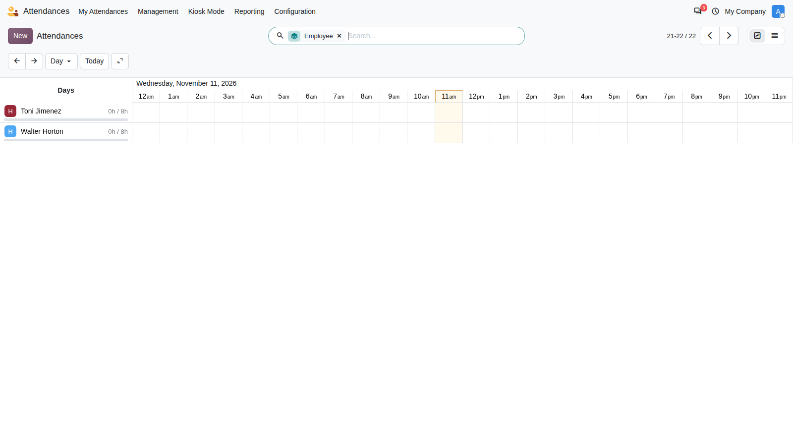
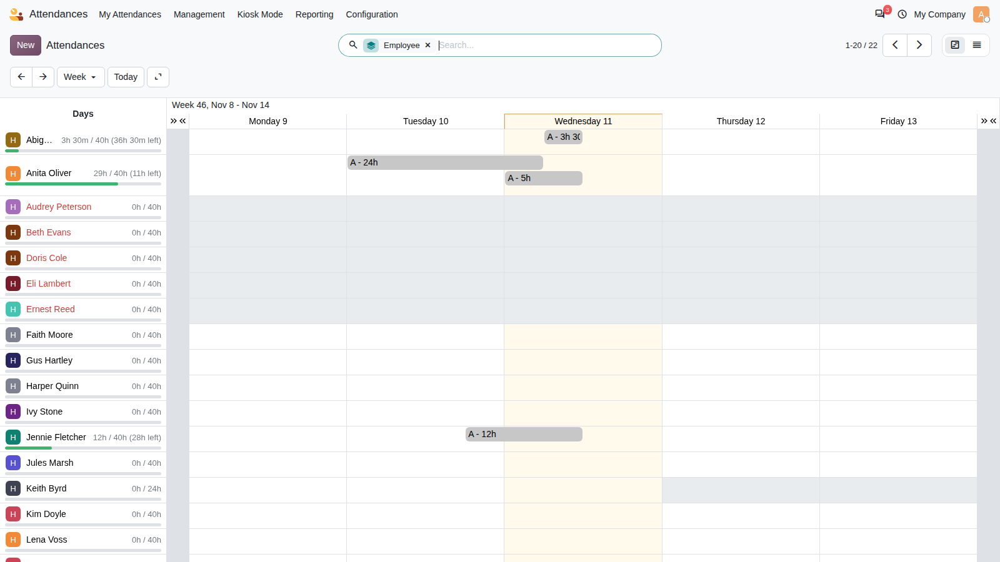
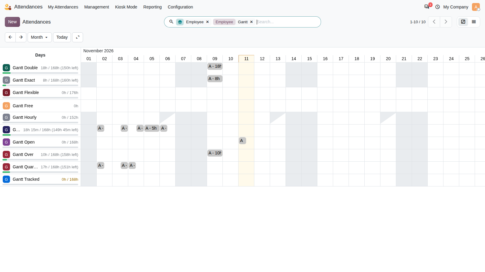
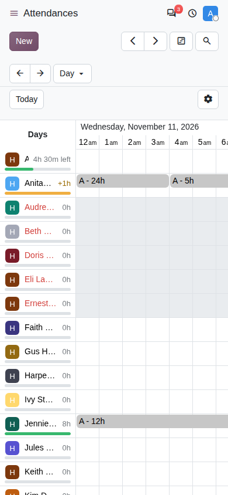
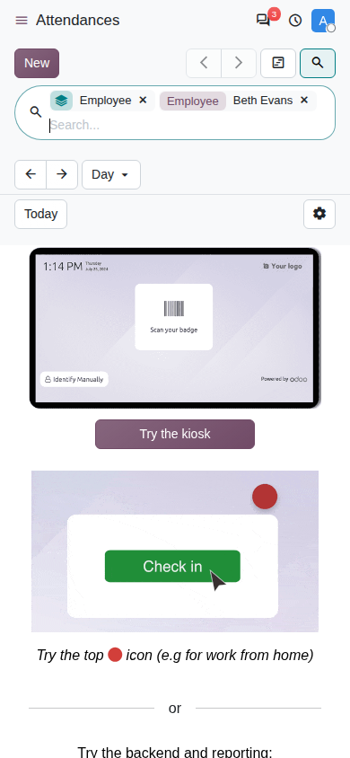

# Attendances Timeline

The module `hr_attendance_gantt` puts the attendances of your employees on a
time grid: one row per employee, one pill per attendance. It is the first view
of the Attendances application to use the [Gantt View](gantt_view.md), and the
first place where the employee rows of the [Employees Timeline](employee_gantt.md)
show up. The grid, its ranges, the control bar and the phone layout are those of
the Gantt view; this page tells what the attendance view adds.

The module installs by itself when the Attendances application and the
Employees timeline module are both installed. It is not an application, and it
adds no menu, group or setting. Uninstalling it gives the Attendances menu its
old list view back.

Technical reference:
[`addons/hr_attendance_gantt/README.rst`](../../addons/hr_attendance_gantt/README.rst).


## Opening the view

Choose **Attendances > Management > Dashboard**. The menu shows for the
attendance groups **Officer: Manage all attendances** and **Administrator**.
The action opens on the Gantt view, which now comes first in the view switcher,
followed by List. The search bar starts with one facet, **Employee**, which is
the grouping of the view; the Community's own grouping by month is no longer
applied. The column over the row headers is titled **Days**.

The view opens on the **Day** range of today: one day, 24 hour columns, the
current hour lit. The pager counts employees, not attendances, and shows 20 of
them per page.

## The rows

Every employee gets a row, ordered by name, **also an employee who has no
attendance in the period**. That is what makes the view useful for spotting who
did not check in. Only active employees are listed, unless your search asks for
archived ones. The pager steps through the pages of employees.



The rows keep to your search. A search on the employee or on a field the
employee carries (the department, the manager, the attendance manager, the
working schedule), and the filters My Attendances, My Team, Active Employees
and Archived Employees, keep the empty rows of the employees that match. A
search on the attendance itself (a state filter, At Work, Errors, a date, the
check-in) leaves only the employees who have a matching attendance. The same
happens when you group by something other than the employee alone: the view
then shows only the groups that have attendances. Grouping by the department
alone gives plain rows, with no avatar, label or bar; grouping by the employee
first and something else after it keeps the avatars, but no name is red.

### Avatars and the card

Each row header starts with the employee's avatar and name. An employee with no
photo gets the generated avatar of the Community, a coloured square with the
first letter of the name. Pointing at the avatar or the name shows the full
name in a tooltip.

A click on an avatar opens the Community's **employee card** under it: photo,
name, job title, work email and phone, a **View Profile** button and whatever
the installed applications add (skills, for one). The card closes on a click
elsewhere or Escape. The click does not scroll the grid. A click on the name or
anywhere else in the header does what it does in every Gantt view: it scrolls
the grid to the first pill of the row.


On a phone, a tap on an avatar opens nothing.

## Ranges: one period at a time

The range menu offers Day, Week, Month, Quarter, Year and Custom. Unlike other
Gantt views, a named range shows **one period**, not three: one day, one week
(starting on the first day of your language's week), one calendar month, quarter
or year. Previous and next move by one period. Today brings back the period of
today, or scrolls to today when it is already shown. The custom range works as
in the Gantt view.

**Around today.** When today lies inside the period on screen, choosing another
range builds it around today, whatever part of the period is scrolled into view.
On the Month range of November, for instance, choosing Week gives the week that
contains today. When today is not on screen, the new range is built around the
middle of what you see, as everywhere else.

The scales are fine-grained where it matters: the Day range works in quarter
hours, the Week range in quarter days, the Month range (and Quarter, which
uses it) in half days, and the Year range in whole months.






### Pills

A pill runs from check-in to check-out. Its text is the code of the work entry
type and the duration, for example "A - 3h 30m". Every attendance of the
standard data has the same type, so every pill is the first colour of the
palette: light grey, and in the dark look the theme's neutral grey, with black
text. Moving, copying and resizing work as described in the Gantt view, with
the Undo notice.

An attendance that goes on over midnight is cut at the edges of the period, and
shows on both days. A pill on the Month range that lies on both halves of one
day can be drawn on one half only, the way a lunch break splits a working day:
on that range, a pill that ends by 14:00 sits on the morning half, and one that
starts at 11:00 or later, and starts nearer noon than it ends, sits on the
afternoon half. Which half is chosen changes only the drawing, never the
record. On the Week range, with its quarters of a day, no pill is rounded.

The dates of the pill are those of the browser's time zone, as in every Gantt
view.

### Open attendances

An attendance with no check-out yet (the employee is still checked in) is
drawn from its check-in up to **now**. Now is read once, when the data is
loaded, and the pill does not grow until the next load; its end is then
rounded up to the end of its column cell (on the Day range, the next quarter
hour). Its text is just the work entry type's code, without a duration. An
open attendance from an earlier day is drawn from the start of the period on
later days. A period that lies entirely in the future shows no open
attendance, and a period in the past shows an open attendance up to its end.


## Hours worked: labels and bars

At the right end of every employee row header is a label, and under the row a
thin bar, both telling how much the employee worked in the period against how
much they should have worked.

- **Worked.** The hours of the employee's closed attendances in the period. An
  attendance that crosses a boundary of the period counts only for the part
  inside it, with any break shared in proportion; so a night shift from 20:00
  to 08:00 gives 4 hours to the first day and 8 to the second. Open
  attendances do not count.
- **Expected.** The hours the employee's working schedule asks for over the
  period's own days, less the company-wide leaves (a public holiday on a working
  day lowers the week from 40 to 32 hours). A flexible schedule with hours per
  week is reckoned by whole weeks plus the remaining days, capped by the weekly
  hours. An employee whose schedule is fully flexible has no expectation.

### What the label says

On a window **1400 px wide or more** the label gives both numbers and the
difference: "29h / 40h (11h left)" while the employee is under target,
"10h / 8h (+2h)" over it, and just "8h / 8h" at exactly the target. Hours and
minutes are written "3h 30m"; minutes appear only when not zero. A difference
that rounds to no whole minute shows no brackets at all.

**The label follows the window live.** When you resize the window across 1400
px, in either direction, the label changes its form on its own, within about a
second, without loading the data again. Below 1400 px (laptops, tablets and
phones) only the bracket's content is shown without the brackets: "+2h",
"4h 30m left", or the hours worked alone ("8h", "0h") when there is nothing to
add. Only the label's text changes; the bar, the row heights and the tooltip
do not.

### Colours

| Situation | Label | Bar |
|---|---|---|
| Under 100 % of the expectation | muted | green, filled to the share worked |
| Over 100 % and under 200 % | warning colour | full, amber |
| 200 % or more | danger colour | full, red |
| Nothing worked, but the employee is tracked by attendances | warning colour | empty |
| Fully flexible schedule | muted, hours only | none, and no tooltip |

A fully flexible employee who is also tracked by attendances still gets the warning
colour, as nothing is expected and nothing counts. Resting the pointer on the
label or the bar shows a tooltip such as "29h/40h (72%)", with the percentage
rounded to the nearest whole number. It has no tooltip when nothing is
expected.


Labels and bars are shown to internal users only; other users see rows without
them.

### Employees without a contract

The name of an employee who has **no contract overlapping the period** is red.
A contract that ends during the period does not turn the name red; the days
after its end are grey instead. The red name is shown only when the view is
grouped by the employee alone.

## Unavailable cells and folded columns

Cells where an employee is not available are grey. The view reads the
employee's contract and working schedule:

- Outside the employee's contracts, and for a whole period with no contract,
  everything is grey.
- On the days of a contract the working schedule decides. A schedule with
  whole working days greys the days off (weekends, typically). A schedule with
  hours greys everything but the working hours: for a day of 8 to 12 and 13 to
  17, the night, the lunch hour and the evening are grey. A flexible schedule
  has no grey day at all, weekends included.
- The public holidays of the working schedule are grey for everyone on it.

The schedule's hours are read in the employee's own time zone and shown at the
same clock time in the time zone of the user's preferences; the browser then
draws them in its own zone.

On a scale with half-day precision (the Month range) a cell whose two halves
differ is split by a **diagonal**: the available half in one triangle and the
grey half in the other, the grey afternoon in the upper-left one. On other
scales cells keep the vertical halves or quarters of the Gantt view.


### Folding

When every employee row of the page is unavailable for a whole column, and no
pill touches that column, the run of such columns folds into one narrow column
with two small arrows. With the standard data, the Week range folds Saturday and
Sunday, and the Month range folds each weekend pair. A flexible employee on the
page, or a pill on a weekend, prevents any folding. Click a folded header or cell
to open the run. A click with Ctrl does the same, and a click with Shift does
nothing, because this view has no multiple selection.

**The folding is worked out at every load.** It is worked out again whenever
the data of the view is loaded: when the view first opens, at every change of
range, scale or period, and also after a search, a filter, a change of
grouping, a step of the pager and the reload after a change. A column you opened
by hand stays open until the next load. The same page therefore always looks
the same, however you got to it. On the Day range, a page where every row is
grey all day folds its 24 hour columns into one column as wide as the grid.


## When nothing shows: the empty-view helper

When the page has **at most one row and that row has no attendance** (a search
on one employee who has not checked in, an unmatched search, a period with
nothing in it), the view shows the helper of the Attendances application, in its
own wording: onboarding for an attendance officer or above who is also an Employees officer, a
short note for others. It is laid over
the grid from 115 px below the top of the view, so the row stays visible and can
still be clicked through it, and it stretches to the bottom of the window. On a
phone, the helper takes the place of the grid instead. Two or more rows never
show it, even if none has an attendance.


The folded column in the second picture is the result of the rule above: the
only row is grey all day, so the page folds right after the search.

## On a phone

Below the small-screen breakpoint the view is the phone layout of the Gantt
view. The row header column is narrower, the names are cut with an ellipsis and
the label always takes its short form. The pager sits in the control panel, and the search facets show once the search
bar is opened with its button. A tap
on an avatar opens nothing.






## Who sees what

The bridge adds no group, access right or record rule.

- **Rows.** A user sees a row for each employee whose attendances they may
  read, also an employee who has none. An attendance officer sees the employees
  they manage and themselves; a user with own attendances only sees their own
  row. In the standard data, Marc Demo, who manages four employees, sees five
  rows.
- **Hours.** Labels and bars sum the attendances the user may read. Other
  users than internal ones see none.
- **Schedules, contracts and leaves** are read by the server for every row on
  the page, with the rights of the system, because these users cannot read them
  themselves. They are used only to grey cells, to work out the expectation and
  to redden names.
- **The card** opens on the employee's public record, which every internal user
  may read.
- **The menu.** The Management menu is shown to officers and administrators. The
  action itself belongs to every user of the attendance groups, and its address
  opens it for them too.

## What a click does for now

In this release, a click on a pill opens its popover and a double click opens the
record in a dialog, as in any Gantt view; a click on an empty cell and the New
button open the create dialog with the attendance model's default form (the
view does not offer the Gantt view's plan dialog). Where
the pointer is over an empty cell, nothing lights up and no button appears. A
later release changes these actions to suit attendances.

## For developers

The module adds one Gantt view record on `hr.attendance`, changes the management
window action, and registers the view variant `attendance_gantt` in the
browser; it adds no model and no stored field. The Python side overrides the
model's data call, the unavailability hook and the progress hook. The
description of the extension points for the next part is in the
[README](../../addons/hr_attendance_gantt/README.rst).

### The demo database at the project's instant

The standard demo data places attendances and contracts around the day it is
installed, so a database that has to show the same thing every time must be
created while the server's clock reads a given instant. The tool
[`tools/odoo_at_instant.py`](../../tools/odoo_at_instant.py) does that, and also
checks and extends such a database. It starts Odoo with the clock set at the
instant you give, and the clock runs on from there.

**It runs inside the project's container only.** It imports Odoo and its test
clock library, reads the database settings from the container's environment
(`HOST`, `PORT`, `USER`, `PASSWORD`) and finds the prepared-record builders in
the attendances bridge under `/mnt/extra-addons`. A Python of the host has none
of this. Mount `tools` read-only into the container, as the commands below do.
Every command is one plain `podman compose` command from the root of the
repository, after `docker/.env` has been created as the
[module authoring guide](../module-authoring.md#start-from-the-scaffold)
describes. Replace `DB` with the name of the database.

Create a database with demo data while the clock reads 11 November 2026,
10:00 UTC (the time is UTC unless it carries a zone):

```
podman compose --env-file docker/versions.env --env-file docker/.env -f docker/compose.yaml run --rm -v ./tools:/mnt/instant:ro odoo python3 /mnt/instant/odoo_at_instant.py --at 2026-11-11T10:00:00 -- -d DB -i web_enterprise,test_web_gantt,hr_attendance_gantt --with-demo --stop-after-init
```

Everything after `--` is the Odoo command line. The module list is the one the
tool was checked with; `hr_attendance_gantt` brings Attendances, Employees and
both bridges. The demo data need the clock while the database is created; the
server is then started under the same clock (below), so that its pages read the
same day as the package's scenarios.

Check that the demo data came out as expected. The command lists every employee
with schedule, time zone, contracts and attendances, then one line `DIFF ...`
for each difference from the expected table, and `differences: N`. It exits with
status 1 when there is a difference; employees whose name starts with "Gantt "
are shown but not compared.

```
podman compose --env-file docker/versions.env --env-file docker/.env -f docker/compose.yaml run --rm -v ./tools:/mnt/instant:ro odoo python3 /mnt/instant/odoo_at_instant.py check-demo -d DB
```

Add the **prepared records**, ten employees named "Gantt ..." with their
working schedules and attendances, which show the states the demo data lacks
(over and under target, an open attendance, an hourly schedule, lunch rounding).
The command removes earlier prepared records first, so it can be run again, and
prints the record counts before and after. `--night` adds an attendance across
the end of a month, and `--holiday` adds a company-wide leave on 12 November.
Both are optional:

```
podman compose --env-file docker/versions.env --env-file docker/.env -f docker/compose.yaml run --rm -v ./tools:/mnt/instant:ro odoo python3 /mnt/instant/odoo_at_instant.py prepare -d DB --night --holiday
```

Remove them again, with their employees, schedules and the holiday:

```
podman compose --env-file docker/versions.env --env-file docker/.env -f docker/compose.yaml run --rm -v ./tools:/mnt/instant:ro odoo python3 /mnt/instant/odoo_at_instant.py unprepare -d DB
```

Start the server on that database with the clock started at the instant and
running on, published on port 8069 (the server answers at
`http://localhost:8069`). Run it in the background or in its own terminal:

```
podman compose --env-file docker/versions.env --env-file docker/.env -f docker/compose.yaml run --rm -p 127.0.0.1:8069:8069 -v ./tools:/mnt/instant:ro odoo python3 /mnt/instant/odoo_at_instant.py --at 2026-11-11T10:00:00 -- -d DB
```

Stop it by name: `podman ps` lists the run container (its name looks like
`docker-odoo-run-c38678dc7f23`), and

```
podman stop CONTAINER
```

stops it; `--rm` removes it.

Drop the database, under the same clock as the other commands:

```
podman compose --env-file docker/versions.env --env-file docker/.env -f docker/compose.yaml run --rm -v ./tools:/mnt/instant:ro odoo python3 /mnt/instant/odoo_at_instant.py --at 2026-11-11T10:00:00 -- db drop DB
```

`prepare` and `unprepare` work as the administrator and commit their changes.
`prepare` needs Attendances installed in the database. The tool also re-points
the clock of the XML data evaluator, which would otherwise keep the real day, so
that contracts which end "today" end on the instant's day; it relies on how this
Odoo release lays that evaluator out, and fails at start with an import error,
not silently, if a later release moves it.
