# Event Tracks Timeline

The module `website_event_track_gantt` adds a **Gantt** view to the tracks of
the event application. The tracks of an event are drawn as pills on a time grid,
in one row per location, and you can open, move, resize, copy, unschedule and
delete them from there. The grid itself, its ranges, the control bar and the
gestures are those described in [Gantt View](gantt_view.md); this page tells
what the bridge adds.

The module installs by itself when the event tracks application and the Gantt
view are both installed. It is not an application, and it adds no menu, group or
setting. Uninstalling it takes the Gantt view mode off the two track actions
again.

Technical reference:
[`addons/website_event_track_gantt/README.rst`](../../addons/website_event_track_gantt/README.rst).

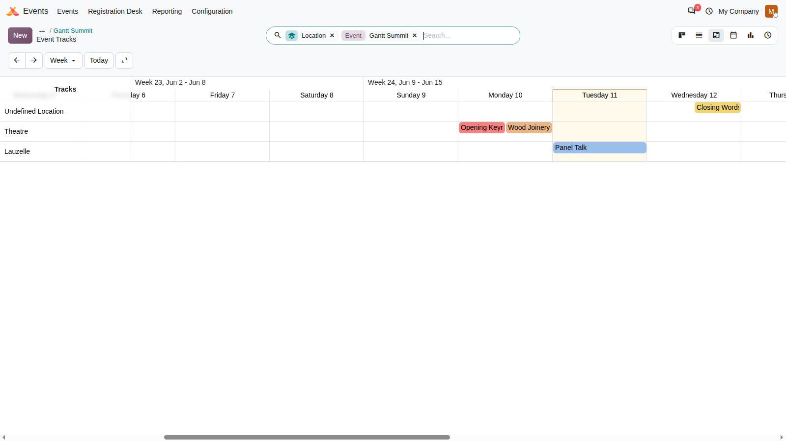

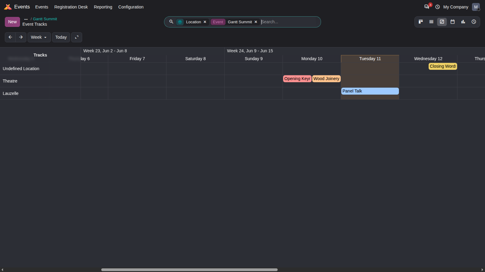

## Opening the view

There are two ways in.

- **From an event.** Open the event and click its **Tracks** button (the
  microphone with the number of tracks). The list of the event's tracks opens;
  choose the Gantt view in the view switcher. The view starts on the event's
  first day and on a range that fits the event (see
  [The first day and the range](#the-first-day-and-the-range)).
- **From the menu.** **Events > Tracks** lists the tracks of every event. The
  menu shows only in developer mode. Its Gantt view opens on the **Year** range
  around today, grouped by **Location**, which shows as a "Location" facet in
  the search bar.

In both actions the Gantt view comes after Form in the view switcher, and the
action still opens on Kanban. A track that has no location lies in the
"Undefined Location" row, which comes first. A track with no start date has no
pill; it stays in the other views. An event without tracks opens an empty row.

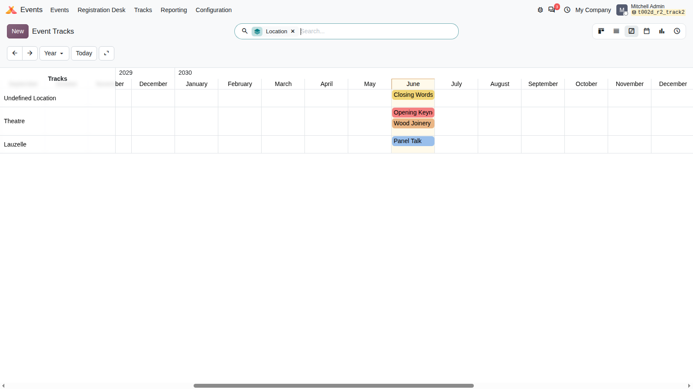

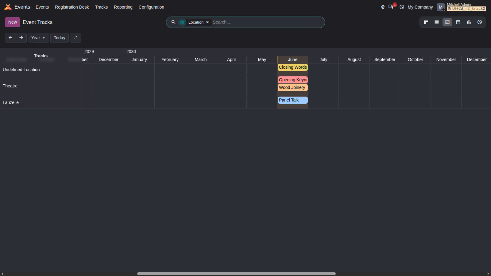

The pill colours come from each track's **Agenda Color**.

## The first day and the range

The two values come from the dates of the event and of its active tracks (an
archived track does not count). The **first** instant is the earliest of the
event's start and its tracks' starts; the **last** is the latest of the event's
end and its tracks' ends. The gap between them decides the range:

| Gap between first and last | Range |
|---|---|
| more than 30 days | Year |
| more than 7 days, up to 30 | Month |
| more than 1 day, up to 7 | Week |
| 1 day or less | Day |

A gap of exactly 30 days, 7 days or one day gives the smaller range. A track
that starts before the event or ends after it widens the gap.

The view opens on the **calendar day of the first instant in your browser's
time zone**, the zone in which the view shows all its dates. Your time zone
preference and the event's own time zone do not count.

Worked example, the event "Gantt Summit": it runs from 10 June 06:00 to
12 June 15:00 (UTC), and its tracks lie inside. The gap is a little more than
two days, so the range is a **Week**. With a browser three hours east of UTC the
first instant is 09:00 on 10 June, and the view opens on 10 June. Other zones
can change the day, and only the day: an event whose earliest start is
1 July at 22:30 UTC opens on 2 July for a browser three hours east of UTC (01:30
there), and an event starting 1 July at 18:00 UTC opens on 1 July for a browser
seven hours west (11:00 there).

The values are worked out when you click the button, from the saved event, so
they follow every change of the dates of the event and of its tracks. If you
opened the Gantt view of that action before and chose another range, the view
remembers your choice, as the Gantt view does everywhere.

## The popover

A click on a pill opens a popover with the track's title as its header and, in
the body, **Start —** with the start of the track, in your language and your
browser's time zone, and **Proposed By —** with the name of the speaker. The
speaker's line shows only when the track has a speaker name. The footer has the
**Edit** button, or **View** when you cannot change tracks.

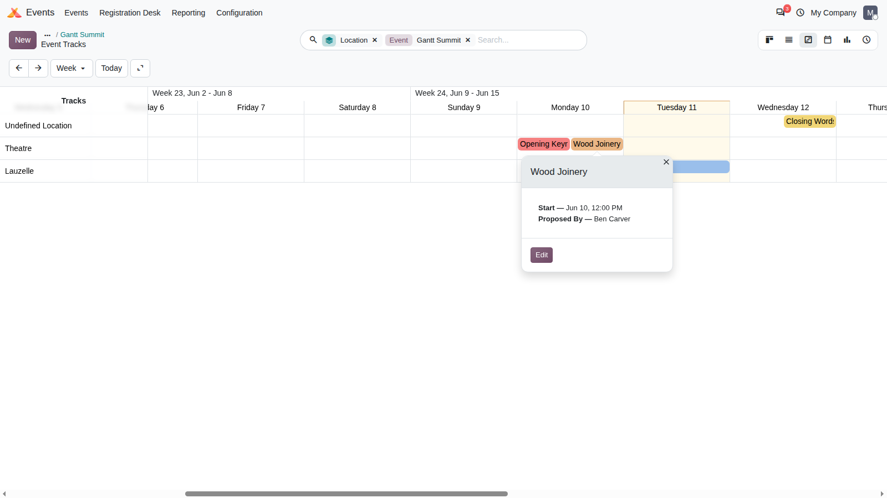

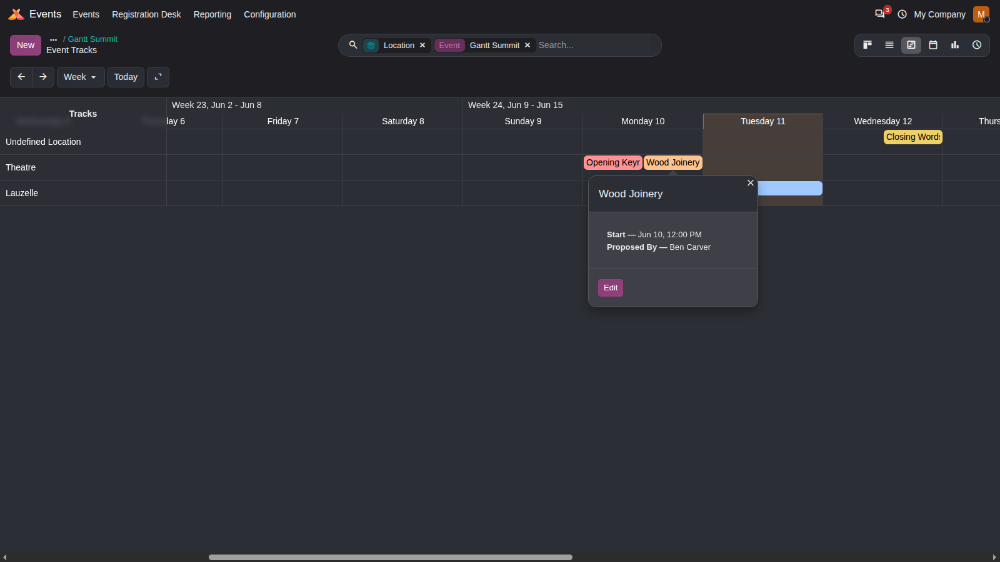

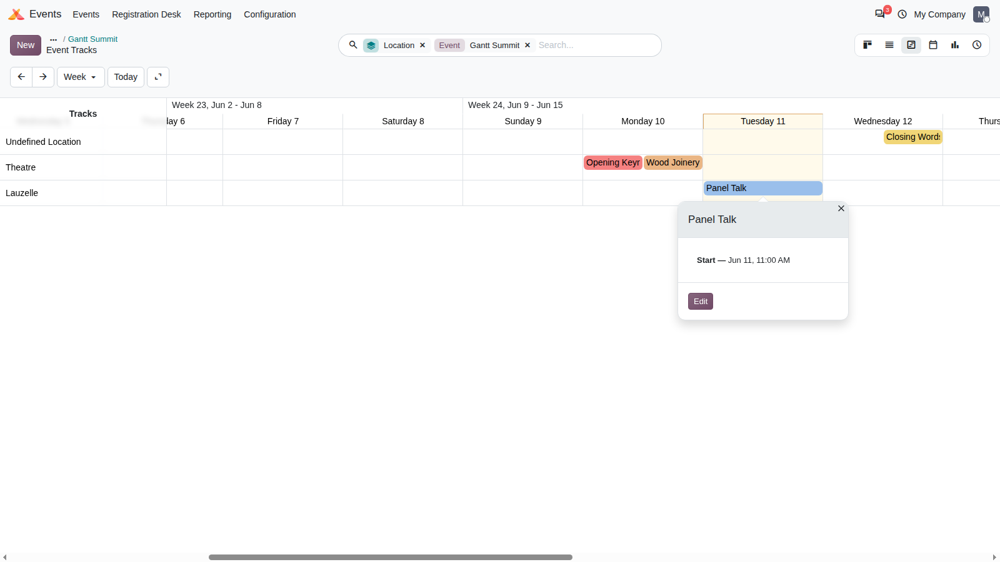

## The track dialog

Edit, View, a double click on a pill, **New** and a click on an empty cell open
the track in a dialog. It is the usual event track form, with three things taken
out: the stage bar (the stage cannot be changed here), the **Wishlisted By**
button and the publish button. The dialog has no chatter. The title, image,
kanban state, track date, location, duration, always wishlisted, responsible,
event, tags, agenda colour and the Speaker, Description and Interactivity pages
are all there. A new track from a cell proposes the day at midnight, as the
other Gantt views do; the New button on the Week range proposes the start of the
week of the focus date as the grid shows it (a Sunday at midnight with the
default language), not the original's Monday.

The footer, from the left, holds up to four buttons:

- **Save** saves the changes and closes the dialog.
- **Discard** drops the changes and closes it.
- **Unschedule** (existing tracks only), see below.
- A bin button (existing tracks only), tooltip **Delete**, see below.

Their shortcuts are Alt+Q for Save, Alt+X for Discard and Alt+D for Delete.
The buttons stand together at the left of the footer.

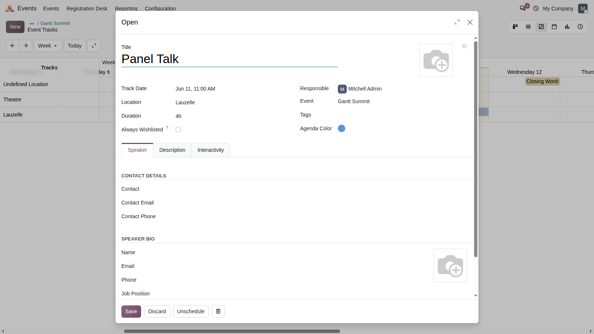

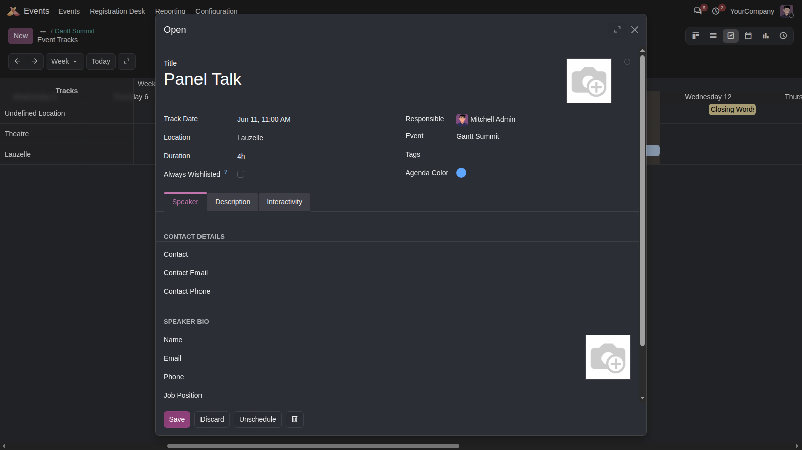

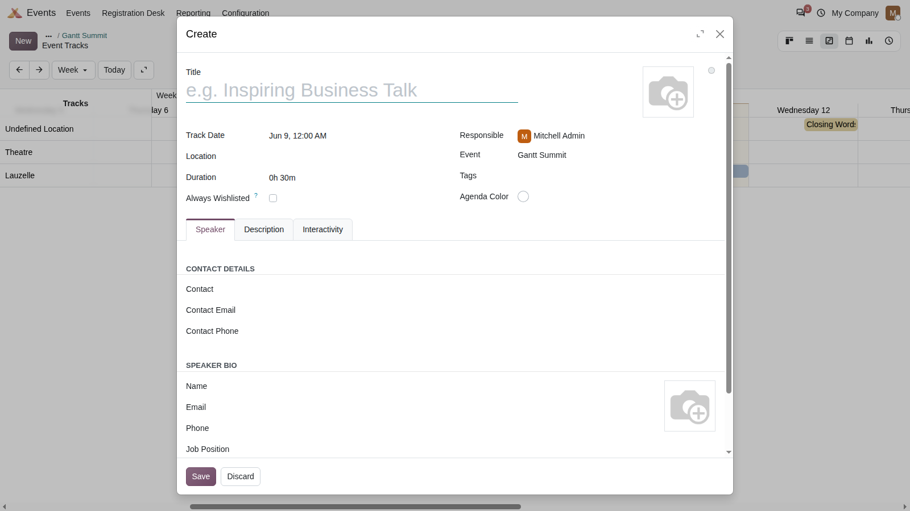

### What each role can do

The footer follows your **access rights on tracks**, not a group:

| Role | In the view | Footer of an existing track | Footer of a new track |
|---|---|---|---|
| Events / Administrator | creates, moves, resizes, copies and deletes | Save, Discard, Unschedule, Delete | Save, Discard |
| Events / User | creates, moves, resizes and copies; cannot delete | Save, Discard, Unschedule | Save, Discard |
| Events / Registration Desk and other internal users | read only; the popover button is View | Discard only, the form is read only | not offered |

Registration Desk users reach the view from the event form's Tracks button, which
that form shows them. The server's own checks on writing and deleting still
apply to every button.

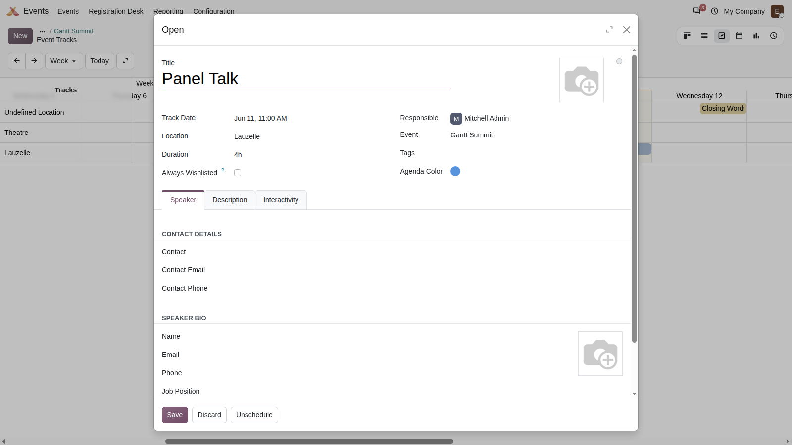

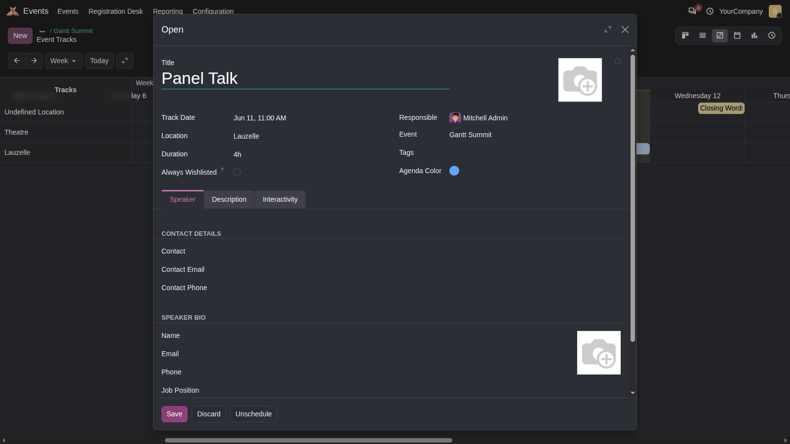

### Unschedule

**Unschedule** first saves the changes made in the dialog, then empties the
track's **start and end** and keeps its **duration**. The dialog closes, the
view reloads and the pill is gone. There is no confirmation, notification or
Undo; the track stays in the other views, and giving it a start again brings it
back. The button works on one track at a time.

### Delete

The bin button opens a **Delete Track** confirmation over the dialog, with a
**Delete** button and a **Discard** button. While it is open, the buttons of the
dialog behind it are disabled and drawn at half strength. Delete saves the
dialog's changes, deletes the track, closes both dialogs and reloads the view.
Discard, the cross and Escape close only the confirmation and nothing is
deleted. If the form is not valid (the title was emptied, for example), Delete
closes the confirmation, deletes nothing, leaves the dialog open with the
invalid fields marked and shows the usual notice that required fields are
missing.

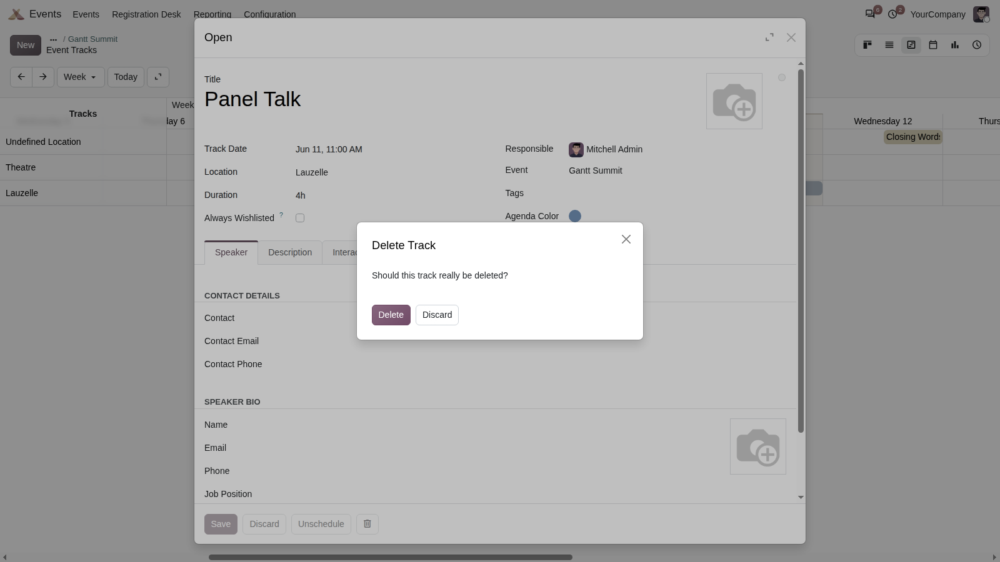

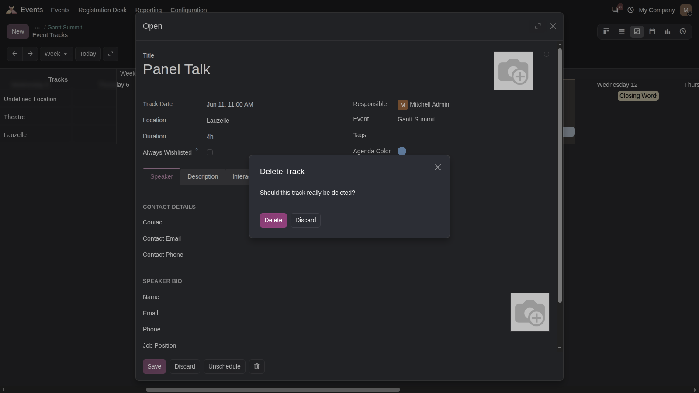

If another session deleted the track meanwhile, a move, a resize or Unschedule
shows the usual missing-record error and the view reloads without the pill; Save
shows the error and keeps the dialog open; Delete succeeds quietly and closes
both dialogs. A deletion that the server refuses shows the usual access error,
and the track is still in the view afterwards.

## Moving pills, and what the view leaves out

Moving, copying and resizing work as in [Moving, copying and resizing
pills](gantt_view.md#moving-copying-and-resizing-pills), with the notification
and Undo, for users who may write tracks. Dragging to another row changes the
location. The view names no template form, no scheduling option and no
dependency field, so it has no multi-selection of cells, no side panel and no
arrows, buffers or method button.

## On a phone

Below the small-screen breakpoint the view is the phone layout of the Gantt
view, the popover opens as a sheet and the dialog is the full-screen form. Its
footer stacks the buttons one under the other, each as wide as the footer, in
the same order. The event's Tracks button sits in the menu that the phone makes
of the form's button box, and the view switcher is a menu too.

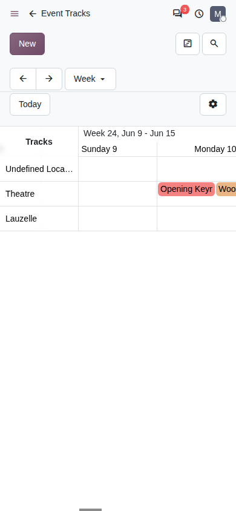

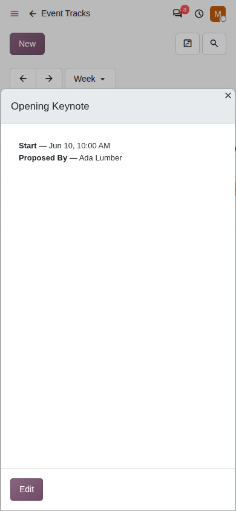

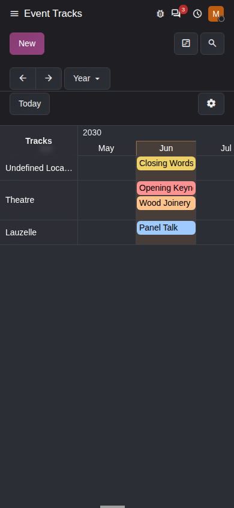

## For developers

The module changes the two Community window actions on `event.track` (the
Events > Tracks menu's and the event's), the event form's Tracks button and the
form of the track dialog; it adds no model and no stored field, only two
computed values on the event (the start and the range its Tracks button passes).
It adds one method on tracks, `action_unschedule`, which clears the start and end and keeps the
duration, and refuses a call on several records. The button of the event passes
the earliest start as a UTC date and time and the range, and the Gantt view reads
the first as a UTC instant and takes its local calendar day as the focus; the
keys it uses are the view's `initialDate` and `default_scale`, and the menu's
action carries `search_default_location`.

**Tests bundle.** While eCommerce (`website_sale`) is not installed, the module
leaves the test files of the Community module Website Address Autocomplete out
of the tests bundle (`web.assets_tests`). That module installs by itself with
Website, and its tour imports the tour helpers of eCommerce without depending on
eCommerce, which would break every tour of the database. Nothing else is
changed, and installing eCommerce brings the files back.
