# Gantt View

The Gantt view shows records as horizontal bars, called pills, on a time grid.
Each pill runs from the start to the stop of its record, and the records can
be arranged in rows by any field. Besides looking and navigating, you can
create records from the grid, plan records that have no dates yet, open a
record, change it and delete it, as far as the view and your rights allow (see
[Creating, planning, opening and deleting](#creating-planning-opening-and-deleting)).
Moving and resizing pills with the pointer is not part of this release.

The view has no menu of its own. It appears in any window action whose view
modes include **Gantt**, next to the other views in the view switcher, or as
the first view of such an action. The first Community applications that use it
arrive in later slices; until then it is reached through actions written by
other modules, such as the scratch host of the hidden test module
[`test_web_gantt`](../../addons/test_web_gantt/README.md), used for the
screenshots below. The search bar of the action (filters, group by, favourites)
applies as usual.

Technical reference:
[`addons/web_gantt/README.md`](../../addons/web_gantt/README.md).


## The control bar

Under the control panel, a bar holds the controls of the view, from left to
right:

| Control | What it does | Key |
|---|---|---|
| Previous and next arrows | Move back or forward by one period of the current range (one day, week, month, quarter or year). A custom range moves by its own length. | `p`, `n` |
| Range button | Shows the current range ("Day", "Week", "Month", "Quarter" or "Year"), or the two dates of a custom range, followed by a small caret. Opens the range menu. | `v` |
| **Today** | Scrolls so that today is in the middle of the grid. If today is outside the displayed period, the range is rebuilt around it; a custom range keeps its length. | `t` |
| Display mode | Switches between one shared row per group of records (dense) and one row per record (sparse). | |
| Open or fold every group | Opens all group rows, or folds them all. Shown only when the first row is a group row; otherwise it keeps its place but is invisible. | |

When several clicks on previous or next follow each other quickly, the data is
loaded once, half a second after the last click. If the view lets you
create records, the **New** button sits in the control panel (key `c`); what it
opens is described under
[Creating](#creating-planning-opening-and-deleting).

### The range menu

The menu lists the ranges the view offers, with the current one checked, then
a line for a **custom range**: two plain date fields (only a line under each)
with an arrow between them and an **Apply** button. Picking a date in either
field opens a date picker, and the date stays unselected so that you can type
over it; the menu stays open until you press Apply. The dates are set a little
larger than the menu text, with room for ten characters, and while a date
picker is open the dates and the arrow take the strongest text colour (black in
the light scheme, white in the dark one); they return to the accent colour when
it closes. If you pick a start after the stop (or
the reverse), the other date follows. A range can be at most ten years minus
one day long. Choosing another range in the list rebuilds the grid around the
date that is currently in the middle of the screen.


When the view opens, the range comes from, in this order: the range you chose
last time on this view (the browser remembers the name of the range, never the
dates of a custom one), the range passed by the action, the default range of
the view definition. If none applies the view opens on a custom range of three
months starting at the first day of the current month.


## Scales and ranges

A named range shows three periods of its kind: the one that contains the focus
date (today unless the action says otherwise), the one before and the one
after. Every range has a scale, which sets what a column is:

| Scale | Column | Grouped under | Used by |
|---|---|---|---|
| Day | one hour | the day | Day range |
| Week | one day | the week | Week range |
| Month | one day | the month | Month range, Quarter range (nine months) |
| Year | one month | the year | Year range |

A custom range picks its scale from its length: under 6 days the day scale,
under 27 the week scale, under 364 the month scale, otherwise the year scale.
If the view does not offer that scale, the nearest smaller offered one is
used, then the nearest larger one. Columns share the free width equally; when
that would make them too narrow the grid scrolls sideways. Weeks start on the
first day of the week of your language. On the days when the clock changes,
the day scale has 23 or 25 hour columns, and pills follow the wall clock.

Today's column has a pale warm tint in its header and cells (on the day scale
it is the current hour).


Records that have only a date, not a time, are shown for the whole days; the
stop day is included. A view may mix the two kinds, for example a date-only
start with a date-and-time stop. Each end is then read on its own terms and
always in the days of your own time zone, wherever you are relative to UTC: a
date-only start is the beginning of its day, a date-only stop the end of its
day, and a record whose date-only stop falls on the day of its start is drawn
for that day. One whose stop day lies before its start is left out.


On the year scale, a record that lies inside a single month fills that whole
month.


Records are shown when they overlap the displayed period. A record without a
start or a stop, or whose stop is before its start, is not shown. A record
that begins before or ends after the period is cut at the edge of the grid.
Archived records appear only when the search asks for them.

## Rows and grouping

With no grouping, one unnamed row holds every pill; pills that overlap in time
are stacked on separate lines. With a grouping from the search bar (or from
the view definition or the action), each value gives a row, and rows nest when
you group by several fields. Grouping by a date or date-and-time field is
ignored.

- A row for records **without a value** comes first and is named "Undefined"
  followed by the field label, for example "Undefined Parent". It is always
  there at the top level, unless the field is required. Zero and an empty text
  also count as no value. Yes/no fields show "True" and "False".
- With a **many-to-many** field, a record appears in the row of every value it
  has, and in the empty-value row only when it has none.
- Fields that list all their values even when empty (a stage, for example)
  give empty rows.
- Row names are shown with the normal display of the field; a grouping field
  can have a small image shown before the name of its row. A name too long
  for the header is cut with an ellipsis.

A row that has sub-rows is a **group row**: a caret before its name shows
whether it is open or folded, and clicking its header or its cells folds or
opens it. Instead of pills, a group row shows for each stretch of time the
number of records running there, as a thin line with the count at its left.
Clicking the header of a row without sub-rows scrolls the grid so that the
start of the column in which its first pill begins is in the middle. Pointing at a group row highlights the whole row, header included.
Changing the grouping opens every row again.


### Sparse mode and paging

In sparse mode every record gets a row of its own, named after the record,
below its group. The record rows follow the order of the pills: first the
sub-column where the pill starts, then its start time; this holds under every
group and when there is no grouping. Group rows are then used for every level of grouping. Without
grouping, each record is a row. Switching between the two modes opens all
folded rows.

When the view definition sets a number of groups per page and the data is
grouped, the control panel shows a pager. It counts combinations of the
grouping values, so with two levels a page of two shows two combinations below
their parent rows, and a parent row can occur on several pages. The
empty-value row is shown on every page.


## Pills

A pill starts at the beginning of the part of a column that holds the start of
the record and ends at the end of the part that holds its stop. Each scale cuts
a column in parts (the day scale by hour, the week and month scales by half
days, the year scale by month); the view definition can make this coarser or
finer.

- **Label.** The pill shows the name of the record. If the view asks for
  dates in the label, a record that spans several days and sticks out of the
  displayed range also shows its start and stop dates before the name (on the
  year scale, any record shows them). The dates are short numeric ones in the
  order of your language, without the year, for example "10/23 - 12/2". When the model has hours allocated to a
  record, a one-day pill on the week and month scales can also show its times
  and allocated hours. Text is cut at the edge of the pill.
- **Colour.** The view can colour pills by a number or relational field. There
  are twelve colours, taken from the theme; the first one is a neutral grey.
- **Marks.** The view definition can mark pills that meet a condition (danger,
  warning, success, info, secondary) with a small triangle in the top left
  corner. The info mark also fills the pill with diagonal stripes.
- **Progress.** A darker band covers the left part of the pill, as wide as the
  percentage held by a field of the record.


### The popover

A single click on a pill opens a popover next to it (after a short delay, so
that a double click does not open it). A cross at the top right, a click
elsewhere, or a click on another pill closes it; the click on the other pill
opens that pill's popover. Without any content in the view definition the
popover shows the record name as its header and two lines, Start and Stop,
with the dates, and a small primary button in its footer: **Edit** when the
view allows editing, **View** otherwise. The button closes the popover and
opens the record in a dialog (see
[Opening, editing and deleting](#opening-editing-and-deleting-a-record)).

A view definition can supply its own content in the manner of a card: a body,
a header and a footer, or the identifier of a card view to borrow its fields
and templates. A custom body replaces the two lines; a custom footer replaces
the button unless it is told to keep it. On a phone the popover opens as a
full-screen sheet.


## The total row

When the view definition asks for it, a row named **Total** is added at the
bottom. For every stretch of time in which records run it draws a vertical bar
whose height follows the number of records, with the count at its foot. Bars
too narrow for the count show a smaller figure. Pointing at a bar turns it to
the primary colour (80 percent opaque) and draws a translucent band up to the
top of the grid. Without row headers
the row has no title.

## Capacity bars, unavailable periods and folded columns

Three features are drawn by the view but filled in by the module that hosts
it. A plain installation of the Gantt view supplies no data for them (the two
hooks return nothing), so you see them only in applications that provide it,
such as the employee, attendance, event track and time off applications of later slices.

- **Capacity bars.** For a grouping field named by the view definition, a row
  header can show how much of a quantity (typically hours) is used: a small
  label with what remains at the right end of the name line, and a thin bar filled in green up to 100 percent
  and in red beyond it. Pointing at the bar or the label shows used and
  maximum with the percentage. If the host gives a warning instead of a
  maximum, a warning icon with that text replaces the bar. In sparse mode only
  group rows show the bars.
- **Unavailable periods.** With the option on, the periods in which the
  resource of a row is unavailable are greyed in its cells; a cell that is
  partly covered is grey only where it is covered.
- **Folded columns.** When every row is unavailable for a whole column and no
  pill touches it, runs of such columns fold into one narrow column whose
  header shows two arrows pointing at each other. Click the folded header or a
  folded cell to open the run, and click the header of an open one to fold it
  again. While you point at the header of an open column of such a run, the
  headers of the run show outward arrows and the others dim. Folding is reset
  when the range or scale changes.


## Creating, planning, opening and deleting

Everything below uses ordinary Community dialogs (a form in a dialog, a list of
records to pick from, a confirmation), coloured by the theme. Which of these
you get depends on the view's options and on your rights; see
[What you may do](#what-you-may-do).

### Creating a record

There are three ways to start a new record from the view, and each one opens
the create dialog (titled "Create") with the dates already filled in:

- **The New button.** It proposes one unit of the current scale around the date
  in the middle of the visible grid: the day on the Day range, the week on the
  Week range, the month on the Month and Quarter ranges, the year on the Year
  range. The week is the one the grid shows, so it starts on the first day of
  the week of your language (a Sunday in US English, a Monday in English (UK)),
  not always on Monday. No row value is set. The button also works on the
  sample data screen.
- **A click on a cell** in a row without sub-rows, when the view does not plan
  records (see below). The record gets the whole column you clicked: the day on
  the Week and Month scales, the hour on the Day scale, the month on the Year
  scale. A click on a cell of a group row folds or opens the row, and a click on
  a folded column opens it, as before.
- **A selection.** Press on an empty part of a cell and drag at least ten
  pixels along the row. A translucent band covers the sub-columns you pass
  over, and two small badges show where it starts and where it stops. The band
  stays in the row where you started, whichever row the pointer crosses, and
  follows the half days or hours of the scale. Near the left or right edge of
  the grid the grid scrolls sideways while you hold, and the band grows with
  it. Releasing opens the create dialog for the selected period. **Escape**
  while the button is held drops the selection and opens nothing. You cannot
  start a selection on a pill, on a group row or on the sample data screen.

When you create from a cell or a selection in a grouped view, the new record
also receives the values of the row, and of the rows above it, for the fields
the view is grouped by. An "Undefined" row gives an empty value. Fields that
are not part of the grouping are left alone.

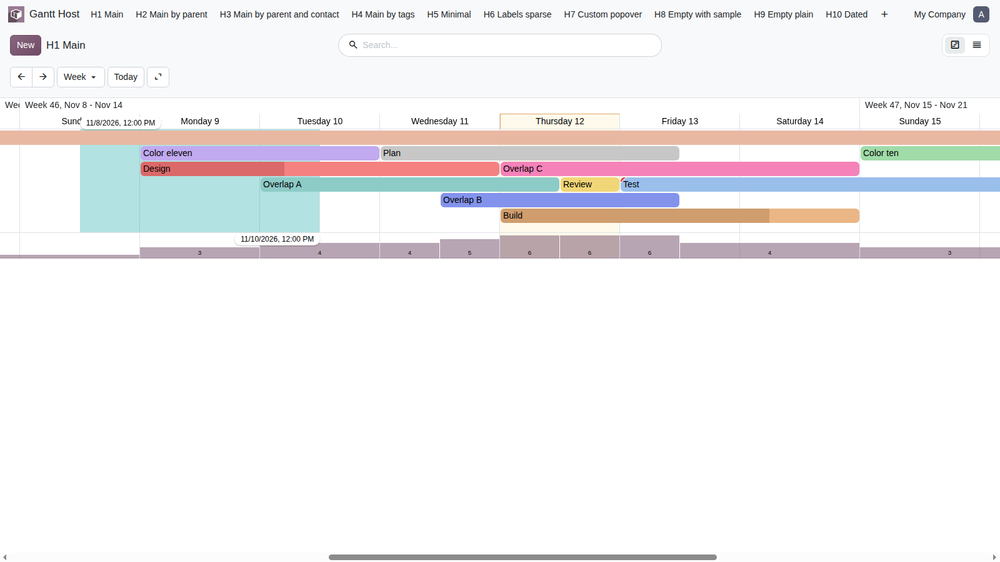

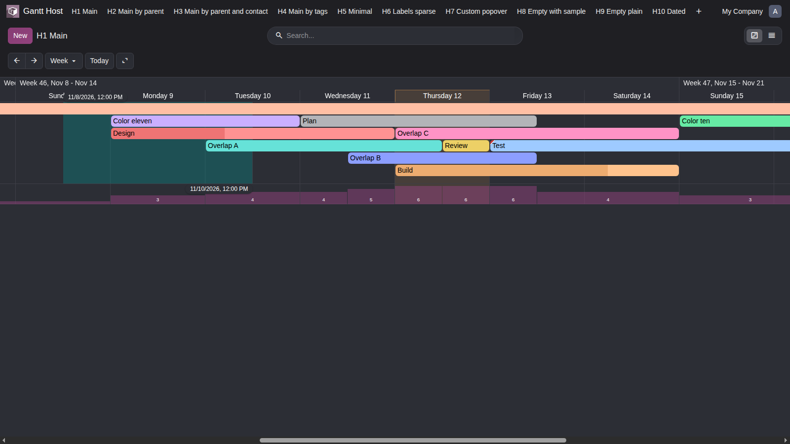

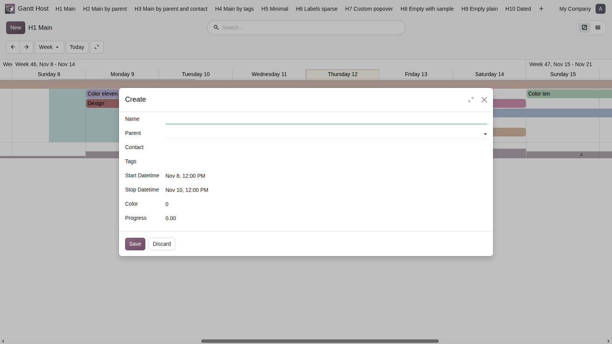

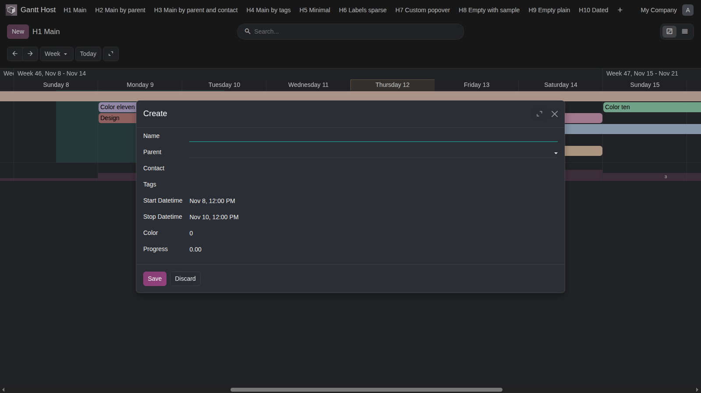

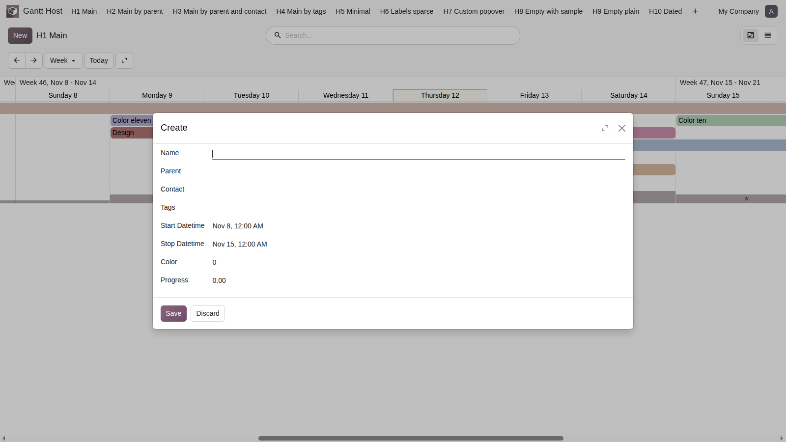

Saving creates the record and closes the dialog; Discard closes it without
writing. Either way the view reloads. The search and the domain of the action
still apply, so a new record that does not match them is saved but not shown.
If the view names a **create action**, that action runs instead of the dialog,
with the same values added to its context, and the view reloads when it closes.

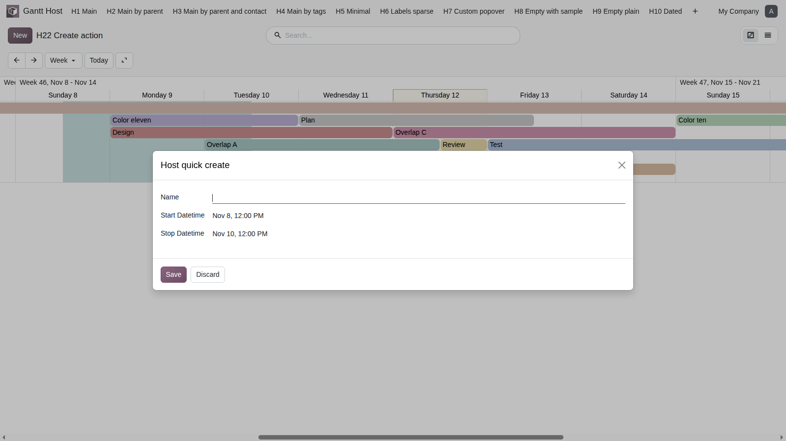

### Dates of date-only records

On a model whose start and stop are plain dates, the proposed stop is the last
day that was clicked or selected, never the day after: a click on the 16th
gives the 16th to the 16th, a selection that ends at midday of the 18th gives
the 18th, and New on the Month range gives the first to the last day of the
month. This matches the way the view draws such records (the stop day is
included). When a model mixes a date start with a date-and-time stop, each
field gets a value of its own type.

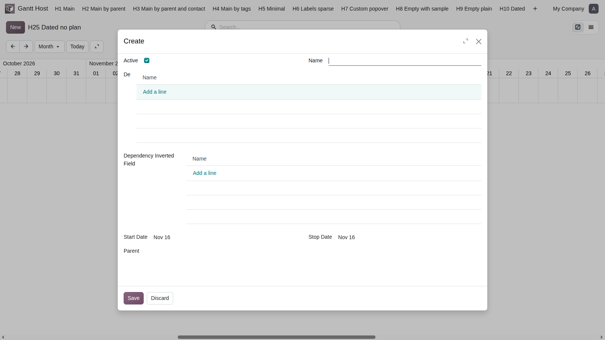

### Planning records that have no dates

With the view's planning option on (it is on unless the definition switches it
off), a click on a cell of a row without sub-rows opens the **Plan** dialog
instead of the create dialog. It lists the records of the action's domain that
have no start or no stop, with check boxes, a search bar and a pager. Search
filters of the view are not carried over, but the dialog starts with the values
of the row you clicked when its search offers the matching field, for example a
filter on the parent of that row.

- **Select** gives every checked record the start and stop of the clicked
  column, and the row's values for the grouping fields; the button stays
  disabled until a record is checked. On a date-only model the clicked day is
  both start and stop. Clicking a record's line (on a phone, tapping its card)
  plans that single record at once.
- **Create New** (offered when creating from cells is allowed) makes a new
  record for the clicked column and row: through the create action if the view
  has one, otherwise in the create dialog with the view's form (or the model's
  default form). A record saved from that dialog is planned in the same way, and
  both dialogs close; Discard returns to the plan dialog.
- **Close** writes nothing.

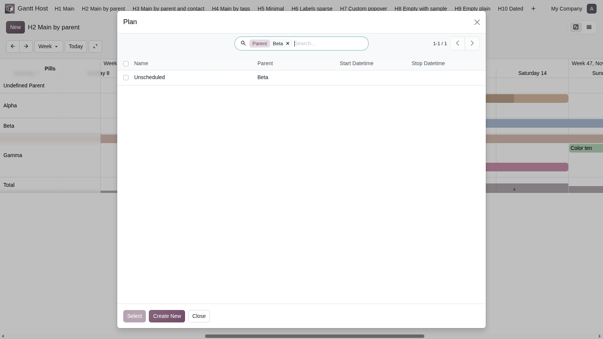

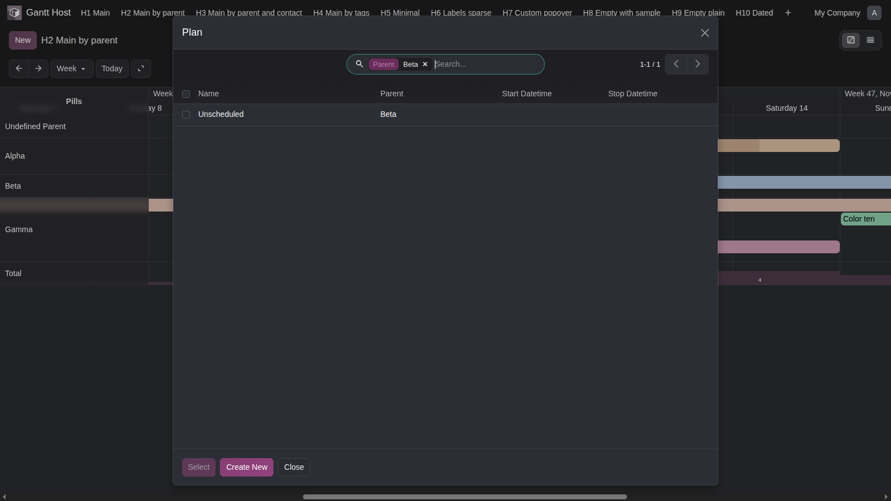

### Opening, editing and deleting a record

A record opens in a dialog titled "Open", from the **Edit** or **View** button
of the popover or by a double click on its pill (which opens no popover). The
dialog shows the form given by the view's form option, or the model's default
form. When the dialog closes, whatever button you used, the view reloads. If a
write that the view itself started (planning, for example) is still running,
the dialog waits for it so that it shows the saved values.

The dialog is editable when both the view and the form itself allow editing;
otherwise it is read-only and offers the usual read-only buttons of the web
client. An editable dialog has Save, Discard and, when the view allows deleting,
**Remove**. Remove asks for confirmation with the web client's own
record-deletion box ("Bye-bye, record!", with **Delete** and **No, keep it**).
Delete removes the record and closes both dialogs; "No, keep it" or the cross
returns to the record. A new record's dialog has no Remove. If the server
refuses a save or a deletion (a missing right, a constraint), the usual error
dialog appears over the record dialog, nothing is changed, and a refused save
keeps what you typed.

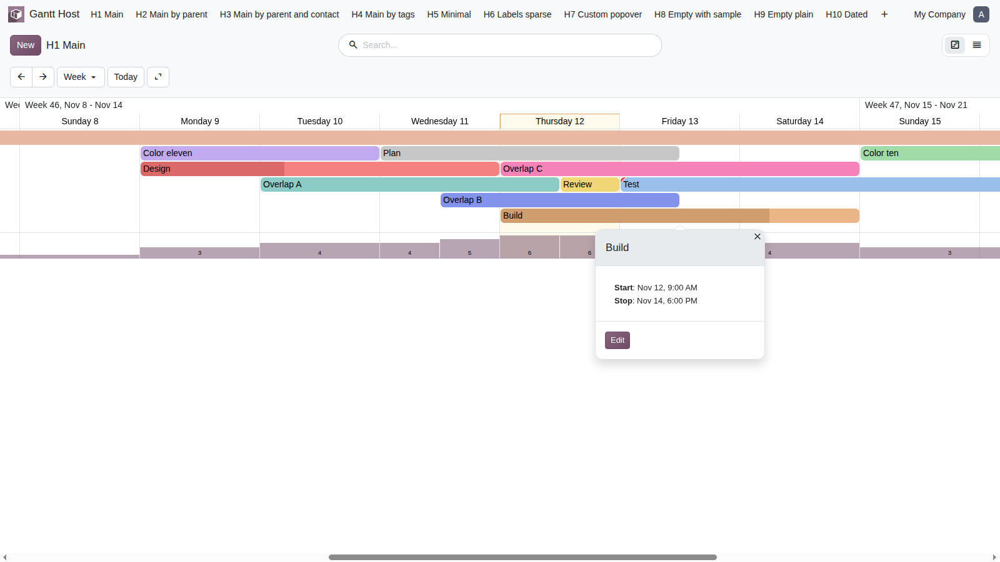

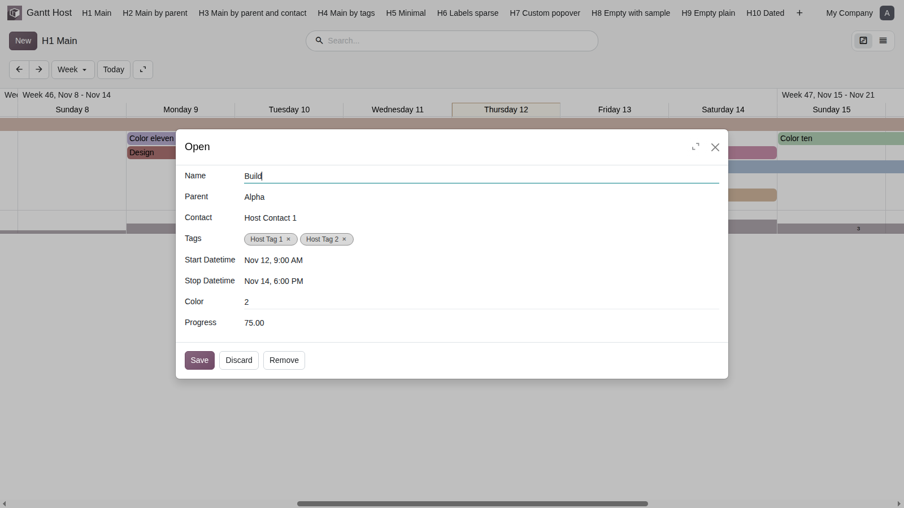

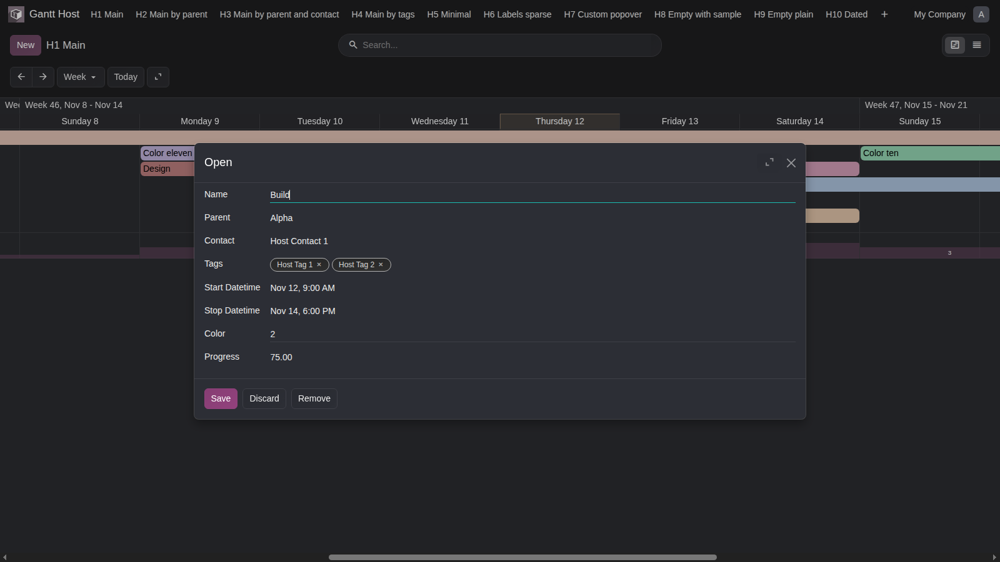

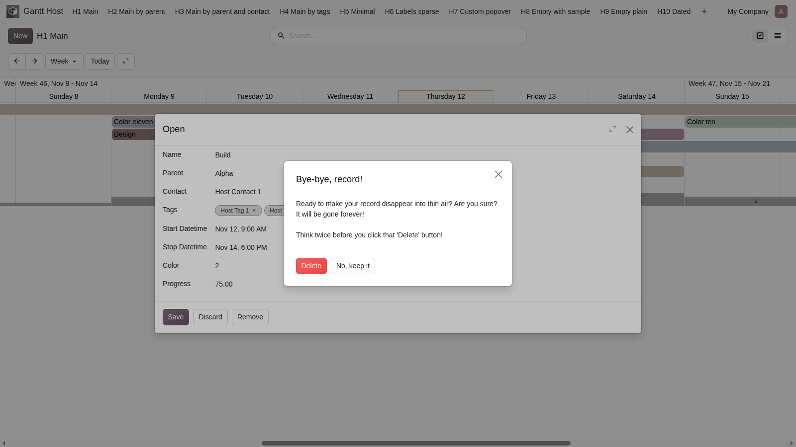

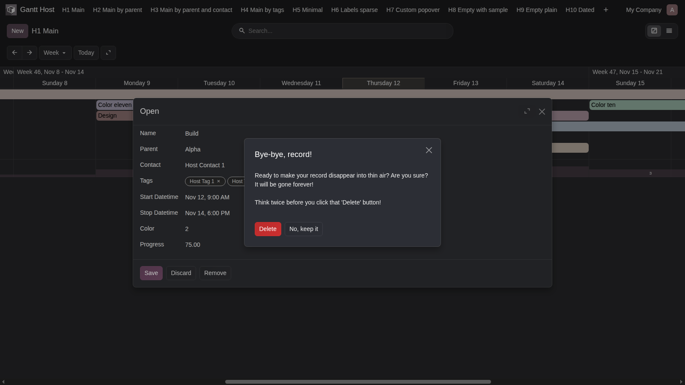

### Editing in the popover

A custom popover (see above) can hold fields and buttons. Buttons run their
method or action as in any card, then the popover closes and the view reloads.
Fields whose card widget can change a value, such as a switch or a selection,
are editable when the view allows editing and show faded and read-only
otherwise. A change is saved at once, and when the popover closes the view
reloads, so a pill whose row value changed moves to its new row.

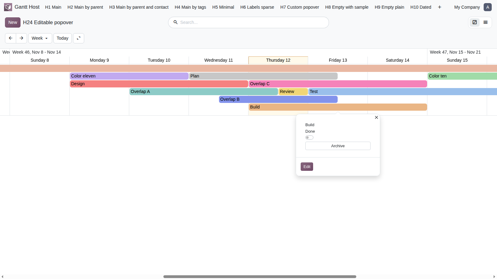

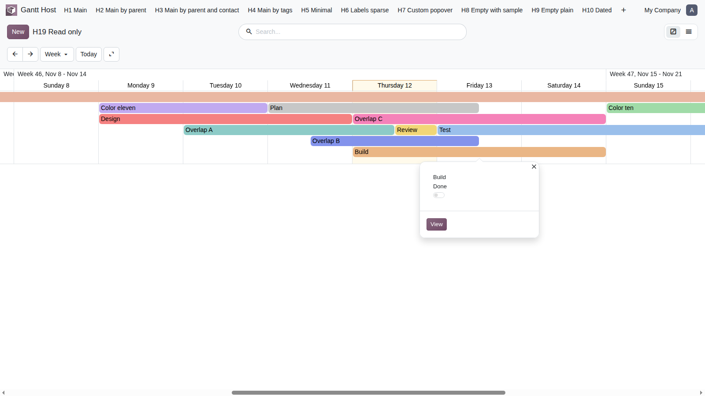

### What you may do

The view has three permissions, *create*, *edit* and *delete*, each on unless
the definition switches it off. When the definition leaves one unset, the web
client turns it off for a user who lacks the matching right on the model
(create, write, delete); a definition that sets it to yes keeps the control
visible and lets the server refuse the action. Two more switches refine them:
creating from cells and planning (see the options below).

| Control | Needs |
|---|---|
| New button | create |
| Selection of cells | creating from cells |
| A click opens the plan dialog | planning |
| A click opens the create dialog | creating from cells, with planning off |
| Create New in the plan dialog | creating from cells |
| Popover button reads Edit (otherwise View) | edit |
| Editable popover fields | edit |
| Editable record dialog | edit, and the form's own edit |
| Remove in the record dialog | delete, and an editable dialog |

The record dialog has a second condition because it shows a form, which has
permissions of its own: the web client switches a form's edit off for a user
without the write right unless the form says otherwise. When the two differ the
dialog follows both. A view that says `edit="1"` and `delete="1"` therefore
shows the button **Edit** to a user who may only read, but the dialog it opens
is read-only, without Remove and without New, and its closing button just
closes it. A user who may only read sees no New button, cells that do nothing,
the popover button **View** and a read-only dialog.

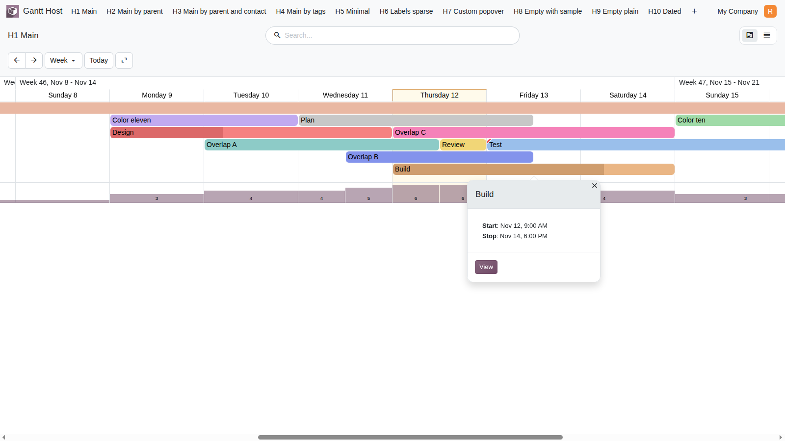

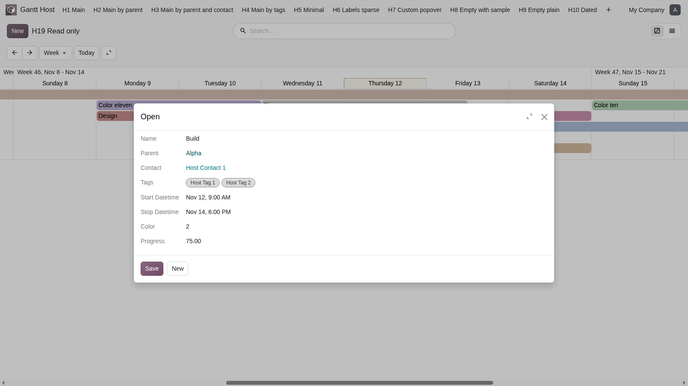

## Sample data and empty views

If the view definition allows sample data and the first load finds no record,
the view shows a faded, non-interactive grid with generated rows and no pills,
and the help text of the action drawn over it. Below its one faded row the sample state shows the page background, so
the help text stands on the page; the help is centred in the free space (on a
phone it starts at the top of the grid area). The sample state ends at the
next load (any navigation or search). When sample data is not allowed, an empty
result shows the normal grid with empty rows and no help. Whenever the grid is
shorter than the screen, the area under it takes the background of the view
rather than the page's. The grid's own scroll area reaches the bottom of the
view, so its horizontal scrollbar sits at the bottom edge of the view and not
under the last row.


## On a phone

On a small screen the control bar wraps: previous, next and the range button
on the first line, then Today and a gear button on the second; without touch
the two lines are packed close, the first with a little more room below and the
second with a little more above. The gear menu
holds the display mode switch ("One row per record" or "Shared rows") and, below
a separator, "Open every group" or "Fold every group"; its icon is the filled
gear. On a touch phone the buttons of the bar take the larger touch size (37 px
tall; previous, next and the gear 44 px wide) while the bar keeps its height.
The range menu opens as a bottom sheet (424 px tall, with the custom range
line well spaced, its dates and Apply button sized for touch), dates are picked in a dialog, popovers open full screen and
the row header column takes a third of the width, where a long name such as
"Undefined Contact" is cut with an ellipsis. Month names in the headers
are abbreviated, and the page itself scrolls.

Creating works as on a desktop: the New button, taps on cells, the plan dialog
and the popover buttons behave the same, and every dialog opens full screen with
its buttons stacked at the bottom, the plan dialog listing records as cards. The
deletion confirmation is the exception: a box centred over the record dialog,
with its buttons stacked. A selection starts with a **long press** of about a
third of a second followed by a move; a swipe that starts without the long press
scrolls the grid. Near the left or right edge the grid scrolls under the finger
while you hold, so start from the middle of the screen to select without
scrolling. With a mouse the selection works as on a desktop.

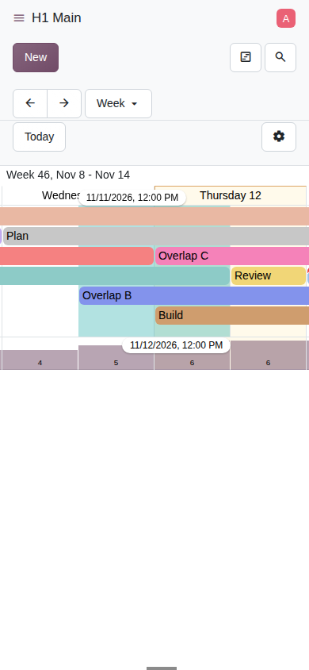

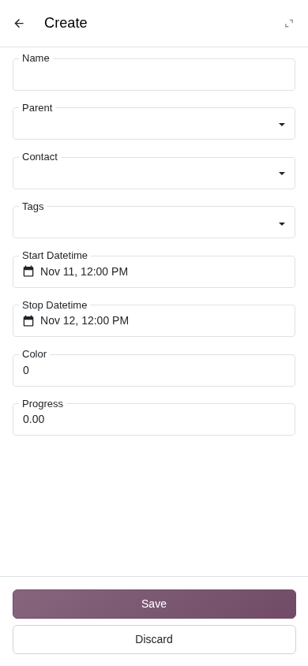

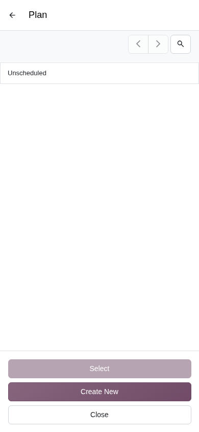

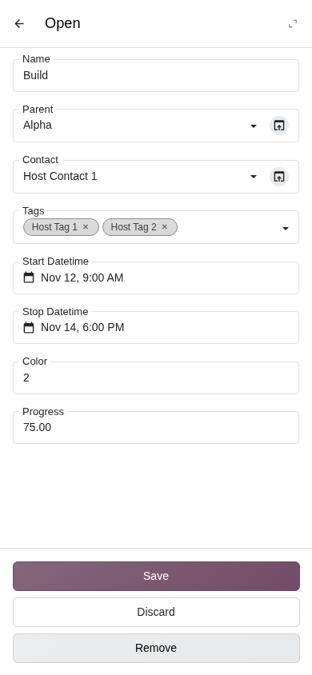

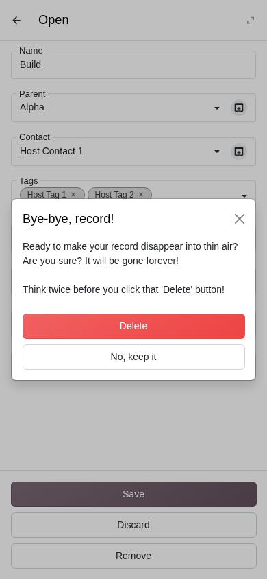

Hovering a column header gives a tooltip with the date including the weekday
("Saturday, November 7, 2026"; on the day scale also the time).


## Light and dark

Every colour of the view comes from the theme colours of the web client, so
the view follows the light or dark look chosen in your preferences (see the
[Web Theme](web_theme.md)). In the dark look today's highlight is a
translucent warning colour, unavailable periods are a flat grey and the first
pill colour is the theme's neutral grey. When the theme module is not
installed the view still works, with the default colours of the web client.

## For developers

### The view definition

A Gantt view is a `gantt` element. `date_start` and `date_stop` (names of date
or date-and-time fields) are required. The other attributes:

| Attribute | Meaning |
|---|---|
| `string` | title above the row headers |
| `default_range`, `default_scale` | opening range: `day`, `week`, `month`, `quarter`, `year` (`default_scale` also takes `week_2` and `month_3`, which give a custom range) |
| `scales` | comma-separated list of the ranges offered |
| `precision` | per scale, `unit:part` with part `full`, `half` or `quarter` |
| `color` | number or relational field choosing the pill colour |
| `decoration-danger`, `-warning`, `-success`, `-info`, `-secondary` | conditions on the record that mark the pill |
| `progress` | number field with a percentage |
| `pill_label` | add dates (and times) to the label |
| `thumbnails` | maps a grouping field to an image field of the related model |
| `display_mode` | `dense` (default) or `sparse` |
| `total_row` | add the Total row |
| `progress_bar` | relational grouping fields that show a capacity bar |
| `display_unavailability` | grey out unavailable periods |
| `groups_limit` | groups per page |
| `create`, `edit`, `delete` | yes or no; the usual meaning in a Community view, with the effects listed under [What you may do](#what-you-may-do) |
| `cell_create` | yes or no (default yes): allows creating from cells, by click when planning is off and by selection |
| `plan` | yes or no (default yes): a click on a cell opens the plan dialog instead of the create dialog |
| `form_view_id` | database identifier of a form view of the same model, used by the create and record dialogs (default: the model's default form) |
| `on_create` | an action reference (an XML identifier such as `module.action_name`, or a database identifier) run instead of the create dialog |
| `default_group_by`, `sample`, `class`, `js_class` | the usual meaning in a Community view |

Children are `field` elements (extra fields to read, for decorations and the
popover) and at most one `popover`. A `popover` takes `card_id` only, and may
hold `field` elements and one `templates` element with `popover-body` (or
`card`), `popover-header` and `popover-footer` (the last with `replace` set to
a false value to keep the default button). The attributes
`multi_create_view`, `disable_drag_drop`, `dependency_field`,
`dependency_inverted_field`, `buffer_start`, `buffer_stop`, `schedule`,
`collapse_first_level`, `dynamic_range` and `offset` are accepted and have no
effect yet. A view that breaks the rules is refused when saved, with a message
that names the problem. An action can pass the context keys `default_range`,
`default_scale`, `default_start_date`, `default_stop_date`, `initialDate` and
`group_by`.

#### Context given to dialogs and actions

The create dialog, the create action and the plan dialog receive the context of
the action combined with the search context, plus these keys from the view
(its keys replace keys of the same name):

| Key | Value |
|---|---|
| the start field's name (for example `date_start`) | start of the period: UTC date and time as `YYYY-MM-DD HH:MM:SS` for a date-and-time field, `YYYY-MM-DD` for a date-only field |
| the stop field's name | stop of the period; for a date-only field, the last day the period covers (see above). Omitted when start and stop are the same field |
| `default_<start field>`, `default_<stop field>` | the same values, as form defaults |
| each grouping field's name | the row's value: an identifier for a relation to one record, a list with one identifier for a relation to many, the plain value otherwise, false for an "Undefined" row. Only for a click, selection or plan in a grouped view |
| `default_<grouping field>`, `search_default_<grouping field>` | the same value; the second pre-applies a facet in the plan dialog when its search view offers the field |

The plan dialog writes only the start, the stop and the grouping fields, never
the other keys. The New button gives the period keys and no row keys.

```xml
<gantt date_start="date_start" date_stop="date_stop" string="Work"
       default_range="week" color="priority" progress="progress"
       decoration-danger="is_late" total_row="1">
    <field name="is_late"/>
</gantt>
```

### The server side

- `get_gantt_data` is the model call the view makes in one go. It returns
  `groups` (with `__record_ids`), `records`, `length`, `unavailabilities` and
  `progress_bars`.
- `_gantt_unavailability` and `_gantt_progress_bar` are the two hooks a host
  model overrides to fill the last two keys. The base versions return nothing.
- A model without a Gantt view gets a generated one (`_get_default_gantt_view`)
  built from the fields named by `_start_name` and `_stop_name`, or the usual
  candidates (`date_start`, `start_date`, `date_stop`, `date_end`, ...). If no
  pair is found the request fails with an error saying so.

## Not included yet

Moving, copying and resizing pills with the pointer, selecting several cells
at once and the side panel of records to schedule, the dependency arrows and
buffers, rescheduling, and the Gantt views of employees, attendances, event
tracks and time off are delivered in later slices.
