# Gantt View

The Gantt view shows records as horizontal bars, called pills, on a time grid.
Each pill runs from the start to the stop of its record, and the records can
be arranged in rows by any field. Besides looking and navigating, you can
create records from the grid, plan records that have no dates yet, open a
record, change it and delete it, as far as the view and your rights allow (see
[Creating, planning, opening and deleting](#creating-planning-opening-and-deleting)).
You can also move a pill to another time or row, copy it, and stretch or
shorten it by its ends (see
[Moving, copying and resizing pills](#moving-copying-and-resizing-pills)).
A view that names a template form lets you pick many cells at once and create
or delete the records of the selection in one go (see
[Selecting several cells](#selecting-several-cells)), and a view that turns on
scheduling adds a side panel of records that still have no dates (see
[The side panel](#the-side-panel)). A view with a dependency field draws arrows
between dependent pills, lets you draw and remove the links, moves the records
that follow when you move one, and can show free time around pills (see
[Dependencies and rescheduling](#dependencies-and-rescheduling)).

The view has no menu of its own. It appears in any window action whose view
modes include **Gantt**, next to the other views in the view switcher, or as
the first view of such an action. The first Community applications that use it
arrive in later slices. The first one is the tracks of an event (see
[Event Tracks Timeline](event_track_gantt.md), and the attendances of the
employees follow in [Attendances Timeline](attendance_gantt.md)); besides them the view is reached
through actions written by other modules, such as the scratch host of the hidden test module
[`test_web_gantt`](../../addons/test_web_gantt/README.md), used for the
screenshots below. The search bar of the action (filters, group by, favourites)
applies as usual.

Technical reference:
[`addons/web_gantt/README.md`](../../addons/web_gantt/README.md).

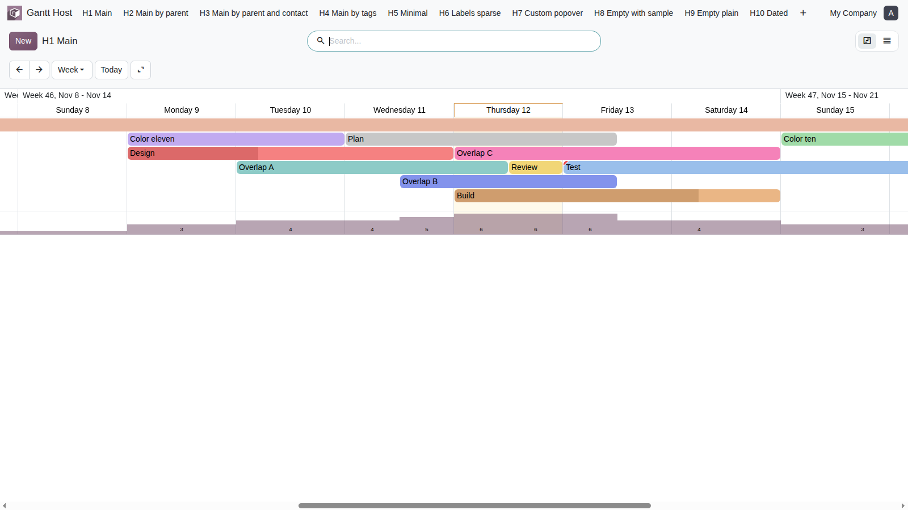

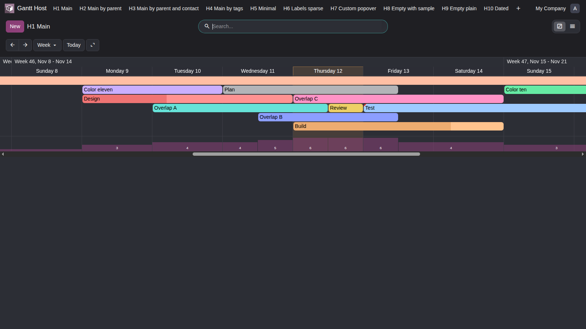

## The control bar

Under the control panel, a bar holds the controls of the view, from left to
right:

| Control | What it does | Key |
|---|---|---|
| Previous and next arrows | Move back or forward by one period of the current range (one day, week, month, quarter or year). A custom range moves by its own length. | `p`, `n` |
| Range button | Shows the current range ("Day", "Week", "Month", "Quarter" or "Year"), or the two dates of a custom range, followed by a small caret. Opens the range menu. | `v` |
| **Today** | Scrolls so that today is in the middle of the grid. If today is outside the displayed period, the range is rebuilt around it; a custom range keeps its length. | `t` |
| Display mode | Switches between one shared row per group of records (dense) and one row per record (sparse). | |
| Open or fold every group | Opens all group rows, or folds them all. Shown only when the first row is a group row; otherwise it keeps its place but is invisible. | |

When several clicks on previous or next follow each other quickly, the data is
loaded once, half a second after the last click. If the view lets you
create records, the **New** button sits in the control panel (key `c`); what it
opens is described under
[Creating](#creating-planning-opening-and-deleting).

### The range menu

The menu lists the ranges the view offers, with the current one checked, then
a line for a **custom range**: two plain date fields (only a line under each)
with an arrow between them and an **Apply** button. Picking a date in either
field opens a date picker, and the date stays unselected so that you can type
over it; the menu stays open until you press Apply. The dates are set a little
larger than the menu text, with room for ten characters, and while a date
picker is open the dates and the arrow take the strongest text colour (black in
the light scheme, white in the dark one); they return to the accent colour when
it closes. If you pick a start after the stop (or
the reverse), the other date follows. A range can be at most ten years minus
one day long. Choosing another range in the list rebuilds the grid around the
date that is currently in the middle of the visible grid (the row header column
left out), taken exactly and not rounded to a column: on the Year range the
middle lies inside a month, and going Week, Day, Month, Year and back to Week
brings you to the same day each time. Scrolling by hand moves that date too, in
every range, and the New button reads it as well.

When the view is first shown, the grid scrolls so that the focus date lies in
the middle of the visible cells (the row header column left out). The place is
worked out as a linear share of the whole loaded period: the focus moment's
distance from the start of the period, divided by the period's length, times the
full width of the cells. It is not the date's place inside its own column. On
the day and week scales, whose columns are equally long, the two are the same
except across a daylight-saving change, where the scale (in milliseconds) and the
columns differ by up to an hour of the period (sub-pixel to about 1 px);
on the month and year scales, whose columns are months of 28 to 31 days drawn at
one width, they differ by a few pixels, and the share of the whole period is the
one used. For example, on a Year range of 2029 to 2031 with the focus on 11 June
2030, the June column starts 4 px further right than it would if the focus were
placed by its position inside June.

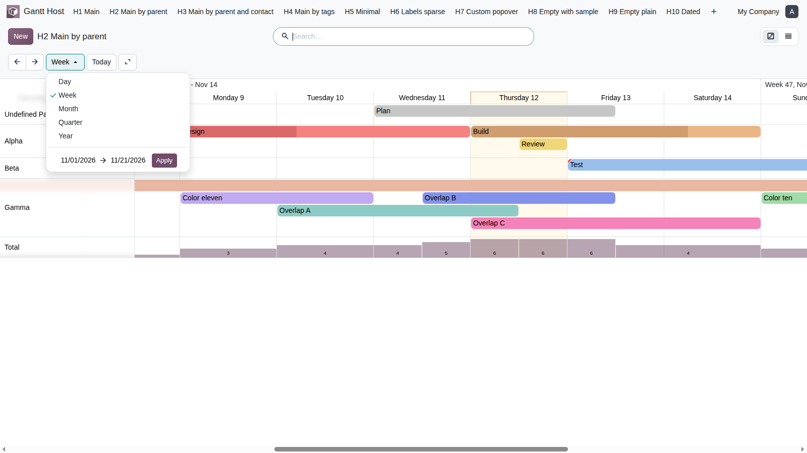

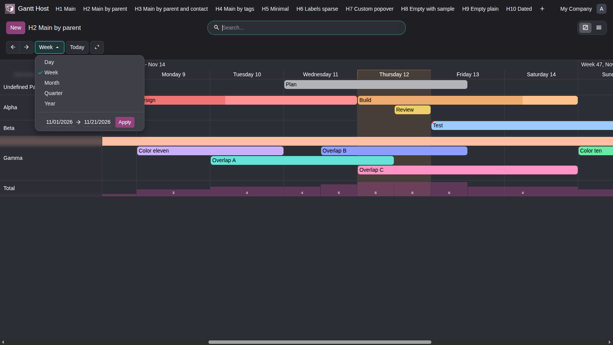

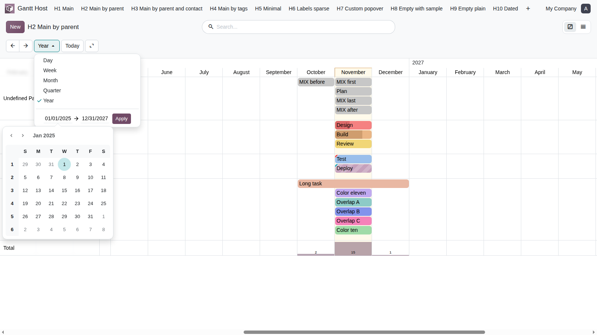

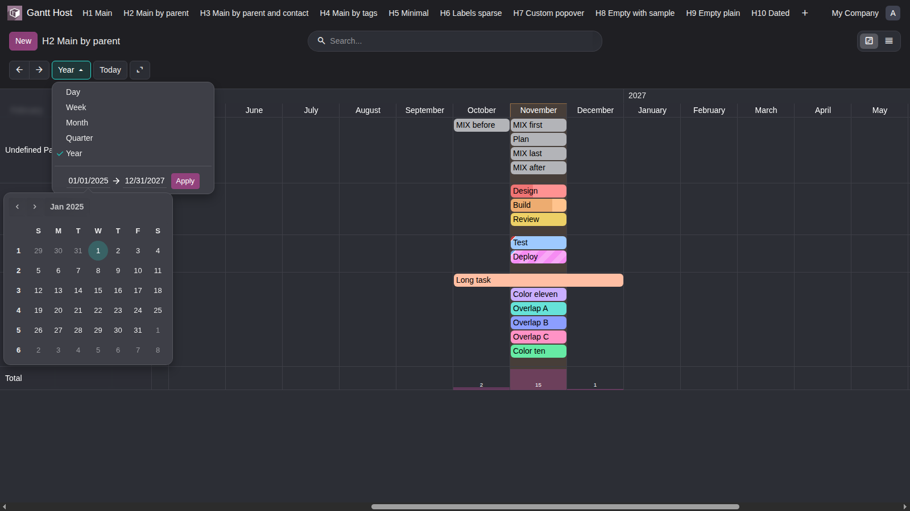

When the view opens, the range comes from, in this order: the range you chose
last time on this view (the browser remembers the name of the range, never the
dates of a custom one), the range passed by the action, the default range of
the view definition. If none applies the view opens on a custom range of three
months starting at the first day of the current month.

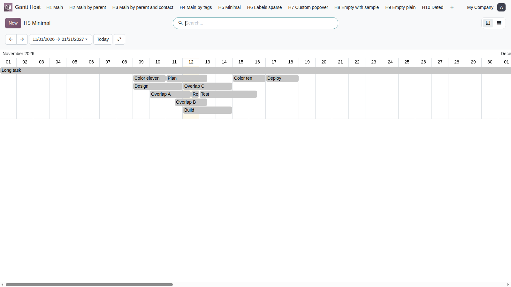

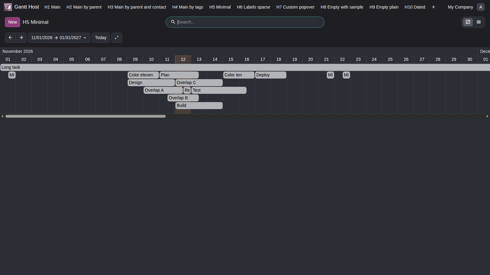

## Scales and ranges

A named range shows three periods of its kind: the one that contains the focus
date (today unless the action says otherwise), the one before and the one
after. Every range has a scale, which sets what a column is:

| Scale | Column | Grouped under | Used by |
|---|---|---|---|
| Day | one hour | the day | Day range |
| Week | one day | the week | Week range |
| Month | one day | the month | Month range, Quarter range (nine months) |
| Year | one month | the year | Year range |

A custom range picks its scale from its length: under 6 days the day scale,
under 27 the week scale, under 364 the month scale, otherwise the year scale.
If the view does not offer that scale, the nearest smaller offered one is
used, then the nearest larger one. Columns share the free width equally; when
that would make them too narrow the grid scrolls sideways. Weeks start on the
first day of the week of your language. On the days when the clock changes,
the day scale has 23 or 25 hour columns, and pills follow the wall clock.

On the week scale the group header reads "Week 24, Jun 9 - Jun 15", the days
as short month and day. When the week belongs to another year than the current
year of the browser's clock, the year follows once at the end, after a space
and without a comma ("Week 24, Jun 9 - Jun 15 2030"); the tooltip has the same
text. The header is left aligned with a small padding and cut by its cell when
the cell is narrower. The other scales always show the year in their labels.

Today's column has a pale warm tint in its header and cells (on the day scale
it is the current hour).

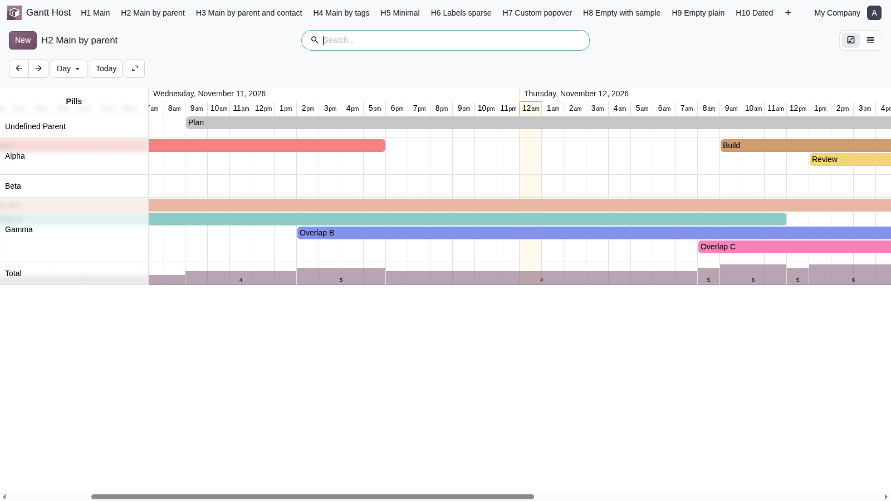

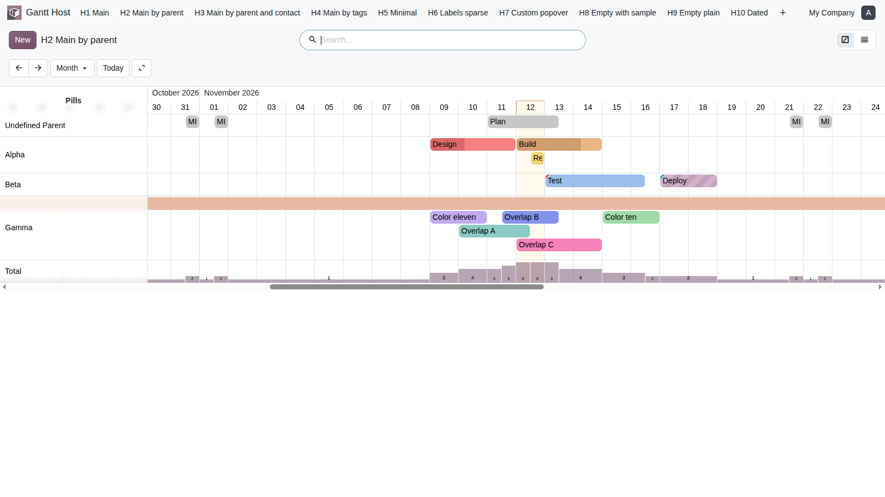

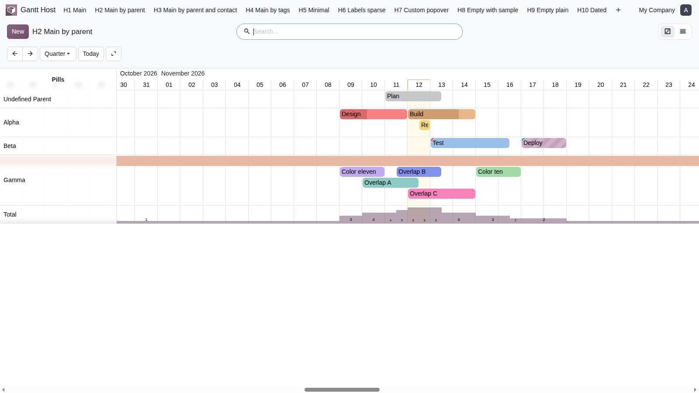


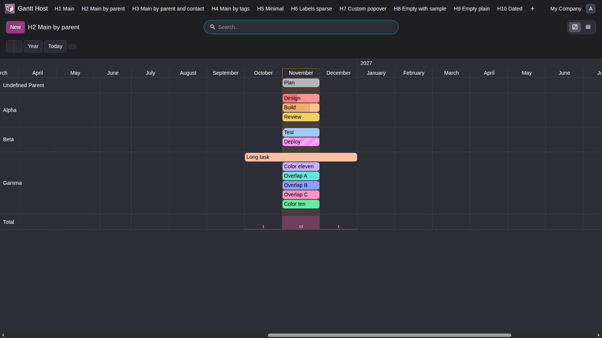

Records that have only a date, not a time, are shown for the whole days; the
stop day is included. A view may mix the two kinds, for example a date-only
start with a date-and-time stop. Each end is then read on its own terms and
always in the days of your own time zone, wherever you are relative to UTC: a
date-only start is the beginning of its day, a date-only stop the end of its
day, and a record whose date-only stop falls on the day of its start is drawn
for that day. One whose stop day lies before its start is left out.

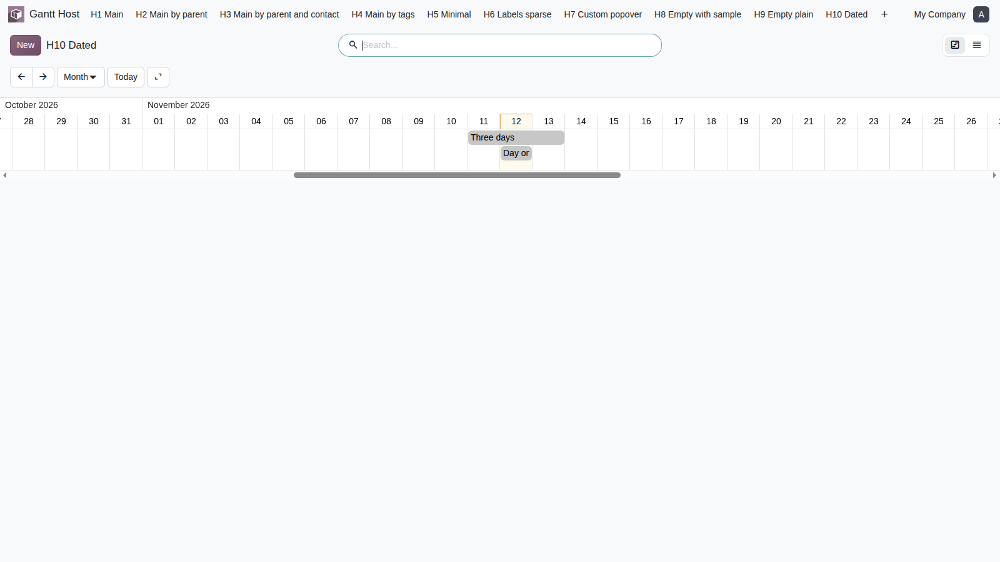

On the year scale, a record that lies inside a single month fills that whole
month.

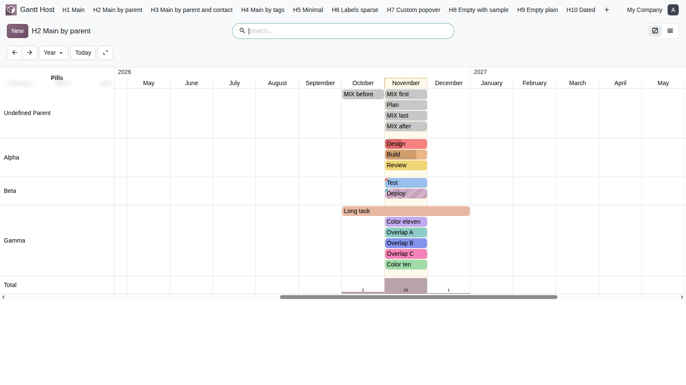

Records are shown when they overlap the displayed period. A record without a
start or a stop, or whose stop is before its start, is not shown. A record
that begins before or ends after the period is cut at the edge of the grid.
Archived records appear only when the search asks for them.

## Rows and grouping

With no grouping, one unnamed row holds every pill; pills that overlap in time
are stacked on separate lines. With a grouping from the search bar (or from
the view definition or the action), each value gives a row, and rows nest when
you group by several fields. Grouping by a date or date-and-time field is
ignored.

- A row for records **without a value** comes first and is named "Undefined"
  followed by the field label, for example "Undefined Parent". It is always
  there at the top level, unless the field is required. Under that leading row every lower grouping level also gets its
  own "Undefined" row first, even when empty, so the first rows form a chain of
  "Undefined" rows. Zero and an empty text
  also count as no value. Yes/no fields show "True" and "False".
- With a **many-to-many** field, a record appears in the row of every value it
  has, and in the empty-value row only when it has none.
- Fields that list all their values even when empty (a stage, for example)
  give empty rows.
- Row names are shown with the normal display of the field; a grouping field
  can have a small image shown before the name of its row. A name too long
  for the header is cut with an ellipsis.

A row that has sub-rows is a **group row**: a caret before its name shows
whether it is open or folded, and clicking its header or its cells folds or
opens it. Only a whole click does: the button pressed and released in the same
cell of the row (the same day column on the Week scale), however far the
pointer moved in between. Pressed in one cell and released in another, or
released in another row, it neither folds nor opens the row and nothing moves.
Instead of pills, a group row shows for each stretch of time the
number of records running there, as a thin line with the count at its left.
Clicking the header of a row without sub-rows scrolls the grid so that the
start of the column in which its first pill begins is in the middle. Pointing at a group row highlights the whole row, header included.
Changing the grouping opens every row again.

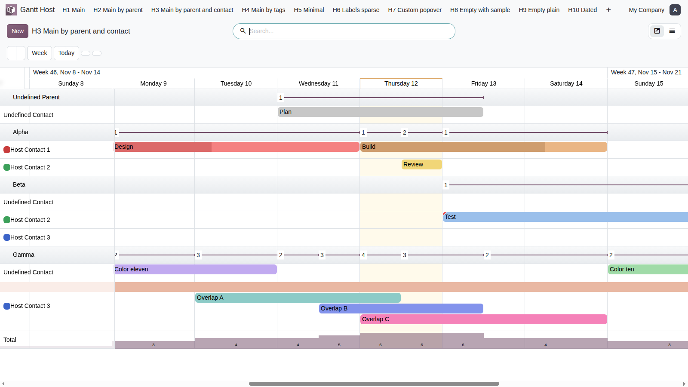

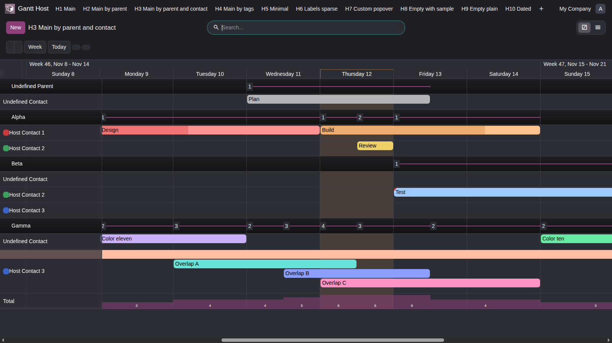

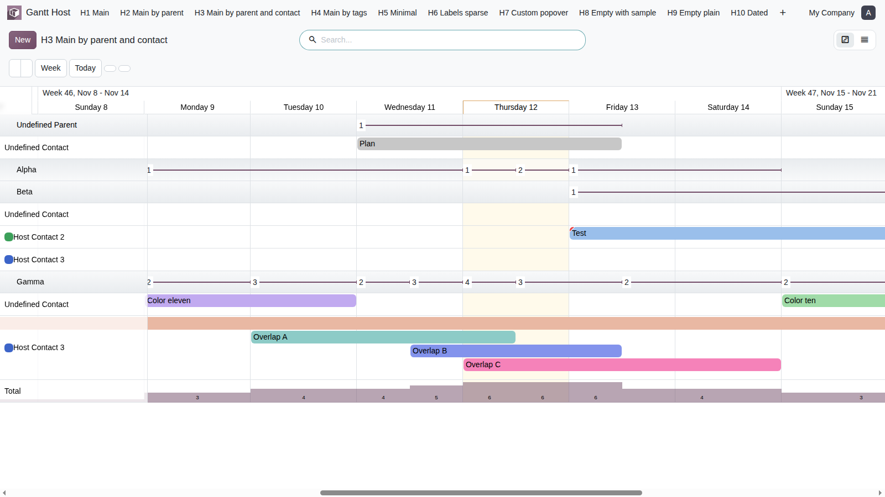

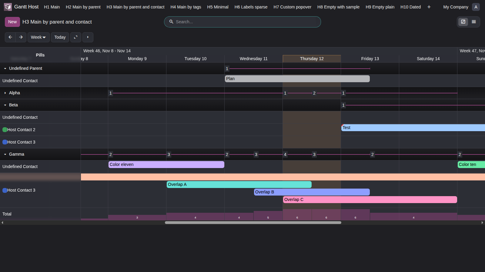

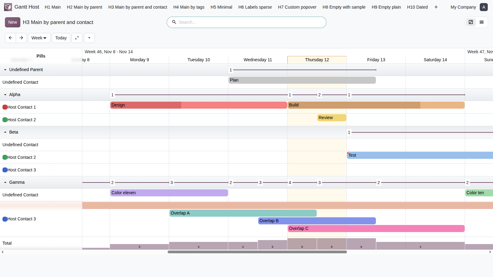

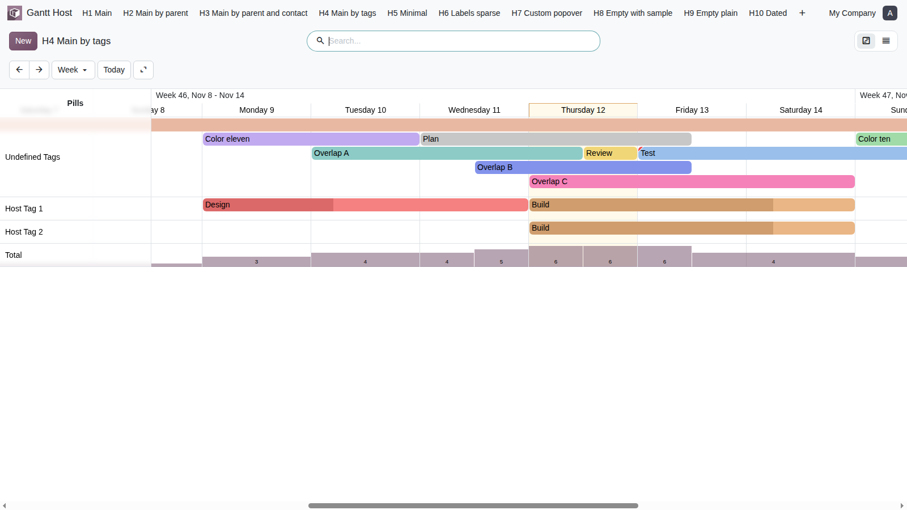

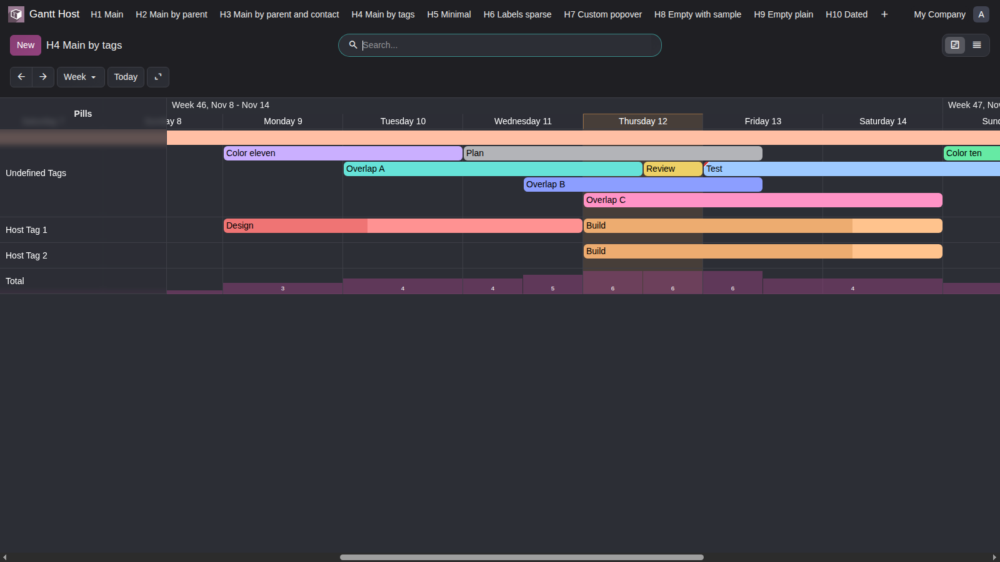

### Sparse mode and paging

In sparse mode every record gets a row of its own, named after the record,
below its group. The record rows follow the order of the pills: first the
sub-column where the pill starts, then its start time; this holds under every
group and when there is no grouping. Group rows are then used for every level of grouping. Without
grouping, each record is a row. Switching between the two modes opens all
folded rows.

When the view definition sets a number of groups per page and the data is
grouped, the control panel shows a pager. It counts combinations of the
grouping values, so with two levels a page of two shows two combinations below
their parent rows, and a parent row can occur on several pages. The
empty-value row is shown on every page.

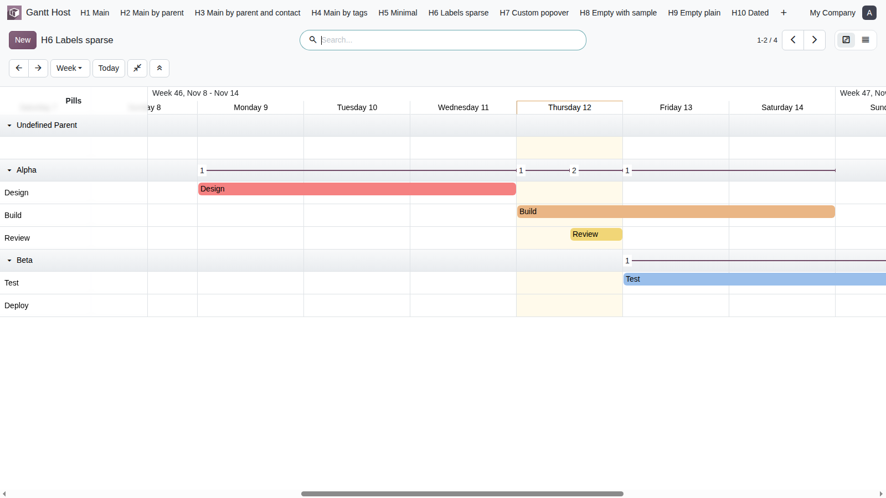

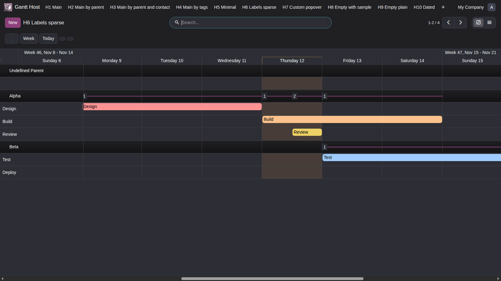

## Pills

A pill starts at the beginning of the part of a column that holds the start of
the record and ends at the end of the part that holds its stop. Each scale cuts
a column in parts (the day scale by hour, the week and month scales by half
days, the year scale by month); the view definition can make this coarser or
finer.

- **Label.** The pill shows the name of the record. If the view asks for
  dates in the label, a record that spans several days and sticks out of the
  displayed range also shows its start and stop dates before the name (on the
  year scale, any record shows them). The dates are short numeric ones in the
  order of your language, without the year, for example "10/23 - 12/2". When the model has hours allocated to a
  record, a one-day pill on the week and month scales can also show its times
  and allocated hours. Text is cut at the edge of the pill.
- **Colour.** The view can colour pills by a number or relational field. There
  are twelve colours, taken from the theme; the first one is a neutral grey.
- **Marks.** The view definition can mark pills that meet a condition (danger,
  warning, success, info, secondary) with a small triangle in the top left
  corner. The info mark also fills the pill with diagonal stripes.
- **Progress.** A darker band covers the left part of the pill, as wide as the
  percentage held by a field of the record.


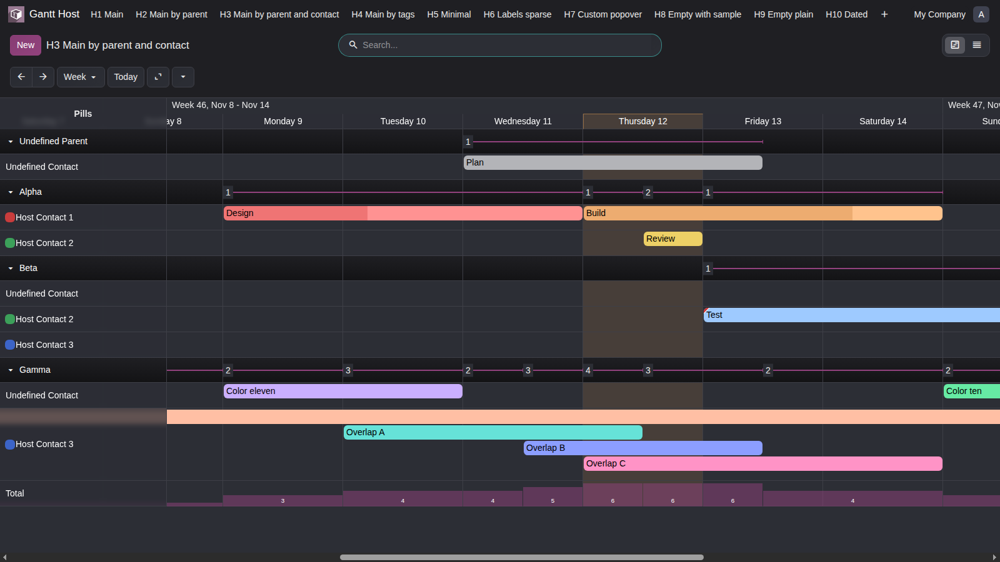

### The popover

A single click on a pill opens a popover next to it (after a short delay, so
that a double click does not open it). A cross at the top right, a click
elsewhere, or a click on another pill closes it; the click on the other pill
opens that pill's popover. Without any content in the view definition the
popover shows the record name as its header and two lines, Start and Stop,
with the dates, and a small primary button in its footer: **Edit** when the
view allows editing, **View** otherwise. The button closes the popover and
opens the record in a dialog (see
[Opening, editing and deleting](#opening-editing-and-deleting-a-record)).

An open popover stays open while a press on its pill is held and the pointer has
moved less than the ten pixels that start a gesture; it closes when the gesture
starts. This holds for a press on the body, on a resize handle and on a drawing
handle with a mouse, and for a finger held on the body or on a drawing handle
with touch at desktop size, however long the finger is held. A click on a
drawing handle, pressed and released without a drawing, leaves the popover open.
After a move cancelled with Escape the next click on that pill opens its popover
at once, without the short delay; a click at the very spot where the cancelled
gesture was released opens it too, and a double click there opens the record
dialog. The cancelled gesture's own press and release never pair with the next
click into a double click, and the click lock that follows clicks on cells does not
apply to pills. (After a gesture that was **completed**, a click counted as the
second of a pair that began with its release is still held back.)

A view definition can supply its own content in the manner of a card: a body,
a header and a footer, or the identifier of a card view to borrow its fields
and templates. A custom body replaces the two lines; a custom footer replaces
the button unless it is told to keep it. On a phone the popover opens as a
full-screen sheet.

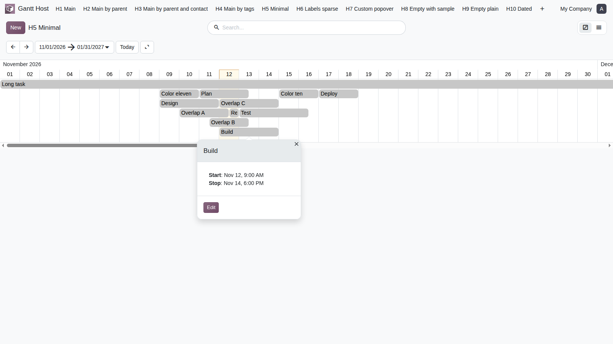

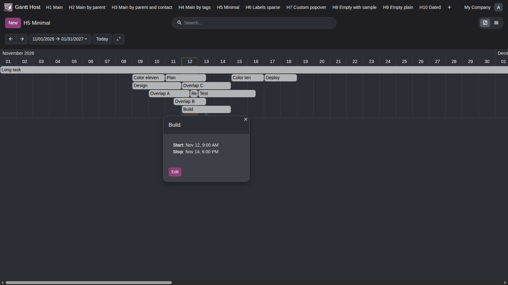

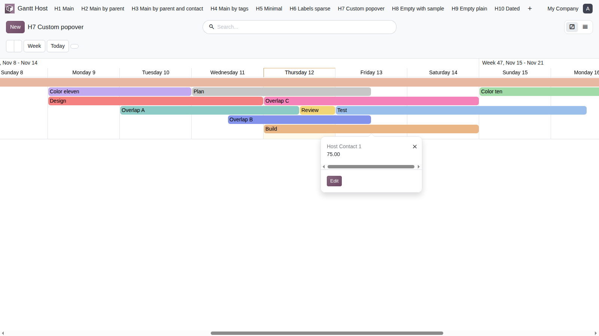

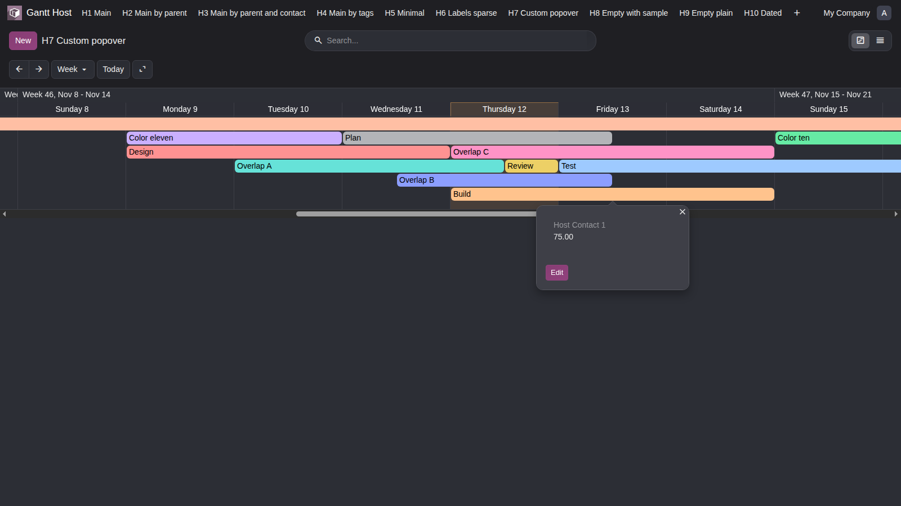

## The total row

When the view definition asks for it, a row named **Total** is added at the
bottom. For every stretch of time in which records run it draws a vertical bar
whose height follows the number of records, with the count at its foot. Bars
too narrow for the count show a smaller figure. Pointing at a bar turns it to
the primary colour (80 percent opaque) and draws a translucent band up to the
top of the grid. Without row headers
the row has no title.

## Capacity bars, unavailable periods and folded columns

Three features are drawn by the view but filled in by the module that hosts
it. A plain installation of the Gantt view supplies no data for them (the two
hooks return nothing), so you see them only in applications that provide it,
such as the employee, attendance, event track and time off applications of later slices.

- **Capacity bars.** For a grouping field named by the view definition, a row
  header can show how much of a quantity (typically hours) is used: a small
  label with what remains at the right end of the name line, and a thin bar filled in green up to 100 percent
  and in red beyond it. Pointing at the bar or the label shows used and
  maximum with the percentage. If the host gives a warning instead of a
  maximum, a warning icon with that text replaces the bar. In sparse mode only
  group rows show the bars.
- **Unavailable periods.** With the option on, the periods in which the
  resource of a row is unavailable are greyed in its cells; a cell that is
  partly covered is grey only where it is covered; its available parts are
  painted in the colour of an ordinary cell (the view background, and today's
  shade in today's column), not left transparent, so they look the same on a
  row whose own background differs, such as a hovered row. In today's column
  the cell's own background colour is transparent and the gradient carries the
  shade once (it would show twice in the dark look otherwise); a wholly
  available cell of that column has the same shade as its background colour.
  The parts follow the direction of the grid: in a right-to-left language the
  first part lies at the cell's right edge and the gradient runs towards the
  left with the same stops.
- **Folded columns.** When every row is unavailable for a whole column and no
  pill touches it, runs of such columns fold into one narrow column whose
  header shows two arrows pointing at each other. Click the folded header or a
  folded cell to open the run, and click the header of an open one to fold it
  again. While you point at the header of an open column of such a run, the
  headers of the run show outward arrows and the others dim. The folding is
  worked out again at every load of the view's data (a change of range, scale
  or period, a search, a filter, a grouping, the pager, the reload after a
  write); a run you opened stays open until the next load.

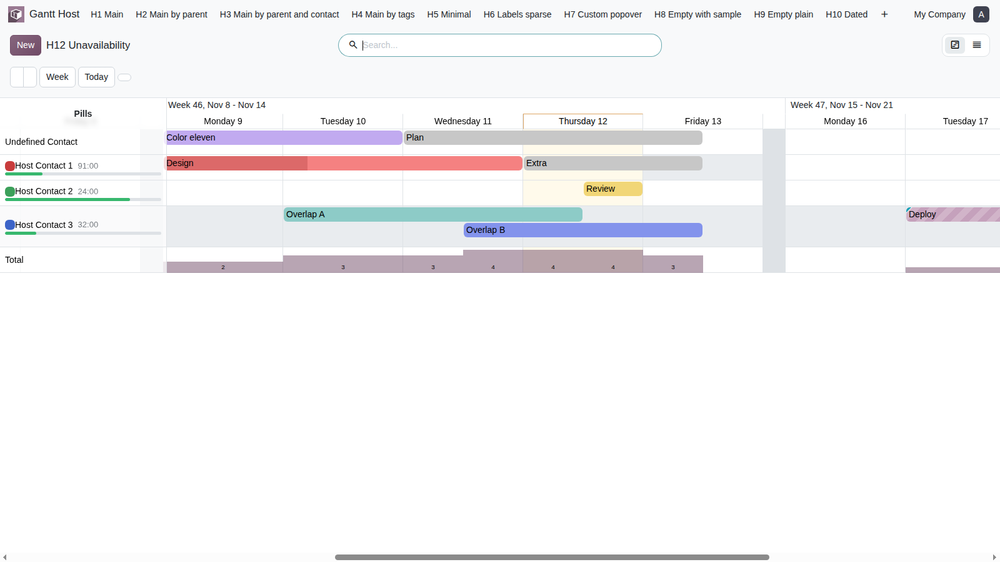

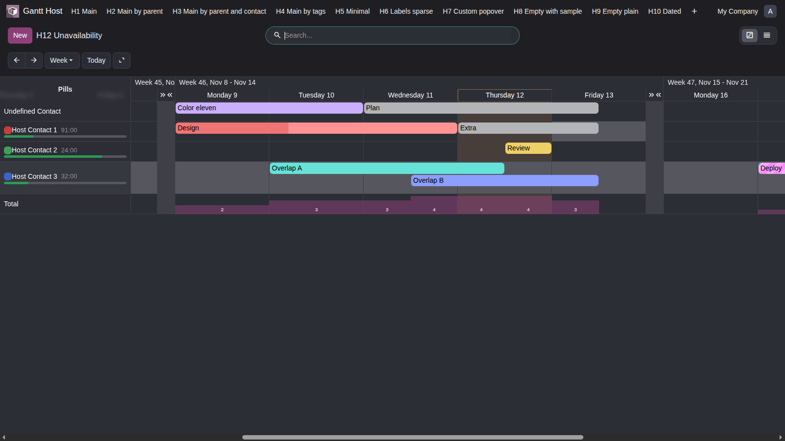

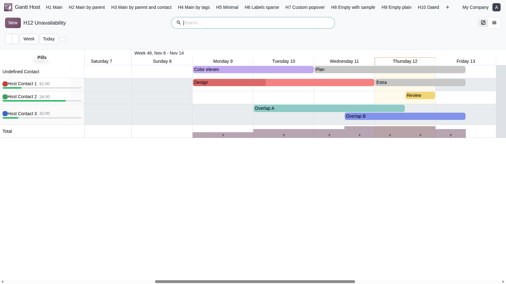

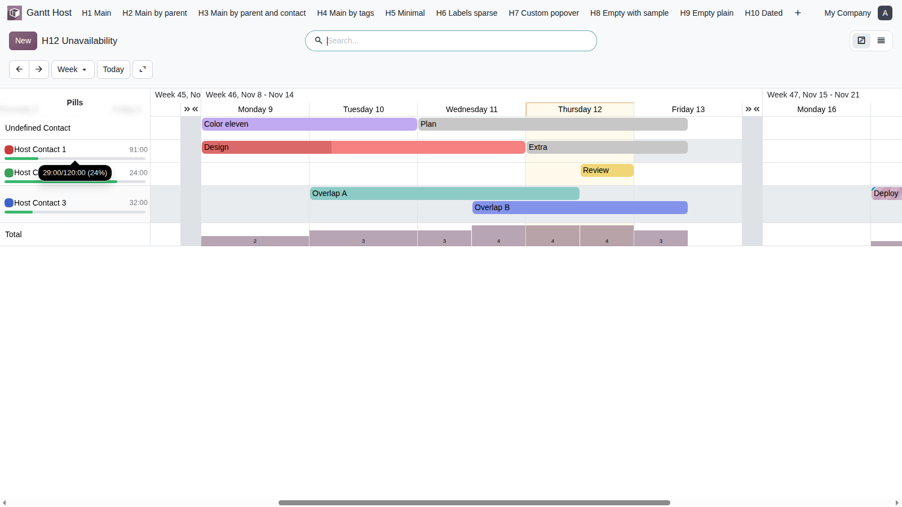

## Creating, planning, opening and deleting

Everything below uses ordinary Community dialogs (a form in a dialog, a list of
records to pick from, a confirmation), coloured by the theme. Which of these
you get depends on the view's options and on your rights; see
[What you may do](#what-you-may-do).

### Creating a record

There are three ways to start a new record from the view, and each one opens
the create dialog (titled "Create") with the dates already filled in:

- **The New button.** It proposes one unit of the current scale around the date
  in the middle of the visible grid: the day on the Day range, the week on the
  Week range, the month on the Month and Quarter ranges, the year on the Year
  range. The week is the one the grid shows, so it starts on the first day of
  the week of your language (a Sunday in US English, a Monday in English (UK)),
  not always on Monday. No row value is set. The button also works on the
  sample data screen.
- **A click on a cell** in a row without sub-rows, when the view does not plan
  records (see below). The record gets the whole column you clicked: the day on
  the Week and Month scales, the hour on the Day scale, the month on the Year
  scale. A click on a cell of a group row folds or opens the row, and a click on
  a folded column opens it, as before.
- **A selection.** Press on an empty part of a cell and drag at least ten
  pixels along the row. A translucent band covers the sub-columns you pass
  over, and two small badges show where it starts and where it stops. The band
  stays in the row where you started, whichever row the pointer crosses, and
  follows the half days or hours of the scale. Near the left or right edge of
  the grid the grid scrolls sideways while you hold, and the band grows with
  it. Releasing opens the create dialog for the selected period. **Escape**
  while the button is held drops the selection and opens nothing. You cannot
  start a selection on a pill, on a group row or on the sample data screen.

When you create from a cell or a selection in a grouped view, the new record
also receives the values of the row, and of the rows above it, for the fields
the view is grouped by. An "Undefined" row gives an empty value. Fields that
are not part of the grouping are left alone.

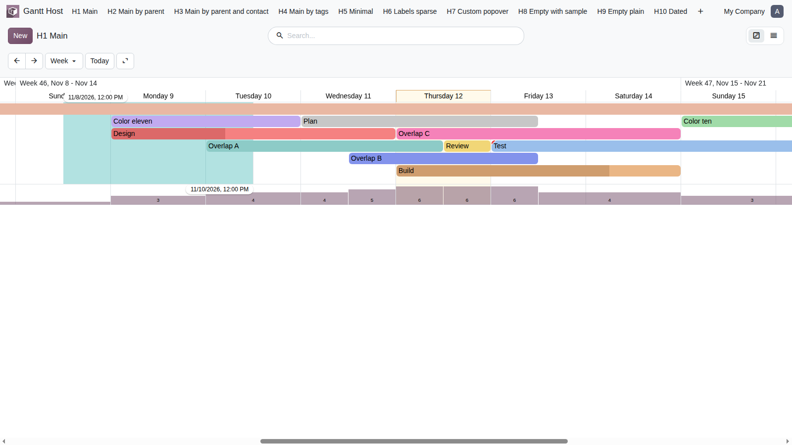

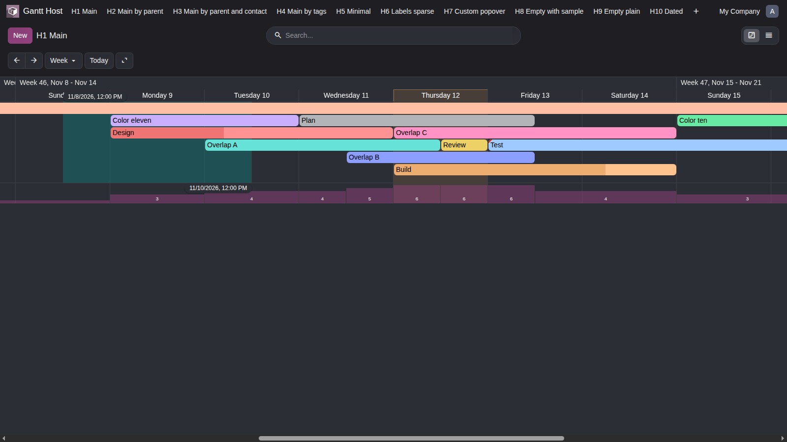

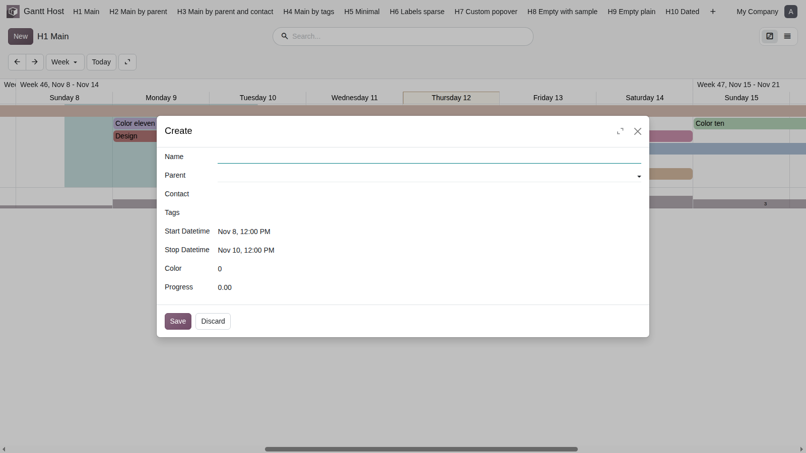

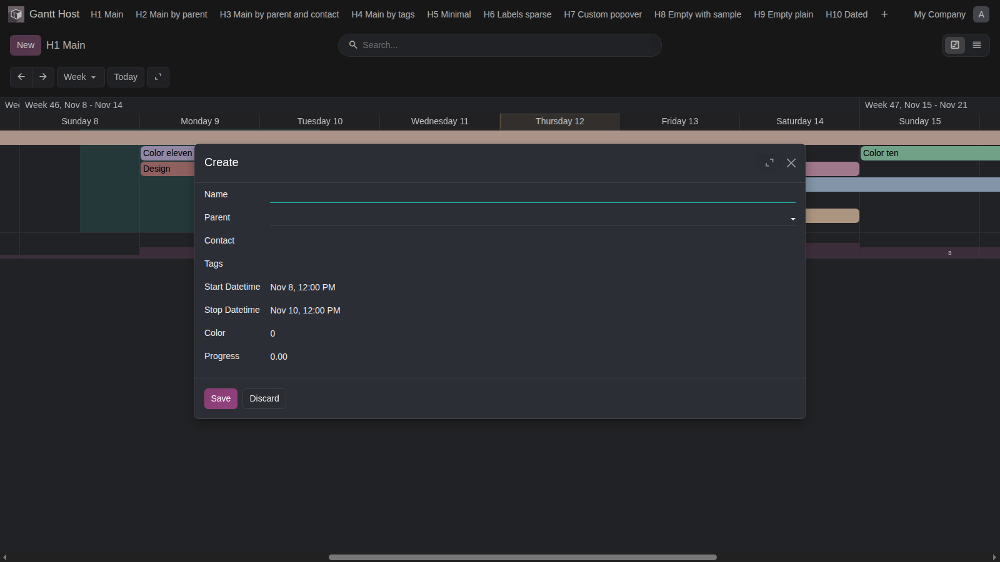

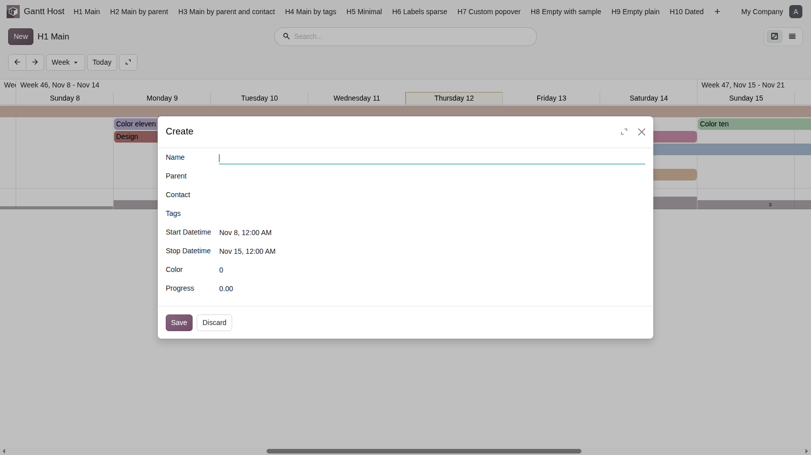

Saving creates the record and closes the dialog; Discard closes it without
writing. Either way the view reloads. The search and the domain of the action
still apply, so a new record that does not match them is saved but not shown.
If the view names a **create action**, that action runs instead of the dialog,
with the same values added to its context, and the view reloads when it closes.

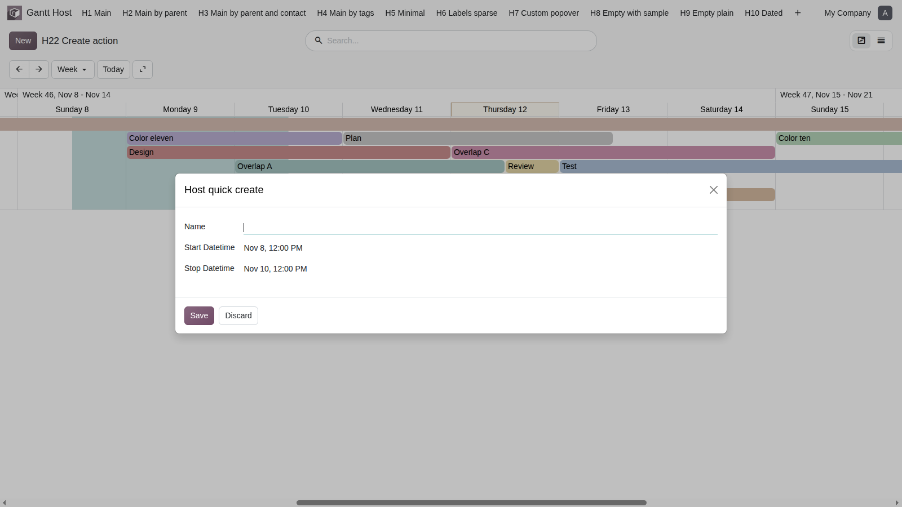

### Dates of date-only records

On a model whose start and stop are plain dates, the proposed stop is the last
day that was clicked or selected, never the day after: a click on the 16th
gives the 16th to the 16th, a selection that ends at midday of the 18th gives
the 18th, and New on the Month range gives the first to the last day of the
month. This matches the way the view draws such records (the stop day is
included). When a model mixes a date start with a date-and-time stop, each
field gets a value of its own type.

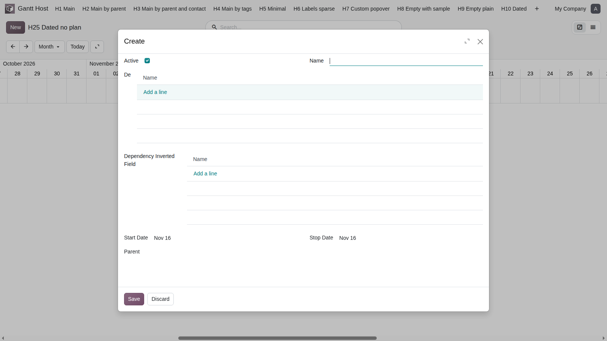

### Planning records that have no dates

With the view's planning option on (it is on unless the definition switches it
off), a click on a cell of a row without sub-rows opens the **Plan** dialog
instead of the create dialog. It lists the records of the action's domain that
have no start or no stop, with check boxes, a search bar and a pager. Search
filters of the view are not carried over, but the dialog starts with the values
of the row you clicked when its search offers the matching field, for example a
filter on the parent of that row.

- **Select** gives every checked record the start and stop of the clicked
  column, and the row's values for the grouping fields; the button stays
  disabled until a record is checked. On a date-only model the clicked day is
  both start and stop. Clicking a record's line (on a phone, tapping its card)
  plans that single record at once.
- **Create New** (offered when creating from cells is allowed) makes a new
  record for the clicked column and row: through the create action if the view
  has one, otherwise in the create dialog with the view's form (or the model's
  default form). A record saved from that dialog is planned in the same way, and
  both dialogs close; Discard returns to the plan dialog.
- **Close** writes nothing.

The dialog's search bar is 33 pixels tall and bordered in the accent tone, like
that of every list dialog; on a phone a small search button next to the pager
shows the bar when tapped.

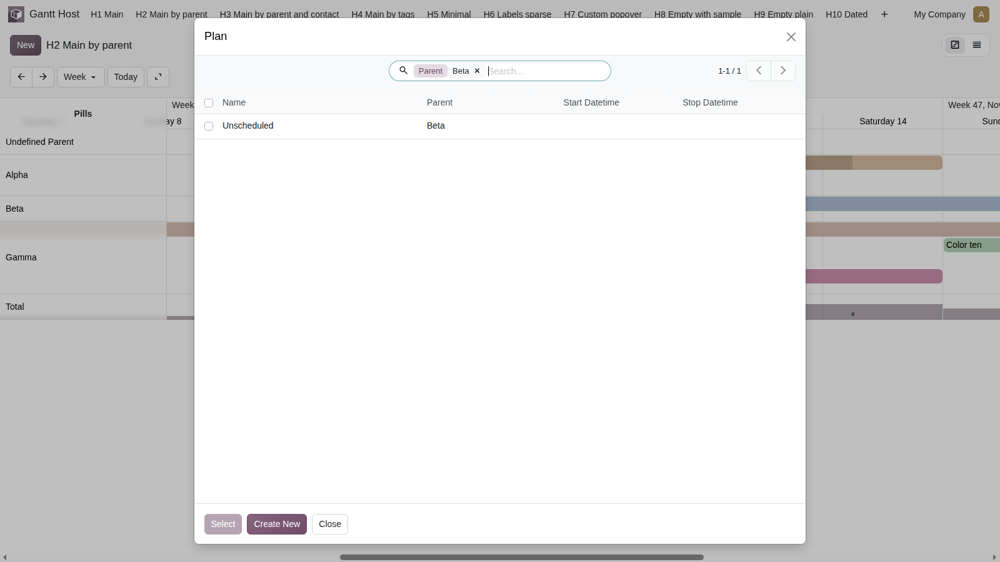

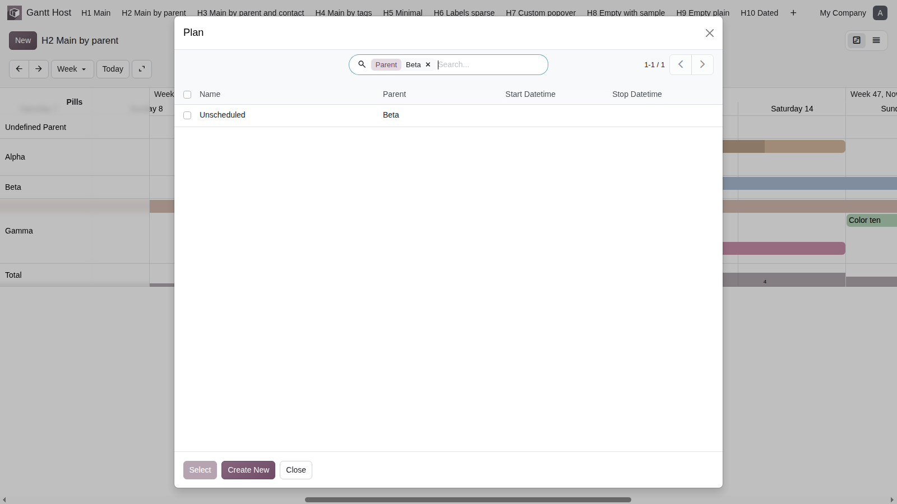

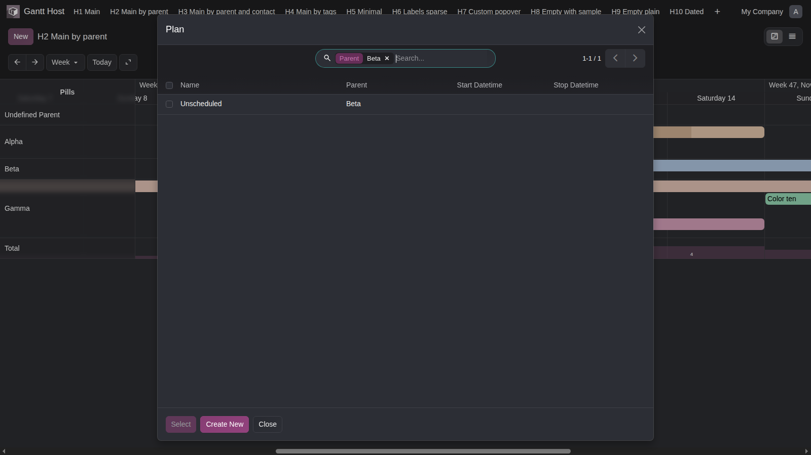

### Opening, editing and deleting a record

A record opens in a dialog titled "Open", from the **Edit** or **View** button
of the popover or by a double click on its pill (which opens no popover). The
dialog shows the form given by the view's form option, or the model's default
form. When the dialog closes, whatever button you used, the view reloads. If a
write that the view itself started (planning, for example) is still running,
the dialog waits for it so that it shows the saved values.

The dialog is editable when both the view and the form itself allow editing;
otherwise it is read-only and offers the usual read-only buttons of the web
client. An editable dialog has Save, Discard and, when the view allows deleting,
**Remove**. Remove asks for confirmation with the web client's own
record-deletion box ("Bye-bye, record!", with **Delete** and **No, keep it**).
Delete removes the record and closes both dialogs; "No, keep it" or the cross
returns to the record. If the connection is lost when you confirm, the
deletion is not sent later: the confirmation closes, the record dialog stays
open with its buttons disabled while the offline indicator shows, nothing is
deleted, and when the connection returns you can press Remove again. A new
record's dialog has no Remove. If the server
refuses a save or a deletion (a missing right, a constraint), the usual error
dialog appears over the record dialog, nothing is changed, and a refused save
keeps what you typed.

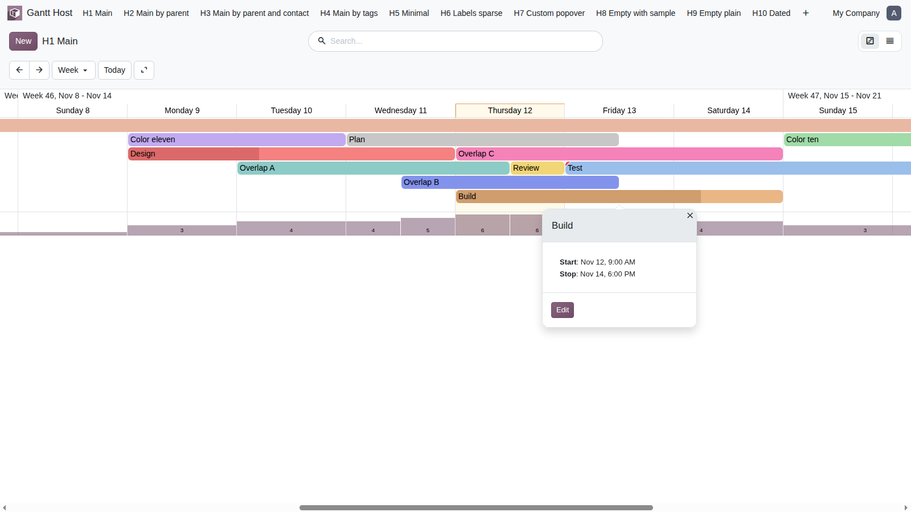

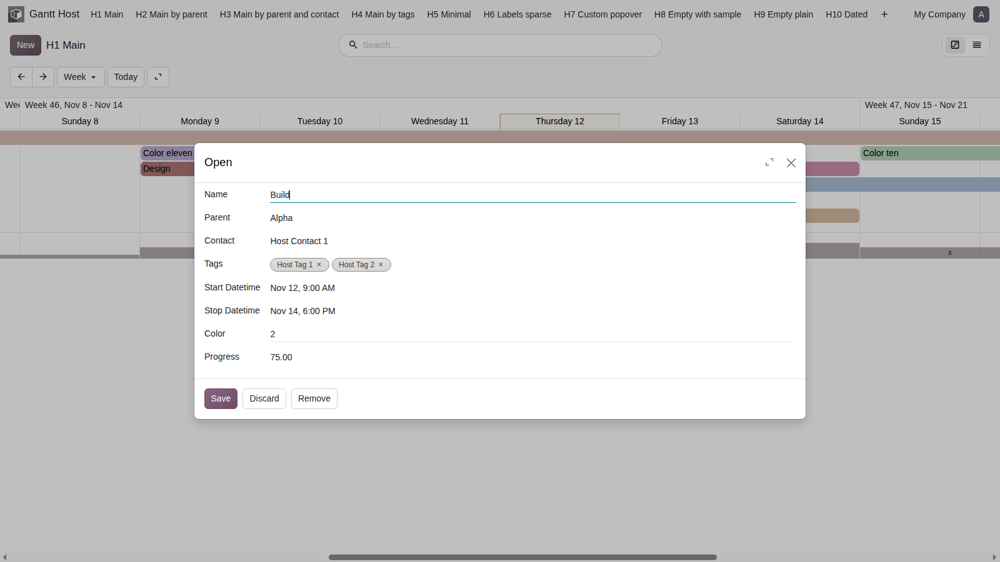

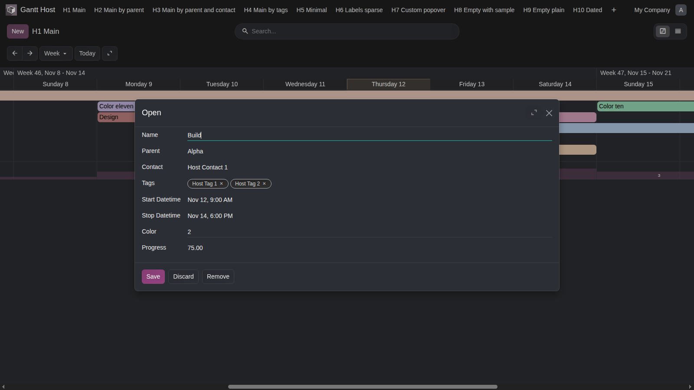

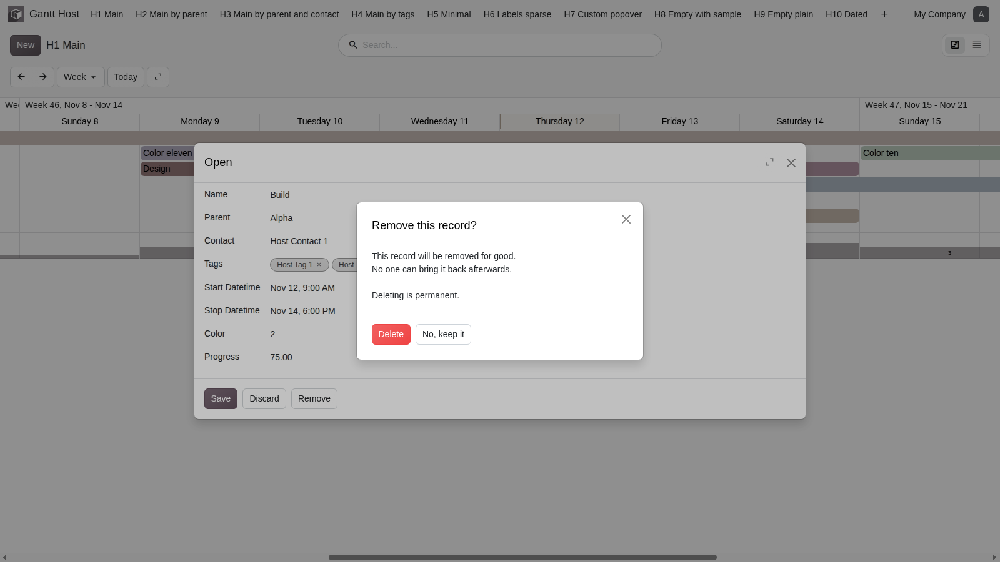

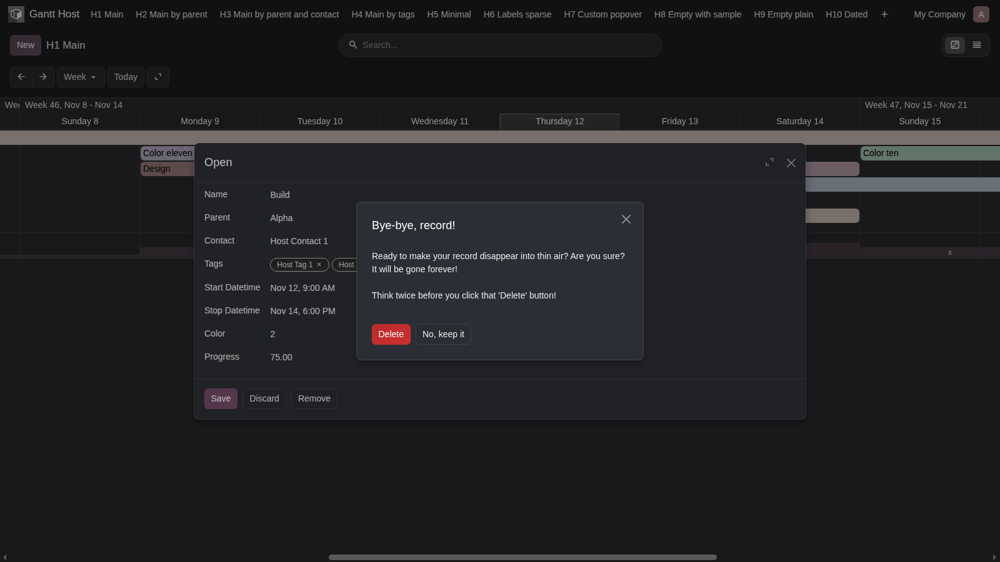

### Editing in the popover

A custom popover (see above) can hold fields and buttons. Buttons run their
method or action as in any card, then the popover closes and the view reloads.
Fields whose card widget can change a value, such as a switch or a selection,
are editable when the view allows editing and show faded and read-only
otherwise. A change is saved at once, and when the popover closes the view
reloads, so a pill whose row value changed moves to its new row.

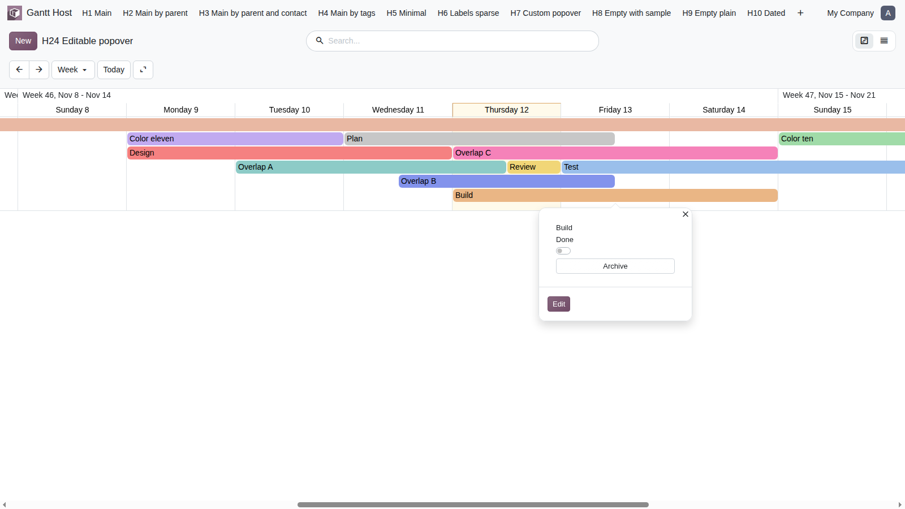

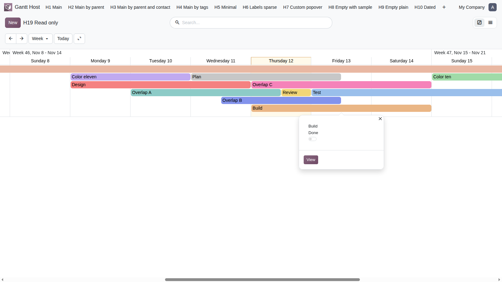

### What you may do

The view has three permissions, *create*, *edit* and *delete*, each on unless
the definition switches it off. When the definition leaves one unset, the web
client turns it off for a user who lacks the matching right on the model
(create, write, delete); a definition that sets it to yes keeps the control
visible and lets the server refuse the action. Two more switches refine them:
creating from cells and planning (see the options below).

| Control | Needs |
|---|---|
| New button | create |
| Selection of cells | creating from cells |
| Add in the selection buttons, and New with a selection | create |
| Plan in the selection buttons | planning, with one selected cell of a record row |
| Delete in the selection buttons | delete, and a count above zero |
| The side panel and its button | edit, scheduling on, not a phone |
| A click opens the plan dialog | planning |
| A click opens the create dialog | creating from cells, with planning off |
| Create New in the plan dialog | creating from cells |
| Popover button reads Edit (otherwise View) | edit |
| Editable popover fields | edit |
| Editable record dialog | edit, and the form's own edit |
| Remove in the record dialog | delete, and an editable dialog |

The record dialog has a second condition because it shows a form, which has
permissions of its own: the web client switches a form's edit off for a user
without the write right unless the form says otherwise. When the two differ the
dialog follows both. A view that says `edit="1"` and `delete="1"` therefore
shows the button **Edit** to a user who may only read, but the dialog it opens
is read-only, without Remove and without New, and its closing button just
closes it. A user who may only read sees no New button, cells that do nothing,
the popover button **View** and a read-only dialog.

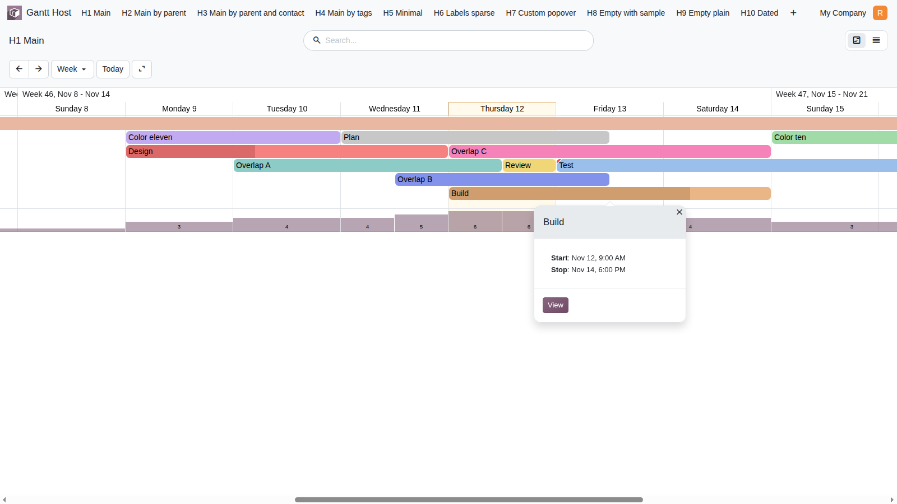


## Selecting several cells

A view whose definition names a template form (the `multi_create_view`
attribute, see [For developers](#for-developers)) selects cells instead of
opening a dialog when you click or draw on the grid. The selection is the base
for creating, planning and deleting records, described in the next sections.
It is on only when all of these hold: the screen is not a phone, the display
mode is shared rows (dense), and the columns of the range are days (the Week,
Month and Quarter ranges, not Day or Year). Otherwise the view behaves as
described under [Creating a record](#creating-a-record).

A **cell** is one part of a day column in one row: half a day on a view with
the usual half-day precision. Selected cells are tinted with the selection
colour and have a thin border on their right and bottom sides. Cells of group
rows can be part of a selection and are tinted, but they never count and never
give a record. Cells of folded columns are never selected: a drawing across a folded run
selects the cells on both sides of it and none inside it. With selection
possible, a click on a folded cell of a record row, with or without Ctrl, does
nothing and leaves the run folded; the folded cell of the total row still opens
it. The pointer is the cross (cell) shape over the cells of record rows and the
hand over headers.

- **Click.** A click on an empty part of a cell of a record row selects the
  whole day column in that row and replaces the selection. With **Ctrl**
  (or Cmd) held, the clicked cells are toggled instead: cells not yet selected
  join, selected ones leave.
- **Drawing.** Press on an empty part of a cell, or on a locked pill, and move
  ten pixels or more: a rectangle is drawn from the pressed cell to the cell
  under the pointer, covering every row in between, group rows included. Only
  the tint shows while you hold; no badges and no buttons. A press on a pill
  that can move starts a move, as before. Releasing makes the rectangle the
  selection, or adds it to the earlier one when Ctrl was held at the start.
  **Escape** while holding drops the drawing and the whole selection. The grid
  scrolls when you hold near an edge, sideways and also up and down.
- **Column headers.** A click on the header of a day selects that day in every
  row, group rows included. With Ctrl it toggles the column. With **Shift** it
  selects every column from the **anchor** to the clicked one, leaving out any folded columns between them; the anchor is
  the column last clicked without Shift. Shift with no anchor acts as a plain
  click, and Shift with Ctrl acts as Shift alone. A foldable column keeps its
  folding behaviour: a plain click on an open one folds it (and selects
  nothing), a click on a folded one opens the run it stands for, with Ctrl it
  also selects that run, and Shift never folds or opens.
- **Row headers.** A click on the header of a row without sub-rows first scrolls
  the grid as before, then selects that row over the whole displayed range.
  Ctrl toggles the row, Shift selects every row between the row anchor and the
  clicked one (group rows between them included). A click on a group row header
  still opens or folds the group, which reloads the view and so clears the
  selection. Using a row header with a column anchor set, or the reverse,
  clears the selection first, and a click on a cell forgets both anchors.

Text in the view, including the row headers, cannot be selected with the
pointer, so a press, a move and a release inside one row header is a click on
it every time.


The selection is cleared by the cross of the count box, by Escape while the
buttons show, by every reload of the view (a creation, a deletion, a range,
search or grouping change, a group opened or folded), at the start of a move,
copy or resize of a pill, at the start of a drag from the side panel, by Load
more and by folding or opening a column without Ctrl. Closing the plan dialog
or the popover keeps it. A click on Today that only scrolls keeps it too.

### Pressing inside a row header

With text selection off in the view, a press, a move and a release inside one
row header is a click on it, with or without the side panel, and three of them
in a row open and fold a group again each time.


### The selection buttons

As soon as the selection holds a cell, a row of buttons appears over the grid:

- **The count box** shows how many records the selection touches, with a cross
  to drop the selection. A record counts once however many selected cells its
  pill covers, and also when it is drawn in two rows. Pills of group rows never
  count. A selection of group-row cells alone shows a count of 0.
- **Add** opens the template form (see below). It needs the view's *create*
  permission.
- **Plan** is offered only when exactly one cell is selected, that cell is in a
  record row, and planning is on (the plan option, with *edit*). It opens the
  plan dialog described under
  [Planning records that have no dates](#planning-records-that-have-no-dates)
  for that cell's row and period. A click selects a whole day, which on a
  half-day view is two cells, so Plan shows there only after a small drawing
  inside one half day.
- **Delete** is offered when the count is above zero and the view's *delete*
  permission is on.

When none of the buttons is offered, the count box shows alone. The selection
itself works without any permission. The **New** button of the control panel,
with a selection, opens the create dialog for the first block of the selected
cells of record rows (the topmost row, its first selected cell and the cells
that follow it without a gap), with that row's values. Without any selected
record-row cell it works as without a selection.


### Creating several records

**Add** opens a popover under the button. It holds the **template form**, a
form of the model named by the view with its own defaults, required marks and
onchanges, and, only when both the start and the stop are date-and-time fields,
two time inputs (start 12:00 and end 13:00 at first). The last valid times are
remembered in the browser for the model and proposed again. What you typed in
the form is kept while the view stays open, also after Discard or a click
outside, and when you switch to another view of the action and back, but not
after the page is reloaded.


**Add** in the popover checks the form (a missing required field keeps the
popover open with the usual message) and the times (an unreadable time, or a
start that is not before the end, shows a warning and keeps the popover). When
all is valid, one record is created **for each day and record row that has at
least one selected cell**: a clicked day gives one record, not one per half day.
Group-row cells give none. All the records are sent in one call, the popover
closes, the selection is cleared and the view reloads.

Each record gets:

1. the values of the template form, as the form would save them, empty values
   included;
2. the dates of its cell: the day at the chosen start and end times in your
   time zone, or the day as both start and stop on a date-only model; on a
   model mixing the two, the date-only end gets the day and the other end the
   start of the first selected part of the day (for the start) or the end of
   the last one (for the stop);
3. the values of its row and of the rows above it for the grouping fields, an
   "Undefined" row giving an empty value.

**The cell's values win.** If the template form shows a field that is also a
grouping field of the row, or the start or stop, the row's or the cell's value
replaces the form's, even when the row's value is empty. So every new record
shows up in the cell chosen for it. Records outside the action's domain or the
search vanish after the reload.


If the server refuses the creation (a missing right or a constraint) the usual
error dialog appears and nothing is created. For a user who may not create on a
view that says *create* explicitly yes, the refusal already comes when Add is
pressed: the popover does not open and the selection stays.

### Deleting several records

**Delete** asks for confirmation in the web client's own box, which says
whether one record or several are concerned. **Ok** deletes every counted record
in one call, sent at once, and reloads; pills that are locked or cut are
deleted like the others. **Discard**, or closing the box, deletes nothing and
keeps the selection. The selection is cleared when you press Ok, whatever the
server answers; if it refuses, the usual error dialog shows and the view is not
loaded again.


## The side panel

A view with the **scheduling** option on (the `schedule` attribute) shows a
panel at the right of the grid with the records that have neither a start nor a
stop, so that you can drag them onto the grid. It exists only when the view
allows editing, the screen is not a phone and the view is not showing sample
data. It is open the first time; the panel button at the right end of the
control bar shows or hides it (its tooltip reads "Show or hide the panel"). The
state is remembered in the browser for each view and action, and read when the
view opens. When the page is printed, the panel and its button are left out.

The grid box keeps a margin and a rounded border while the panel is there, and
reaches the right edge of the screen when the panel is closed. The row header
column is always one sixth of the width of the whole content, the panel
included. The first time the grid is shown, it scrolls so that the focus day
lies at the middle of the width left after the row header and the open panel.
Opening, closing or resizing the panel later changes the column widths but moves
neither the row header nor the scroll position.


- **The title** reads "Unscheduled: 4" with the number of records to schedule,
  or "All records are scheduled" when there are none. While the panel is closed
  the same text stands before the panel button.
- **The list** holds the records of the action's domain and of the current
  search that have **both** start and stop empty, in the model's default order,
  twenty at first. A record with only one of the two dates is not listed. Every
  condition on the start or stop field is left out of the filter, whether it
  comes from the search or from the action's own domain (the two are joined by
  "and" first), so that a date condition cannot hide an unscheduled record; a
  negated date condition is left out together with its negation, and one that
  stands directly under an "or" lets the other side decide. The grid itself
  keeps using the action's domain and the search unchanged. **Load more** under the list adds twenty
  lines; a reload shows the first twenty again.
- **A line** has a handle and the name. A click anywhere on the line opens the
  record dialog. The name is only as wide as its text; a long name keeps the
  width of its whole text and runs past the end of the line, and the line cuts
  it with an ellipsis. The pointer over it is the hand of a
  link; over the rest of the line, handle included, it is the open hand of
  something you can drag, and a press and move from any point of the line,
  the name too, drags the record.
- **Resizing.** Press the thin strip between the grid and the panel and move
  sideways: the panel is at least 150 pixels wide and at most the larger of half
  the window and its width at the start. The width is kept while the view stays
  open, and is 262 pixels again when the view is opened anew.


### Scheduling a record from the panel

Press a line and move ten pixels: the line follows the pointer, the list keeps
a copy in place, and the selection is cleared. Over a cell that accepts drops a
highlight covers one column (a day on the Week and Month ranges) in the target
row, with the start and stop badges. Cells of record rows and group rows accept,
except in rows at or below a grouping level that is read-only, which all refuse
because the record has no row to start from. Over the panel, the headers, the
control bar or a refusing row nothing is highlighted and a release writes
nothing; Escape cancels. The grid does not scroll at its edges during this
drag. A release over a cell writes the start, the stop (on a date-only model the
day as both) and the row's grouping values in one write, after any write still
running, then reloads. The record leaves the list and appears as a pill, with no
notification and no Undo.


### Removing the dates by dragging a pill onto the panel

While a pill is moved or copied and the panel is open, the list is replaced by a
**drop zone** with the text "Drop here to remove the dates". Releasing the pill
over the zone's own box (not over the panel's margin around it) empties its
start and stop in one write, sent at once, and reloads; the pill disappears and
the record joins the list, with no notification and no Undo. With Ctrl held the
original record loses its dates and no copy is made. A resize never shows the
zone. While the panel is open, a moved pill does not scroll the grid at its
edges; with the panel closed it does.


## Moving, copying and resizing pills

A pill can be dragged to another time, to another row, or stretched by one of
its ends, as long as the view lets you edit. Every gesture is one ordinary
write (or copy) on the record, made with your own rights.


### Moving

Press on a pill and move the pointer by at least ten pixels; a press that does
not move stays a click (popover on a single click, record dialog on a double
click). The popover closes when the move starts, and the release that ends a
move is never taken for a click.

- The pill follows the pointer, a little see-through and with a soft shadow,
  and a faded copy stays at its place. A highlight covers the cells where the
  pill would land, over the full height of the target row; the pill keeps the
  offset at which you grabbed it. The pointer over the view becomes the
  four-arrow move shape.
- Two **time badges** show the new start (above the pill's left end) and stop
  (below its right end), as in a selection: green when the pill moves later, red
  when it moves earlier. They show the record's own times, not the column
  borders, so a pill from 09:00 to 18:00 moved by a half-day column reads
  21:00 to 06:00.
- Moving is in whole sub-columns (half days, hours or months according to the
  scale and the view's precision) and the pill cannot leave the grid. The
  target row may be another row, a group row (only the grouping values of that
  row and of the rows above it are written) or an "Undefined" row (which empties
  the value). A drop on a many-to-many row replaces the record's list with that
  one value, unless the record already has it.
- Release over a cell to write. Release over the headers, the control panel, a
  refusing row or nowhere does nothing. A release that would change nothing (the
  same place, or a row whose values the record already holds) writes nothing,
  shows no notification and does not reload. If you drop on a closed group row,
  it opens once the server has accepted the change. What the arrows show after
  such a release is told under [The arrows](#the-arrows).
- **Escape**, or any other key except Alt, Ctrl, Meta and Shift, cancels the
  move, as does the browser cancelling the pointer or the tab being hidden.
  Ctrl switches a move into a copy and Shift does nothing; neither cancels. A
  second pointer put down inside the grid (on a cell, a pill, a row or column
  header or an arrow) cancels the gesture too, a second finger during a touch gesture, and also a finger during a gesture
  made with the mouse. The finger that cancels does nothing else: no dialog,
  popover, selection or new gesture, on a cell, a pill, a header or an arrow, lifted
  before or after the mouse button is released. A second finger below the
  last row or in the control panel does not. Losing the focus of the window
  while the page stays visible does **not** cancel: the gesture goes on and the
  release writes. See [Cancelling a gesture](#cancelling-a-gesture) for what is
  left lit.


### Copying

Hold **Ctrl** at the start of the move, or press it while moving, and the move
becomes a copy; release it and it is a move again. The pointer shows the
arrow with a plus. Releasing over a cell duplicates the record with the target
start, stop and row values (all of them, even ones the record already has, and
also when the dates do not change); the original stays as it is. The copy is
named by the model's own duplicate rules. Pressing Meta does not copy. A copy
also needs the right to create records.


### The notification and Undo

After a move, a resize or a copy that the server accepted, a notification at
the top right ("Dates changed" or "Record copied") offers **Undo**. Only one
such notification exists at a time: the next change replaces it. It closes by
itself after a while, or with its cross, and nothing is undone then. Undo puts
the earlier start, stop and row values back (for a move, those of the row where
the pill started; for a many-to-many row, the former whole list), or deletes the
copy. The notification stays until the server answers, then a second one
reports "Change undone" or "Copy removed", or, when the record no longer exists,
"This change could not be undone" or "This copy could not be removed". The view
reloads either way. If the server refuses a write, only the usual error dialog
appears, the pill returns to its stored place and no success notification is
shown. Writes are sent one after the other (Undo is sent at once), and the view reloads after each.


### Resizing

When the pointer enters a pill that can be resized, two invisible handles, each
eight pixels wide, appear at its ends (the pointer shows the east or west
resize shape over them; they go away when the pointer leaves). A pill can be
resized at its start when its start lies inside the displayed range, and at its
stop when its stop does. Press a handle and move ten pixels to start; the edge
then follows the pointer to the nearest sub-column border, and the pill never
becomes shorter than one sub-column. On a pill whose body is narrower than 16 pixels
(a pill narrower than 18 pixels, as its body is inset by one pixel on each
side) the two handles cover the whole body, so it can only be resized at its
end; a 26 pixel pill has a 24 pixel body, and the 8 pixels between its two
handles move it.

The badge of the moved end shows the new date and time with the change of the
pill's length in brackets ("(+24 hours)"; minutes on the day scale, hours on
the week and month scales, months on the year scale): green when the pill gets
longer, red when shorter. The sign is the change of the *length*, so moving a
start earlier reads "+". The other badge keeps its value in plain text colour.
Releasing writes only the moved end, shows the notification and reloads; a
release at the starting border does nothing. Escape and the other cancelling
events work as for a move. Resizing works whether or not drag and drop is
switched off.


#### Invalid results

A resize that would put the stop before the start (or the start after the stop)
shows the impossible value in red while you hold; on release nothing is written
and a warning notification, without Undo, says why. This can happen when a
record does not start and end on sub-column borders, for example a 10:00 to
14:00 record drawn over two half-days and shortened by one of them.


### Locked pills

A pill cannot be moved or copied when the view does not allow editing, when the
view's drag-and-drop option is off, or when it is **cut**, that is, it begins
before the first displayed moment or ends after the last one. It looks like any
other pill, but when you press and drag it, it only rises in place and shows a
small black lock at its right end while the pointer is the not-allowed shape;
nothing is written. A cut pill shows only the handle of its other end, a pill
cut at both ends none, and without edit rights there are no handles at all.
The grey group pills of group rows let the pointer through to the row and never
move, and pressing and releasing on one in two different cells does nothing. In
the sample state nothing moves.


### Rows that refuse a drop

When one of the grouping fields is read-only, the rows of that
level and of every level below refuse drops; rows of the levels above it accept
them. While you move a pill, its own row still accepts it, and so do the rows
next to it under the same row of the read-only level. A refusing row shows no
highlight and no badges, and releasing over it does nothing. A row that accepts
the drop is highlighted.


### Edge scrolling

Near the left or right edge of the grid (the row header column does not count),
and near the top or bottom when the grid is taller than its area, the grid
scrolls while you hold a moved pill; the scroll stops at the ends of the grid
and the target, highlight and badges follow it. The edge zone is narrow (30
pixels) for a move, and wide (150 pixels) for a resize or a selection; the
nearer the pointer is to the edge, the faster the grid scrolls, evenly on every
frame.

### Date-only fields

When a start or stop field holds only a date, moving and resizing go in whole
days (whole months on the year scale), whatever precision the view draws its
cells with. A move steps when the pointer crosses a midnight counted from where
you pressed; a resize edge goes to the nearest day border, so it steps at the
middle of a day. A date-only pill is never shorter than one day. The badges
show dates without a time, and a date-only stop as its last day (three days from
the 11th to the 13th, moved a day later, reads the 12th and the 14th). The
difference of a resize counts days. Released within its starting day, a
date-only pill is left alone. On a mixed model the other bound moves by the same
number of days, keeping its local time.

### Right-to-left languages

In a right-to-left language the picture is mirrored: later is to the left, the
start handle is at the pill's right end, and the badges of a selection, a move
and a resize swap sides and heights (the stop badge stands above, the start
badge below). Dates and times in badges and in the column headers use the
language's own formatting, with Arabic-Indic digits for Arabic; the resize
difference keeps Western digits.


Every screenshot above also exists in a dark variant (suffix `-dark`) and a
phone variant (suffix `.mobile`) in `docs/assets/gantt_view/`.

## Dependencies and rescheduling

A view that names a **dependency field** (see
[the view definition](#the-view-definition)) shows which records wait for which:
an arrow runs from a record's pill to the pills of the records it blocks. The
same view can draw and remove those links with the pointer, and it can move the
records that follow when you move or resize one of them. Free time before and
after a record can be shown as a band behind its pill. Arrows, handles, the
method button and the switch need a computer screen and real data; the buffer
bands and the rescheduling also work on a phone (see [below](#dependencies-on-a-phone)).


### The arrows

- **Which.** Every record that has a pill in a record row is joined to each of
  the records it depends on that also have one. Group rows carry no arrows, and
  a record outside the loaded period or the search has none. The loaded period
  is the one the view reads, so on the week range the week before and the week
  after count, not only the displayed week. A record that sits in several rows
  (grouped by a relation to many records) gets an arrow for each pair of pills
  that makes sense, without a second arrow across rows that have nothing to do
  with each other.
- **Route.** An arrow leaves the middle of the right edge of the source pill and
  enters the middle of the left edge of the target pill (swapped in a
  right-to-left language), with rounded corners and a small filled arrowhead
  with a notched back. When the target starts less than 8 pixels to the right of
  the end of the source, the line goes around: out to the right, back on the other side
  of the pills, and into the target from the left. The route is drawn again
  whenever a pill moves on screen.
- **Colour.** The colour tells whether the order is respected: grey when the
  target starts after the source stops, orange when it starts before the source
  stops, red when it starts before the source starts. At rest the line is half
  transparent; highlighted it is solid. For date-only records the stop counts as
  the end of its day, so a target that starts on the day its source stops is
  orange. No outline is drawn under a line, in either look.
- **Layering.** At rest the arrows lie over the cells and under the pills, so a
  press on a pill always reaches the pill. A highlighted arrow lies over the
  pills; a click on it where it crosses a pill goes to the arrow.
- **Highlight.** The pointer over a pill highlights every arrow of that pill;
  the pointer over an arrow (a band of about 13 pixels around the line)
  highlights that arrow alone, also where the band crosses a pill: the pill
  under the band does not count, so its own arrows rest and its handles are
  gone. The highlight is worked out when the pointer moves (or the grid
  scrolls) and not otherwise: after a gesture ends and the view reloads, and
  after "Show dependencies" is switched off or on with the pointer resting on
  a pill, nothing is highlighted until the pointer moves. While a move, a
  resize or a drawing is in progress the highlight stays as it was (a moved
  pill's arrows are highlighted and follow it; a resized pill's arrows stay on
  the stored end until the view reloads after the release). A gesture
  cancelled with Escape writes nothing and reloads nothing, so it keeps that
  state: at Escape and after the release with the pointer still, the arrows lit
  when the gesture started stay lit with their buttons and the pill under the
  pointer shows its handles again (none on an empty cell); at the pointer's next
  move the highlight follows the pointer again. When the grid scrolled during the
  gesture (edge scrolling) and the pointer is still in the edge zone at Escape, the
  highlight is worked out from what lies under the pointer at Escape instead; a
  gesture whose pointer had left the zone keeps the state above. The same holds for every release
  that writes nothing, see [After a gesture that writes nothing](#after-a-gesture-that-writes-nothing).


#### After a gesture that writes nothing

A move, a resize or a drawing released where nothing is written, or cancelled,
keeps the state it started in: the arrows that were lit when the gesture began
stay lit with their remove buttons, the pill under the pointer shows its handles,
and the next move of the pointer over the grid works the highlight out again.
The cases:

- A drawing released on an empty cell, over the column headers, over its own pill
  or outside the view keeps the arrow lit at its start (the drawing's own pill
  shows its handles when it is released over it). A drawing released over the
  row headers leaves no arrow lit. A drawing released on a pill that already
  depends on the source writes the link again and reloads, so it ends as a write
  does, with nothing lit until the pointer moves.
- A move released outside the view or over the column headers keeps the pill's
  arrows lit; over the row headers it leaves none lit. After a release outside the
  view, the lit arrows stay until the pointer moves over the grid again; moves
  elsewhere do not work the highlight out.
- A release **that changes nothing** is decided by the sub-column under the
  pointer, not by the pixel: a release anywhere in the starting sub-column of the
  starting row, the press point included, changes no date, and for a move no row
  either. A move of that kind with the manual method, or in a view without a
  dependency field, writes and reloads nothing and keeps the lit state above. A
  move with a method that uses buffers still calls the rescheduling method once
  with no value: the server writes nothing, the success notification with Undo
  shows, the view reloads and nothing is lit until the pointer moves. A resize
  that changes nothing makes no call with any method and keeps the lit state. A
  copy always creates the duplicate.
- The band of an arrow begins at the outer edge of its source pill, not at the
  pill's body: on the last column of the pill's outer box both of the pill's
  arrows are still lit and its handles are gone, and from the next pixel the
  pointer is on the band and that arrow alone is lit.
- A resize handle pressed inside the 150 px edge zone does not scroll the grid
  while the pointer is held still; once the resize has started, every move inside
  the zone scrolls it. A resize cancelled after such a scroll leaves no arrow lit
  (the pill moved away from the pointer); one that did not scroll, such as one from
  the left handle, keeps the pill's arrows lit, with or without its popover open
  before the press.


#### Cancelling a gesture

Besides Escape, any key except Alt, Ctrl, Meta and Shift cancels a move, a copy,
a resize or a drawing and writes nothing; the arrows lit at its start stay lit,
and after the next move the pill under the pointer keeps its handles and only the
arrows go out. A touch gesture cancelled by a key keeps the arrows lit only while
the finger stays down. When the browser takes the touch away (a pointer cancel),
nothing is written, a drawing's line disappears and, unlike with Escape, **no
arrow stays lit**. A second finger put down inside the grid cancels the gesture,
and a finger put down inside the grid cancels a gesture made with the mouse; that
finger does nothing else, not even when it lifts (no dialog, popover or selection).
The arrows lit at the start stay lit while the finger or both fingers are down and
go out as soon as that finger, or one of the two, lifts, whether the mouse button is
still held or not. The page becoming hidden (another tab shown) cancels as Escape
does, and losing the window's focus alone does not.

### Drawing and removing a dependency

Both need the view's *edit* permission. Without it (the definition says no, or
the definition is silent and you cannot write the model) the pills show no
handles and the arrows no remove button; everything else on this page stays.
A pill that is locked for moving (cut at the edge, drag and drop off) still
shows its handles and buttons, because they write the link, not the pill.

- **Handles.** While the pointer is over a pill of a record row, two small round
  handles appear: one above its left end, one below its right end. Group pills
  have none. The dot takes the pill's own colour. The pill stays under the
  pointer while it is on the body, in a strip 11 pixels tall above and below the
  body (as wide as the pill's outer box, starting at the body's left edge, not
  beyond its ends, over neighbouring pills and rows, under the column headers
  and a highlighted arrow's band), or on a
  handle, so the pointer can go from the body to a handle on a slant. A click
  in a strip does nothing; a press and move there moves the pill.
- **Drawing.** Press a handle and move the pointer: a grey line follows from the
  handle to the pointer, the cell selection is cleared, an open popover closes
  and the grid scrolls when you hold near its edges. Release over another pill
  and that pill now depends on the one whose handle you pressed (one write on
  the target; the view reloads). Either handle works, the pressed pill is always
  the source. Releasing on the same pill, on a group row, outside the pills or
  after Escape writes nothing; a remove button counts as outside the pills.
  During a drawing the source pill lies over the other pills and over the
  arrows at rest; the highlighted arrows (with their buttons, which cannot be
  clicked) and the line being drawn lie over all pills. Drawing a link that already exists changes
  nothing, and a link that closes a loop is accepted; the loop shows up only when
  a rescheduling meets it.
- **Touch.** At desktop size a tap on a pill shows its handles and opens its
  popover but lights none of its arrows; a finger put down on a handle lights
  the pill's arrows with their buttons, and a move draws the same way. During
  the drawing only the arrow lit when it started stays lit, and after the save
  none is. The handles belong to the **pill last tapped**, not to the finger of a
  gesture: after a touch drawing from a tapped pill to another one, the tapped
  pill still shows its handles, the target shows none and no arrow is lit; the same
  holds when the drawing is lifted over its own pill (nothing written) and after a
  write made while a second finger rests below the last row. This
  lasts until the next touch: a tap on an empty cell hides the handles, and a tap
  on another pill shows that pill's handles and opens its popover. A finger put
  down on a pill that was not tapped lights its arrows and shows no handles; when
  it is lifted without moving it is a tap, and the light goes out; after a touch
  move from there nothing is lit and no handles show. Which pill was tapped is
  decided by the place of the tap: when a record has two pills, only the tapped
  one shows handles, and after a write moves the tapped pill away, a pill that
  now lies at the place of the tap shows them.
- **A finger on a pill's end.** At desktop size with touch, a finger put down on
  the place of either resize handle (the first and last 8 px of the pill) moves
  the pill, by the same hold and threshold as a finger on its body, and an open
  popover stays until the move starts. There is no resize by touch; a mouse
  press on the same place still resizes, and the phone is unchanged.
- **Removing.** A highlighted arrow shows a small round button with a cross at
  the middle of its route, named "Remove this dependency" for assistive
  technology. A click removes the source from the target's dependencies (one
  write on the target) and reloads. There is no confirmation and no Undo; a
  refused write shows the usual error.


### The method menu and "Show dependencies"

On a computer screen a button right after the button that opens or folds every
group shows the **rescheduling method** (see below) and opens a menu with the
three methods and, below a separator, **Show dependencies**. It is there also
when you may not edit, though then the method changes nothing you can do.

- The chosen method is marked and named on the button; the default is
  **Auto-Reschedule (Keep Buffer)**. The choice is kept in the browser for the
  view (all actions of it share it) and read when the view opens. The choice
  takes effect with the reload half a second later, so a move made in that
  moment still uses the old one.
- **Show dependencies** is on by default and marked when on. Switched off, the
  arrows at rest are invisible and take no pointer; highlighted arrows still
  show (the pointer over a pill, a drawing), and handles, drawing and removal
  work as before. The state is kept per view and per action.


### Rescheduling

With **Manual Reschedule** a move or resize is what
[Moving, copying and resizing pills](#moving-copying-and-resizing-pills)
describes: one write, one notification with Undo. With one of the two automatic
methods, a **move** (not a copy) or a **resize** is sent to the server as one
call that also moves the records that follow, and the notification of that call
replaces the usual one. Copies, drops from the side panel, drops on the drop
zone and the plan dialog never reschedule.

- **Direction.** Moving a record later (or its end later) pushes the records it
  blocks, and those they block, and so on. Moving it earlier pulls the records
  that block it, and so on; when only the end is made earlier, the records it
  blocks are drawn along by the same amount. A record is moved only if it has
  both dates and starts in the future; the search along the links stops at one
  that does not. Each moved record keeps its length.
- **Keep Buffer.** The free time between a blocker and the record it blocks is
  kept: the record is placed after the blocker's new end plus the time that was
  between them. Every following record moves.
- **Use Buffer.** A following record moves only if it is in conflict, that is,
  it starts before the end of a blocker or ends after the start of a record it
  blocks; then it goes just after the blocker with no free time. One that is not
  in conflict stays, the free time before it is used up, and it passes no new
  limit on to the records after it.
- **Plain writes.** Nothing else moves when you drop a record in the past (its
  new start is before the server's current time), when you change only the row,
  or when you resize the start. Resizing the end is rescheduled even if the
  record started in the past. A drop that changes nothing still calls the
  server, which writes nothing and answers with the success message.
- **Past and loops.** If a record would have to start more than half a minute in
  the past, or the links form a loop, nothing is moved at all, not even the
  record you moved; a warning explains why (below).
- **Whole days.** On a view whose start and stop are dates, everything is in
  whole days: a record covers from the start of its first day to the end of its
  last day, its length and the free time are counted in days, and a record that
  starts the day its blocker stops counts as in conflict. Today counts as the
  past, since a day starts at midnight.
- **Rights and order.** Every write is made with your own rights, after the
  earlier writes of the view have finished, and the view reloads when the call
  returns, also after an error.


### The notification and Undo

A rescheduling answers with a **sticky** notification, replacing any other of
the view: success shows "Records rescheduled" with **Undo**; a loop shows a
warning that says the dependencies form a loop and nothing was moved, and a
record that would start in the past shows a warning naming it ("Could not move
... it would start in the past"). Warnings have no Undo. The notification stays
until you close it, use Undo or the next one replaces it. Undo writes back the
old start and stop of every record the call changed (for the record you moved,
every value it wrote, the row included, a grouping property as a whole) and
reloads the view; if records changed in the meantime, the old values are written
over the new ones. An exception on the server shows the web client's error
dialog and the view reloads.


### Buffers

When the definition names a **buffer before** and a **buffer after** field
(numbers of hours), a record with a positive value gets a band behind its pill,
in the pill's colour, 60 percent of its height, rounded at the ends. It runs
from the start minus the hours before to the stop plus the hours after, each
rounded to whole sub-columns of the scale and kept inside the displayed period;
a value too small for one sub-column, zero or negative adds nothing on that
side. The band hides while its pill is moved or resized and comes back when the
gesture ends. Bands are only a display: the rescheduling does not read them.


### Dependencies on a phone

Below the small-screen breakpoint, and in the sample state, there are no
arrows, no handles, no method button and no switch. The buffer bands are drawn,
and a move or resize is rescheduled with the method stored for the view in that
browser (keep buffer when none), exactly as on a computer.


## Sample data and empty views

If the view definition allows sample data and the first load finds no record,
the view shows a faded, non-interactive grid with generated rows and no pills,
and the help text of the action drawn over it. Below its one faded row the sample state shows the page background, so
the help text stands on the page; the help is centred in the free space (on a
phone it starts at the top of the grid area). The sample state ends at the
next load (any navigation or search). The side panel is not shown in it, even
when scheduling is on. When sample data is not allowed, an empty
result shows the normal grid with empty rows and no help. Whenever the grid is
shorter than the screen, the area under it takes the background of the view
rather than the page's. The grid's own scroll area reaches the bottom of the
view, so its horizontal scrollbar sits at the bottom edge of the view and not
under the last row.


## On a phone

On a small screen the control bar wraps: previous, next and the range button
on the first line, then Today and a gear button on the second; without touch
the two lines are packed close, the first with a little more room below and the
second with a little more above. The gear menu
holds the display mode switch ("One row per record" or "Shared rows") and, below
a separator, "Open every group" or "Fold every group"; its icon is the filled
gear. On a touch phone the buttons of the bar take the larger touch size (37 px
tall; previous, next and the gear 44 px wide) while the bar keeps its height.
The range menu opens as a bottom sheet (424 px tall, with the custom range
line well spaced, its dates and Apply button sized for touch), dates are picked in a dialog, popovers open full screen and
the row header column takes a third of the width, where a long name such as
"Undefined Contact" is cut with an ellipsis. Month names in the headers
are abbreviated, and the page itself scrolls.

There is no multi-selection and no side panel on a phone: cells, headers and
the New button behave as described for a screen without them, and the control
bar has no panel button.

Creating works as on a desktop: the New button, taps on cells, the plan dialog
and the popover buttons behave the same, and every dialog opens full screen with
its buttons stacked at the bottom, the plan dialog listing records as cards. The
deletion confirmation is the exception: a box centred over the record dialog,
with its buttons stacked. A selection starts with a **long press** of about a
third of a second followed by a move; a swipe that starts without the long press
scrolls the grid. Near the left or right edge the grid scrolls under the finger
while you hold, so start from the middle of the screen to select without
scrolling. With a mouse the selection works as on a desktop.


Moving pills works with a finger after a **long press** of about a third of a
second followed by a move (a quick swipe scrolls the grid), or with a mouse. The
edge zones take a large part of the narrow screen, so start in the middle.
Copying needs a held Ctrl key, so it is possible only with a keyboard. Resizing
needs a mouse: a finger held on a pill's end, even on its handle, moves the
pill, and touch resizing is not offered. A finger held on a locked pill shows
its lock after the hold. The notifications stand at the bottom of the screen.


Dependencies show differently on a phone: no arrows, handles, method button
or switch, but buffer bands are drawn and moves are rescheduled (see
[Dependencies on a phone](#dependencies-on-a-phone)).

Hovering a column header gives a tooltip with the date including the weekday
("Saturday, November 7, 2026"; on the day scale also the time).


## Light and dark

Every colour of the view comes from the theme colours of the web client, so
the view follows the light or dark look chosen in your preferences (see the
[Web Theme](web_theme.md)). In the dark look today's highlight is a
translucent warning colour, unavailable periods are a flat grey and the first
pill colour is the theme's neutral grey. When the theme module is not
installed the view still works, with the default colours of the web client.

## For developers

### The view definition

A Gantt view is a `gantt` element. `date_start` and `date_stop` (names of date
or date-and-time fields) are required. The other attributes:

| Attribute | Meaning |
|---|---|
| `string` | title above the row headers |
| `default_range`, `default_scale` | opening range: `day`, `week`, `month`, `quarter`, `year` (`default_scale` also takes `week_2` and `month_3`, which give a custom range) |
| `scales` | comma-separated list of the ranges offered |
| `precision` | per scale, `unit:part` with part `full`, `half` or `quarter` |
| `color` | number or relational field choosing the pill colour |
| `decoration-danger`, `-warning`, `-success`, `-info`, `-secondary` | conditions on the record that mark the pill |
| `progress` | number field with a percentage |
| `pill_label` | add dates (and times) to the label |
| `thumbnails` | maps a grouping field to an image field of the related model |
| `display_mode` | `dense` (default) or `sparse` |
| `total_row` | add the Total row |
| `progress_bar` | relational grouping fields that show a capacity bar |
| `display_unavailability` | grey out unavailable periods |
| `groups_limit` | groups per page |
| `disable_drag_drop` | yes or no (default no): locks every pill for moving and copying; resizing stays possible. Any value read as false keeps moving on |
| `create`, `edit`, `delete` | yes or no; the usual meaning in a Community view, with the effects listed under [What you may do](#what-you-may-do) |
| `cell_create` | yes or no (default yes): allows creating from cells, by click when planning is off and by selection |
| `plan` | yes or no (default yes): a click on a cell opens the plan dialog instead of the create dialog |
| `form_view_id` | database identifier of a form view of the same model, used by the create and record dialogs (default: the model's default form) |
| `multi_create_view` | XML identifier of a form view of the same model (`module.name`), used as the template form of the selection's Add button. Without it there is no multi-selection |
| `dependency_field` | a many-to-many field of the model to itself holding the records that block each record; turns on arrows, drawing handles, the method menu and rescheduling. Needs `dependency_inverted_field` |
| `dependency_inverted_field` | the reverse field: the records each record blocks |
| `buffer_start`, `buffer_stop` | number fields with the hours of free time before the start and after the stop of each record, drawn as bands |
| `schedule` | yes or no (default no): shows the side panel of records without dates (with edit on, not on a phone) |
| `on_create` | an action reference (an XML identifier such as `module.action_name`, or a database identifier) run instead of the create dialog |
| `default_group_by`, `sample`, `class`, `js_class` | the usual meaning in a Community view |

Children are `field` elements (extra fields to read, for decorations and the
popover) and at most one `popover`. A `popover` takes `card_id` only, and may
hold `field` elements and one `templates` element with `popover-body` (or
`card`), `popover-header` and `popover-footer` (the last with `replace` set to
a false value to keep the default button). The attributes
`collapse_first_level`, `dynamic_range` and `offset` are accepted and have no
effect yet. A view that breaks the rules is refused when saved, with a message
that names the problem. An action can pass the context keys `default_range`,
`default_scale`, `default_start_date`, `default_stop_date`, `initialDate` and
`group_by`.

#### Context given to dialogs and actions

The create dialog, the create action and the plan dialog receive the context of
the action combined with the search context, plus these keys from the view
(its keys replace keys of the same name):

| Key | Value |
|---|---|
| the start field's name (for example `date_start`) | start of the period: UTC date and time as `YYYY-MM-DD HH:MM:SS` for a date-and-time field, `YYYY-MM-DD` for a date-only field |
| the stop field's name | stop of the period; for a date-only field, the last day the period covers (see above). Omitted when start and stop are the same field |
| `default_<start field>`, `default_<stop field>` | the same values, as form defaults |
| each grouping field's name | the row's value: an identifier for a relation to one record, a list with one identifier for a relation to many, the plain value otherwise, false for an "Undefined" row. Only for a click, selection or plan in a grouped view |
| `default_<grouping field>`, `search_default_<grouping field>` | the same value; the second pre-applies a facet in the plan dialog when its search view offers the field |

The plan dialog writes only the start, the stop and the grouping fields, never
the other keys. The New button gives the period keys and no row keys.

```xml
<gantt date_start="date_start" date_stop="date_stop" string="Work"
       default_range="week" color="priority" progress="progress"
       decoration-danger="is_late" total_row="1"
       multi_create_view="my_module.view_work_template" schedule="1">
    <field name="is_late"/>
</gantt>
```

#### The multi-creation call

Add sends one create call with the list of all the value mappings. Its context
is the action's context combined with the search context plus the key
`multi_create` set to true, so a model can tell a multi-creation from a normal
creation in its create method. A deletion from the selection is one delete call
for all the records, and the panel is read with one search-and-read of the
display name with a limit. Scheduling from the panel is one write queued behind
earlier writes; removing dates through the drop zone is one write sent at once.
Each write is followed by a reload. The panel's open state is kept in the
browser under the key `timelinePanelOpen-view-<view id>-action-<action id>`.

#### Dependencies and rescheduling for developers

- The data call also reads the dependency field and the two buffer fields when
  the view names them. The arrows are computed in the browser from the loaded
  records; nothing about them is stored.
- Drawing a link is one write `{dependency_field: [[4, source_id]]}` on the
  target, removing one is `[[3, source_id]]`, both queued behind earlier writes
  and followed by a reload.
- A move or resize with an automatic method calls `web_gantt_reschedule` (below)
  instead of writing, through the same write queue. Undo calls
  `action_rollback_scheduling`.
- The browser keeps two choices in its local storage:
  `rescheduleMethod-viewId-<view id>` holds `manual`, `consumeBuffer` or
  `maintainBuffer` (any other value counts as `maintainBuffer`), and
  `gantt_show_connectors,<view id>,<action id>` holds `true` or `false`.
  `manual` never reaches the server.

### Extension points for view variants

A module can register its own variant of the view and choose it with the
`js_class` attribute of the definition: it builds an object from `timelineView`
(exported by `@web_gantt/timeline_view`), replaces `Model` or `Renderer` with
subclasses of `TimelineModel` or `TimelineRenderer`, and adds it to the
`views` registry. Eight places are meant to be overridden (the four of the table,
then the editor slot and the three editor hooks after it). The employee variant of
[Employees Timeline](employee_gantt.md) uses three of the first four and reshapes the
row name through an inheriting template instead of `rowLeadTemplate`; the plain
view behaves exactly as before when none is overridden.

| Place | On | What a variant may do | What the view guarantees |
|---|---|---|---|
| `rowLeadTemplate` | renderer, a getter | Return the name of its own template to draw what comes before the name in a row header. | The template is called with `row` (the row's descriptor) in scope, once for every row that has a header, group rows included; it sits after the group caret and before the row's body (name, label, bar). The default, `web_gantt.TimelineRowLead`, draws the thumbnail of the row's value when it has one, which is what the view always did. |
| `_focusForKind(kind)` | model | Return a `DateTime` that the named range `kind` is built around. | It is asked only when a named range is chosen from the range menu and the caller gives no date; the view sets the date to the start of its day, and builds the range of that kind around it. Custom ranges, previous, next and Today never ask. The default is the middle of the visible part (`visibleMiddleDate()`). |
| `_spanOf(record)` | model | Return the sub-columns a record covers, `{from, to, ...}` (`to` is not included), or null to leave the record out. | It is called for every record that has both dates, with the start and the stop as `DateTime`s in the record's fields, and the result is the pill's place. A null result drops the record from the drawing; the record's own data is never changed by it. The default places the record by the rules of the view (a pill over every sub-column it touches). |
| `partialCellStyle(covered)` | renderer | Return the style declarations of a cell that is partly unavailable. | `covered[part]` is true for a grey part, in the order of the cell's parts; the hook is called only when some parts are grey and some are not (a fully grey cell takes the unavailable class and no style). The returned text becomes the cell's `style`. The default is the hard-edged gradient of grey parts and available parts (painted in the view background, in today's column in today's shade, on a transparent cell) that follows the language's direction. |

#### The editor slot and the editor hooks

The dialogs and the writes of the view belong to an editor object
(`TimelineEditor`, `@web_gantt/timeline_editor`). A variant can replace it and
change what it sends.

- **Editor slot.** The view definition may carry `Editor`, a subclass of
  `TimelineEditor` (`{...timelineView, Editor: MyEditor}`). The view passes it to
  the controller, which builds `new Editor({env, model, archInfo, services})`; the
  default is `TimelineEditor`, so a definition that names none behaves as before.
  A variant overrides the editor's methods (for instance `openRecord`) in the
  subclass.
- **Creation context.** `creationContextFor({period, row})` returns the context of
  every creation (the create dialog, the create action, the plan dialog and
  the multi-creation call). A subclass adds its own keys:
  `return {...super.creationContextFor(params), scale: "month"}`. The default is the
  context the view always built. No other hook is needed.
- **Value hooks.** `writeValuesFor(change)` returns the values a move, a resize or a
  copy writes (the defaults of the duplicate for a copy), and `undoValuesFor(change)`
  the values Undo sends back to `gantt_undo_drag_drop` (not called for a copy). Both
  default to returning `change.values` unchanged. `change` holds `kind` (`"move"`,
  `"copy"`, `"resize-start"` or `"resize-stop"`), `record` (the parsed record read at
  the press, with its `raw` values and whatever the variant's model added),
  `values` (the computed values), `steps` (the number of sub-columns of the gesture),
  and `bounds` (`{start, stop}`, moves and copies) or `bound` (the new `DateTime` of
  the moved edge, resizes); `undoValuesFor` also gets `writeValues`, the write
  that Undo takes back. A result with no value writes nothing, as for any change.
  The hooks run for the gestures on a pill only; the side panel, the automatic
  rescheduling method and the unscheduling are not shaped by them.
- **Pill clicks.** `onPillClick` and `onPillDoubleClick` are renderer methods, so a
  variant's `Renderer` subclass overrides them; nothing else was added.

| Place | What a variant may do | What the view guarantees |
|---|---|---|
| `Editor` on the view definition | Name a subclass of `TimelineEditor`; override its methods and call `super`. | The controller builds it once with `{env, model, archInfo, services}`; every dialog and every write of the view goes through it. A definition with no `Editor` uses `TimelineEditor`. |
| `creationContextFor({period, row})` | Return the context of a creation, usually the default with keys added (the attendance variant adds `scale`, the id of the displayed scale, so that the creation form can read it). | Called for the create dialog, the create action, the plan dialog and the multi-creation call, with the `period` (`{start, stop}`) and, when the gesture has one, the `row` (otherwise null). Its result is merged over the search defaults of the action where the view uses them (the plan dialog), so a key it returns wins. |
| `writeValuesFor(change)` | Return the values a move, a resize or a copy writes: drop a key, add one, or return an empty object to write nothing. | Called once for each gesture on a pill, after the framework has worked out `change.values`, and before the write; the answer is what is sent. `change.record.raw` holds the record as it was when the pointer was pressed. |
| `undoValuesFor(change)` | Return the values Undo sends back (the attendance variant empties the check-out of an open attendance). | Called with the earlier values and `change.writeValues`, the write that was sent; not called for a copy. |

The attendance variant (`AttendanceTimelineEditor`, in
[Attendances Timeline](attendance_gantt.md)) uses all three hooks: `creationContextFor`
for the scale that its check-out proposal reads, and the two value hooks for the open
attendances. The renderer of a variant that opens a dialog of its own on a pill does it
in `onPillClick`, a renderer method (the attendance variant does it with a lock of
200 ms of its own).

A variant that overrides `rowLeadTemplate` supplies the template through its
own XML file, as an ordinary `t-name`; a template that inherits the grid
(`t-inherit` of `web_gantt.TimelineRenderer`) can reshape more, as the employee
variant does for the row name. These hooks do not change the data call, the
folding (worked out at every load, see
[Capacity bars, unavailable periods and folded columns](#capacity-bars-unavailable-periods-and-folded-columns))
or the gestures.

### The server side

- `get_gantt_data` is the model call the view makes in one go. It returns
  `groups` (with `__record_ids`), `records`, `length`, `unavailabilities` and
  `progress_bars`.
- `_gantt_unavailability` and `_gantt_progress_bar` are the two hooks a host
  model overrides to fill the last two keys. The base versions return nothing.
- The module [Employees Timeline](employee_gantt.md) adds
  `_get_gantt_data_with_empty` to every model: the same call, answered with a
  group for every matching record of the one related model the view groups by,
  also those that have no record. A model that wants employee rows without
  records calls it from its own `get_gantt_data`.
- `gantt_undo_drag_drop(drag_kind, values=None)` takes back a move, a resize
  or a copy. Called on the one record, it deletes the record when the kind is
  `copy`, and writes `values` (earlier start, stop and grouping values) when the
  kind is `reschedule`. It returns the result of the deletion or write, and false
  when the record no longer exists, the kind is unknown or a reschedule has
  nothing to write. It adds no access rule: the user's own rights apply.
- `web_gantt_reschedule(values, method, record_ids, dependency_field,
  inverted_field, start_field, stop_field)` is called on the model, with the
  user's rights. `values` is what a plain move would write; `method` is
  `consumeBuffer` (use the free time) or `maintainBuffer` (keep it), any other
  name raises an error; `record_ids` is a list with the moved record's
  identifier (a bare identifier works too). It writes plainly when the values
  hold no stop (or an empty one), when the dependency field or the inverted
  field is not given, when the moved record lacks a start or a stop, or when a
  new start lies in the past; otherwise it reschedules inside a savepoint, so
  an error leaves nothing changed. The answer is `{'type': 'success' | 'warning', 'message': ...,
  'old_vals_per_pill_id': {id: {field: old value}}}`; a module may also answer
  `info`, which the view shows as an information notification with Undo.
- `action_rollback_scheduling(old_vals_per_pill_id)` writes the old values back
  to each listed record (identifiers may be text or numbers) and returns
  nothing.
- The calculation is split into steps that modules can override by name, each a
  method of every model: `_web_gantt_reschedule_compute_dates`,
  `_web_gantt_reschedule_is_record_candidate`,
  `_web_gantt_reschedule_can_record_be_rescheduled`,
  `_web_gantt_reschedule_write_new_dates`, `_web_gantt_record_has_dependencies`,
  `_web_gantt_get_reschedule_message_per_key`, `_web_gantt_get_reschedule_message`,
  `_web_gantt_move_candidates`, `_web_gantt_is_candidate_in_conflict`,
  `_web_gantt_action_reschedule_candidates`, `_web_gantt_get_direction` and
  `web_gantt_format_property_fields`. The constants `forward`, `backward` and
  `loop_error` are the values other modules compare with. Four more steps
  (`_tl_outer_bound`, `_tl_spread_bound`, `_tl_gather_candidates`,
  `_tl_keep_old_values`) have free names of this module; modules written for
  other implementations that override these steps must be adapted. The code is in `models/timeline_reschedule.py`; the effects of the
  project and manufacturing applications are not included.
- A model without a Gantt view gets a generated one (`_get_default_gantt_view`)
  built from the fields named by `_start_name` and `_stop_name`, or the usual
  candidates (`date_start`, `start_date`, `date_stop`, `date_end`, ...). If no
  pair is found the request fails with an error saying so.

## Not included yet

**Known difference.** With touch input at desktop size the control bar is 4 px
taller than with a mouse in Complete, where the original differs by 14 px; this
is left to a later batch.

The Gantt view of time off is delivered in a later slice (the event tracks view
is described in [Event Tracks Timeline](event_track_gantt.md), the attendances
in [Attendances Timeline](attendance_gantt.md), the employee rows in
[Employees Timeline](employee_gantt.md)), as are the parts that project tasks and work orders
add to rescheduling (working calendars, conflicts with other tasks, planned
record highlight, dashed arrows).
