# Mobile Bridge

The Complete mobile apps for Android and iOS show the web client inside an
embedded browser and hand the page a small interface to the phone. The Mobile
Bridge modules use that interface to give the page a few features that only
make sense inside an app, and one point of sale feature that uses the camera.

In a normal browser **nothing changes**. Every screen, menu and button is
exactly the one described in [Web Shell](web_shell.md) and
[Web Theme](web_theme.md). The extra features appear one by one, only for the
things the app says it can do; an app that offers only some of them gets only
those.

The modules install themselves when their parts are present: `web_mobile`
with the web client, `hr_mobile` with Employees, `pos_hr_mobile` with Point of
Sale and Employees. You find no menu and no setting for them.

Technical reference:
[`addons/web_mobile/README.md`](../../addons/web_mobile/README.md),
[`addons/hr_mobile/README.md`](../../addons/hr_mobile/README.md) and
[`addons/pos_hr_mobile/README.md`](../../addons/pos_hr_mobile/README.md).

## The user menu inside the app

Inside the app the user menu has an **Add to Home Screen** entry and a
**Switch/Add Account** entry. The latter takes the place of **Log out**, because
the app has its own account switcher. In a normal browser the menu is the usual
one and ends with **Log out**.

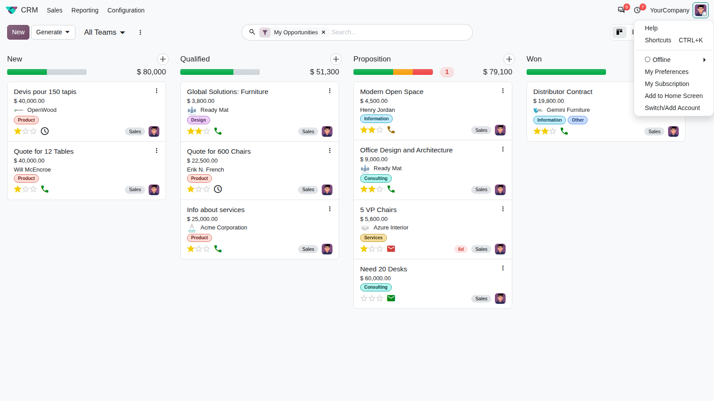

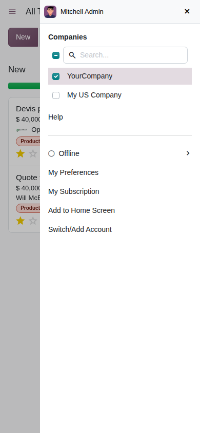

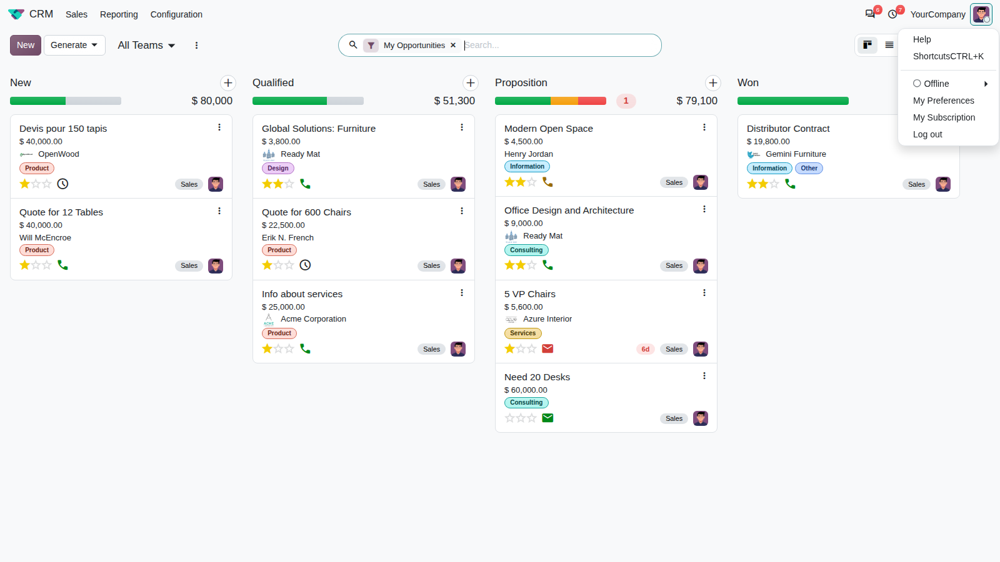

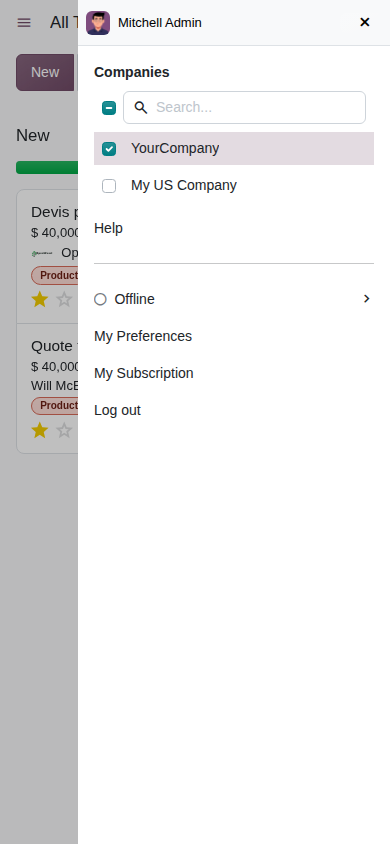

**Switch/Add Account** opens the account switcher of the app. The page itself
does not log out and does not change.

### Add to Home Screen

Open an application and choose **Add to Home Screen**. The app offers to put a
shortcut to that screen, with the application's icon, on your phone. Nothing
is shown on the page.

Two cases cannot be pinned, and a short notice tells you why:

- On the home menu there is no application to pin: "Open an app first: the main
  menu can't be pinned to your home screen."
- An application whose icon is not a picture (a font glyph, or none): "This app
  has no image icon, so it can't be pinned to your home screen."

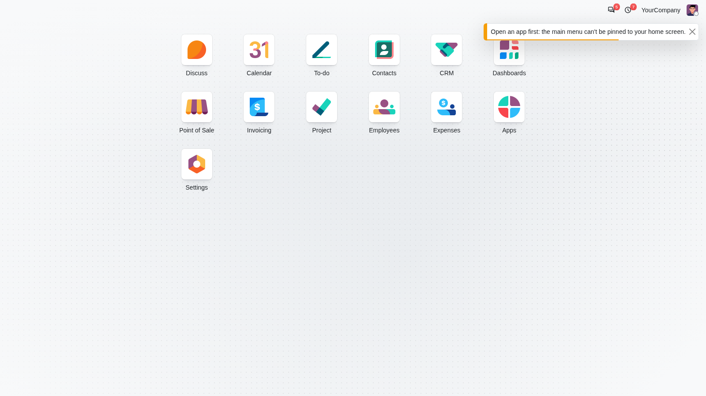

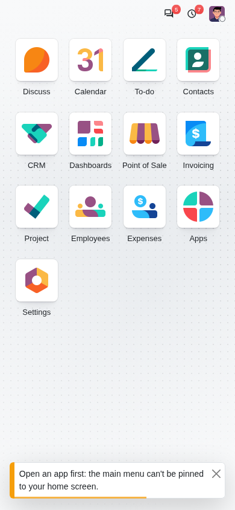

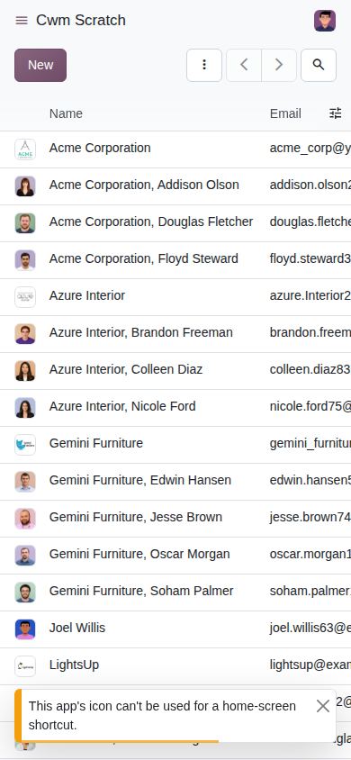

## Things the app keeps in step

- **The application list.** Each time the home menu is shown, the app receives
  the applications in the order of your tiles (name, address and picture icon).
  It receives the list again only when it has changed, for example after you
  reorder the tiles. The app can use it for its own shortcuts.
- **Your account details.** When the page loads, and after you save **My
  Preferences**, the app receives your picture, name, login, user id and
  database. After a save it gets the values you just saved. With the Employees
  application the same happens on the Employees preferences form, before the
  page reloads for a language change. If the app does not answer, or your
  picture cannot be read, nothing is shown to you and the dialog closes as
  usual. Inside the iOS app the page does not wait for an answer.

## Downloads, history, the back button and errors

- **Downloads.** Reports, exports and attachments that the page would
  download are handed to the app, which downloads them with its own download
  manager. The page does not show progress. A file that is built inside the
  page itself cannot be handed over; you see the notice "This file is generated
  in the page and can't be saved from inside the mobile app."
- **History moves.** When you go back or forward and the query part of the
  address changed, the app is told the new parameters. Moves the page makes by
  itself (opening a record, switching a view) are not reported.
- **The back button.** While a dialog, popover, bottom sheet or file viewer is
  open, the device's back button closes the topmost one, instead of leaving the
  page. When none is open the app handles back as before.
- **Error reports.** Every error that reaches the web client's error handling
  is also sent to the app. The usual error dialog still appears; the report
  only gives the app something to show in its own logs.

## Shared files

Share a file to the app from another phone application. Where Complete has a
place for it (expenses, bills, leads, tasks and to-dos), the "Create" dialog
opens with the files attached.

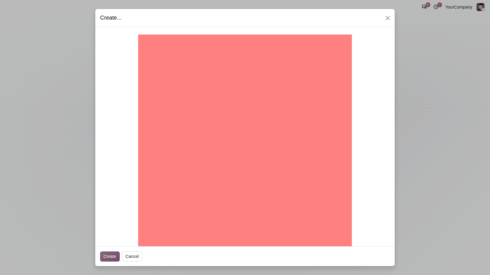

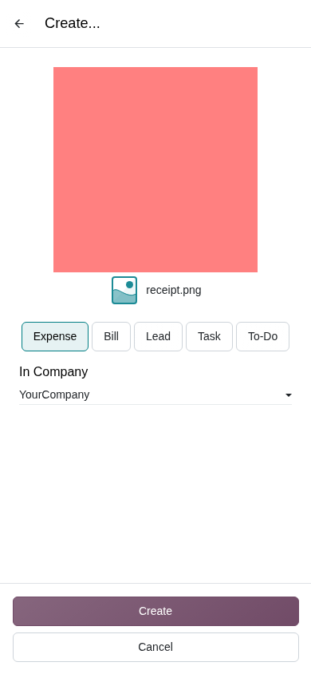

If the app cannot hand over the files, no dialog opens and a notice says "The
files shared with the app could not be loaded." When one file cannot be read the
notice names it: "The shared file "name" could not be loaded from the app."

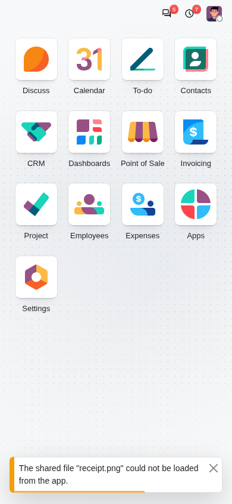

## The application list in the iOS app

Inside the iOS app, on a phone, the home menu shows one full-width row per
application, with the icon on the left and the name next to it, instead of the
grid. The rows have a slightly lighter background than the page, in the light
and in the dark theme. Wider windows keep the grid.

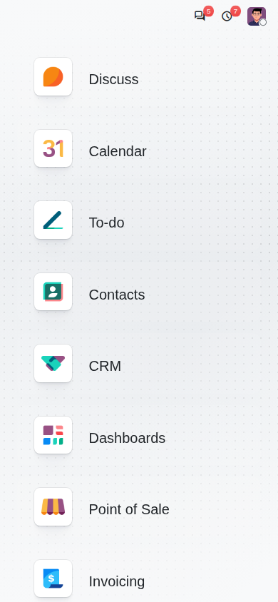

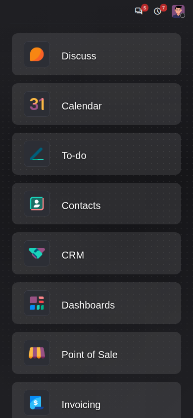

Inside the Android app, and in a browser on a phone, the grid stays, with
the application names kept whole where they fit.

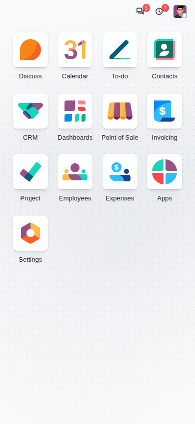

## Readers

Other modules can listen to the hardware readers of the app (contactless or
radio-tag readers) through an event channel of the bridge. This part has no
screen of its own: while something listens, the page asks the app for reads in
the background and passes them on.

## Badge scan with the camera (Point of Sale)

With Point of Sale and Employees installed, the login screen of the point of
sale can read an employee badge with the camera. It works in any browser, inside
the app or not, as long as the browser offers camera access.

### Setting it up

1. In the Point of Sale settings, choose the shop and turn on the employee
   login (the option that lets employees log in to the cash register).
2. In the same place, list the employees allowed to use this shop's cash
   register, under the access level each should have (for example Cashier or
   Manager).
3. On each of those employees (**Employees**, tab **HR Settings**), fill in the
   **Badge ID** with the code printed on the badge.

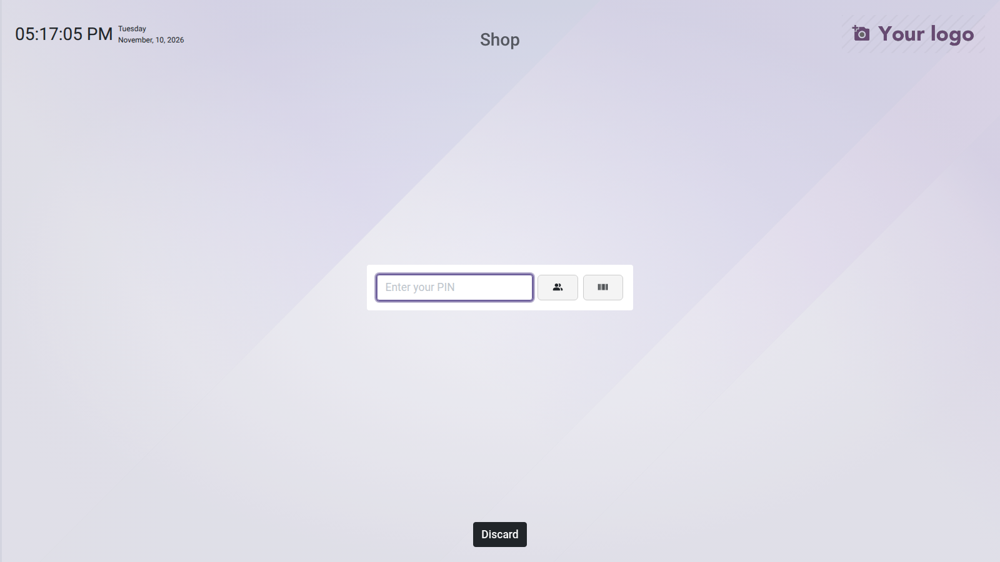

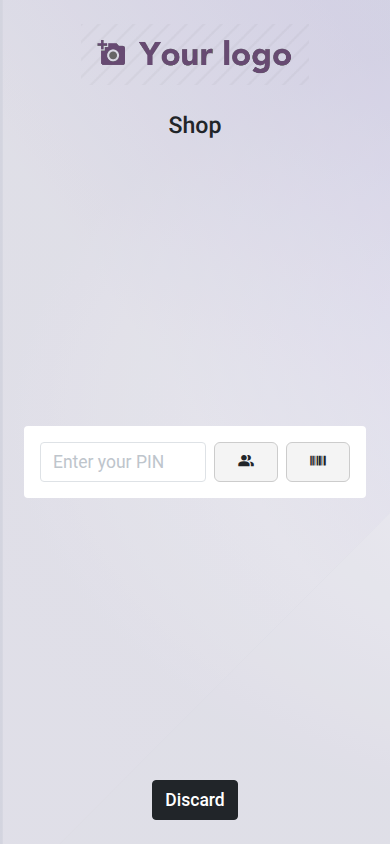

### Scanning

Open the shop. On the PIN step of the login screen, tap the badge button. The
camera (the rear one on a phone) opens in a panel; hold the badge in front of
it.

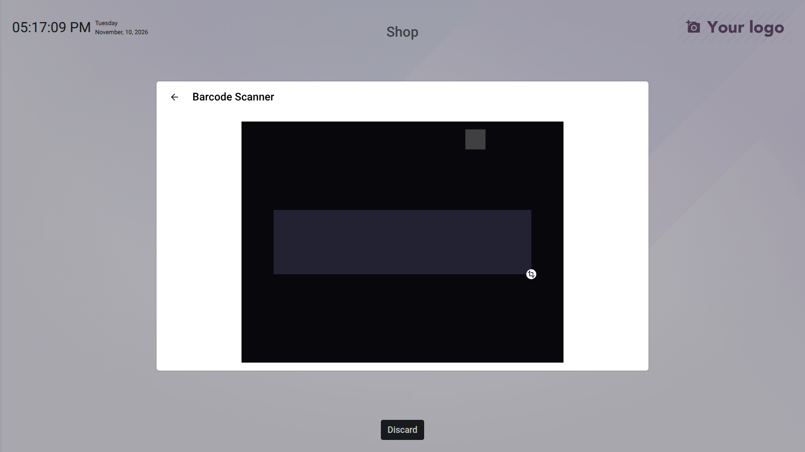

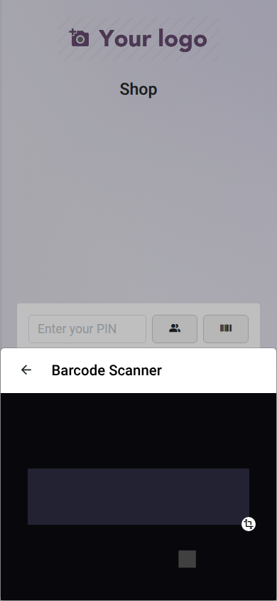

The code is treated exactly as a code from a hardware scanner: the badge of an
allowed employee logs them in (asking for the PIN when the shop requires it),
the phone vibrates briefly where it can, and the point of sale opens.

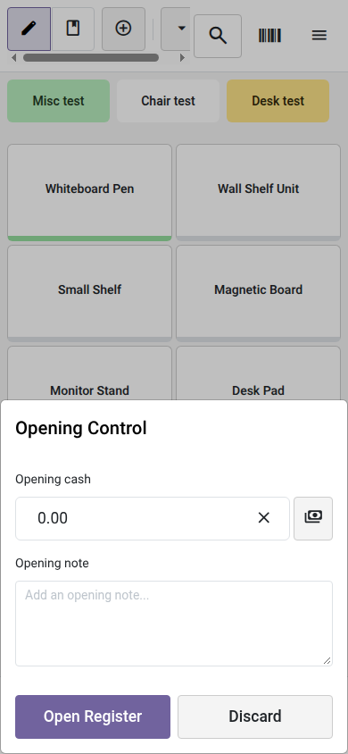

Which browsers work: those that offer camera access, which means a page opened
over HTTPS (or on the same machine as `localhost`) in a browser with camera
support. On a page opened over plain HTTP from another computer the badge
button does nothing.

If the camera is refused or missing, the scanner panel itself says so, and you
can type the PIN or pick the employee as usual.

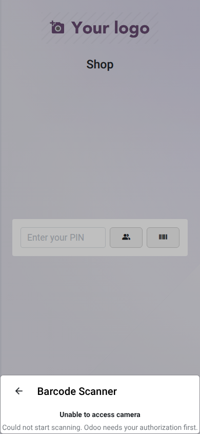

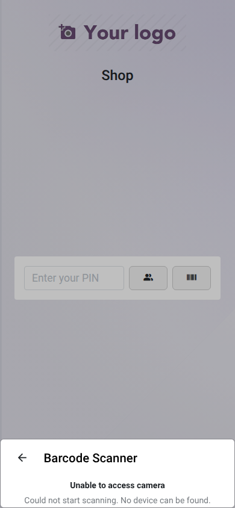

If the scan gives an empty code, the panel closes and a notice asks "No code was
read. Please scan the badge again." The PIN step stays open. A badge that belongs
to no allowed employee is handled by the point of sale as for a hardware scanner.

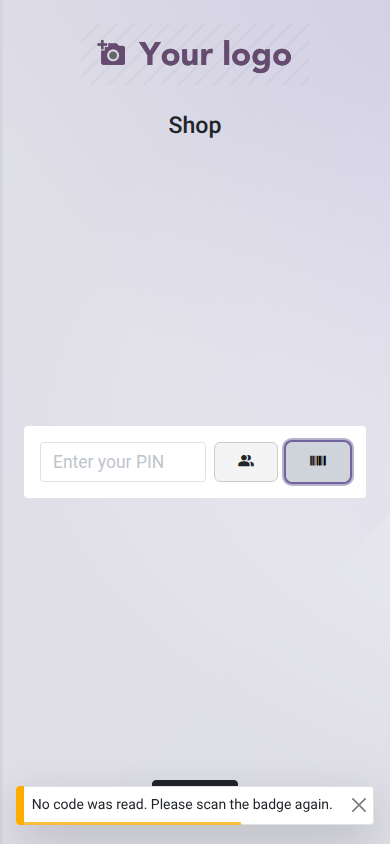
