# Time Off Timeline

The module `hr_holidays_gantt` puts the time off of your employees on a time
grid: one row per employee, one pill per request. It is the bridge between the
Time Off application and the [Gantt View](gantt_view.md), and it builds on the
employee rows of the [Employees Timeline](employee_gantt.md). The grid, its
ranges, the control bar and the phone layout are those of the Gantt view; this
page tells what the time-off views add.

The module installs by itself when Time Off, Import and the Employees timeline
module are installed. It is not an application and adds no menu, group or
setting. Uninstalling it gives Time Off its old screens back (see
[Uninstalling](#uninstalling)).

Technical reference:
[`addons/hr_holidays_gantt/README.rst`](../../addons/hr_holidays_gantt/README.rst).


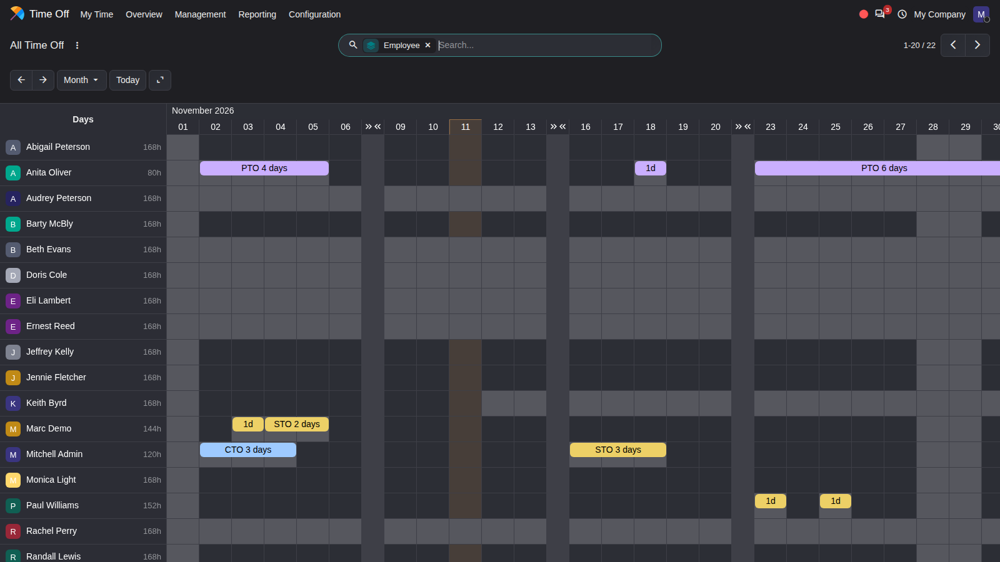

## In this release: opening and changing leaves

This release makes the Gantt views **act**. A leave is opened, changed, approved,
refused and deleted on its pill, and in the leave view it is also moved, resized,
copied and split:

- a click or a tap on a pill opens the **leave popover** (see
  [The leave popover](#the-leave-popover)); its buttons edit, save, approve,
  refuse, discard and delete;
- a double click (two taps on a phone) opens the request's record dialog;
- a drag moves the pill, its ends resize it, and Ctrl with a drag copies it, in
  the leave view (see [Moving, resizing and copying](#moving-resizing-and-copying));
- an Officer or an Administrator splits a request in two at a day border, with
  **Undo** (see [The split tool](#the-split-tool));
- on a phone the popover is the Gantt view's bottom sheet (see
  [On the phone](#on-the-phone)).

**Not yet:** creating a leave from the cells. The selection of several cells, its
buttons and the creation form follow in a later release. Until then a click, a
double click or a tap on an empty cell, and a drag or a Ctrl-click across cells,
**do nothing**: nothing is selected, nothing opens, nothing is written, and the
pointer keeps its default shape over an empty cell. Requests are still created in
the other views of Time Off (the list, the kanban, the calendar, the request form
and the Community dashboard).

What works in the views besides: the search and its filters, the grouping, the
range menu, the previous, next and Today buttons, the pager, the folding of
columns, the click on an avatar (the employee card), the click on a row header (it
scrolls to the first pill of the row) and the gear menu.

## Two views, and who reaches which

The module adds two Gantt views.

- **The leave view** shows time off requests, one pill per request.
- **The report view** shows the Community's time-off report, one pill per
  request too, and reads the same for every employee. It cannot write anything.

The menu **Time Off > Overview** chooses by role each time you click it.

| Your role | Overview opens | Also reached |
|---|---|---|
| Officer (Manage all requests) or Administrator | the leave view | Management > Time Off, with the Gantt button last in its switcher |
| Employee, Approver, or Manager of an employee | the report view, with Calendar as its second view | Approvers also have Management > Time Off, in which they see the requests they may read |
| No Time Off group | the Community's access error | Time Off is not in their home menu |

For an Officer or Administrator the Overview opens the leave view alone, with
the title "All Time Off", the grouping by employee as its only facet and no
other search default. Requests that are Refused or Cancelled are not listed
there. The page's address names the management action, and **a reload keeps this
reduced view**: the leave view alone, the title "All Time Off", the Employee
grouping as the only facet (no Waiting For Me) and the same rows, with no view
switcher. Management > Time Off is the Community list action with a Gantt view
added after its other views (List stays the default); its Gantt view lists every
state, and starts with the action's own filters (Waiting For Me and the current
year).

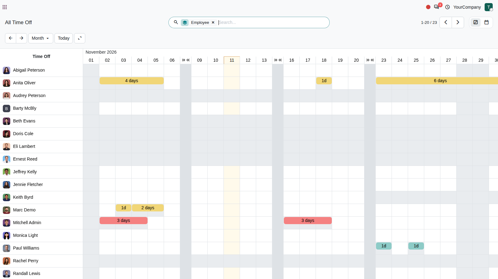

The report view and the leave view differ in a few more ways.

| | Leave view | Report view |
|---|---|---|
| Header over the row names | Days | Time Off |
| Ranges | Week, Month, Quarter, Custom | Day, Week, Month, Quarter, Year, Custom |
| Pill colour | the colour of the leave type | the colour of the employee |
| Marks on pills | striped with an info mark for requests waiting for approval; a danger mark for Refused; a secondary mark for Cancelled | none |
| Hours label | yes, for internal users | none |
| Gear: Import and Export | yes, on a wide screen | none |
| Sample data | none | at the view's first load, when no request lies on the first page in the opening period |

The report view's Week range works by half days, so a leave of half a day is
drawn on half of its day there, and the lunch rounding of the attendance views
applies. When you have 50 employees or more to read, the report also opens with
the filter **My Team** (if you manage someone) or **My Department**, so that the
first page is not the whole company.

## Ranges

Like the attendance views, each named range shows **one period**: one week
(from the first day of your language's week), one calendar month, one quarter.
Previous and next move by one period, and Today brings back the period of
today. The leave view opens on the Month range. When today lies inside the
period on screen, choosing another range builds it around today. The custom
range works as in the Gantt view. The columns of the leave view are whole days;
no pill is rounded.


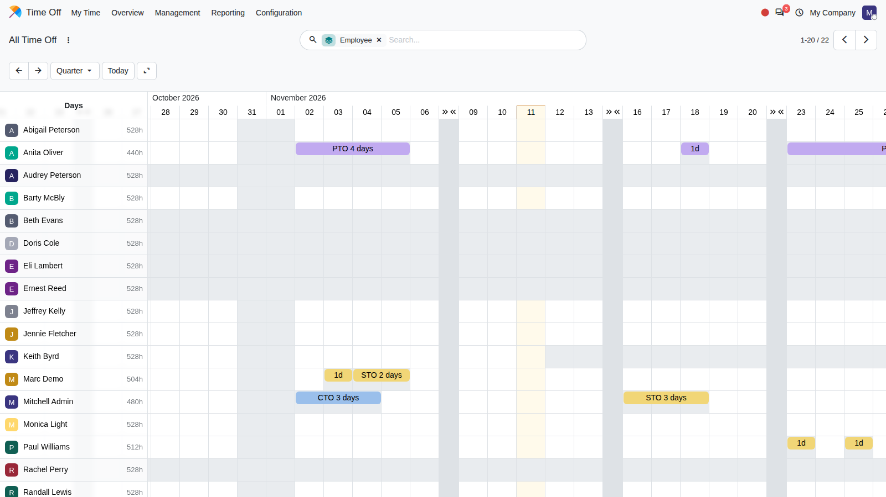

## The pills

A pill runs from the first to the last day of the request.

| Who reads | On the Month and Quarter ranges, a request of one day or less | Otherwise (for example on the Week range) |
|---|---|---|
| Officer, Administrator | the duration alone: "1d", "0.5d", or "04:00" for a request in hours | the type's code (its name when it has no code), a space and the duration: "PTO 4 days", "TH 04:00" |
| Anyone else | the duration alone | the duration alone: "4 days", "1 day" |

A request of one day or less therefore reads its duration alone on the Month
and Quarter ranges, **whatever the search holds**. This includes the searches
on the request itself, as the default filters of Management > Time Off (Waiting
For Me, a state, a type, a date). The view tells the server which range it shows
with every load, with or without such a condition, so a one-day request does not
change its text when you add a filter.

Without the grouping by employee (you removed it, or you chose another
grouping), the pill has the Community's long text instead: the employee, the type
and the dates; no avatar, label or unavailable cell is then drawn.

The colour of the leave view's pill is that of the leave type; the text is black.
The states that are shown:

| State | Overview (leave view) | Management > Time Off | Report view |
|---|---|---|---|
| To Approve, Second Approval | shown, striped, info mark | shown, striped, info mark | shown, plain |
| Approved | shown | shown | shown |
| Refused | not shown | shown, danger mark | not shown |
| Cancelled | not shown | shown, secondary mark | not shown |


## The rows

Which employees get a row depends on what you search.

- **A search on employees.** With the grouping by employee alone and a search
  that concerns only the employee (the name, the department, the manager, the
  schedule, My Team, My Department, or no search at all), **every matching
  employee has a row**, also one with no leave in the period. The rows are
  ordered by name, 20 to a page, and the pager counts employees ("1-20 / 22").
- **A search on the requests.** With a condition on the request itself (a state
  filter, Waiting For Me, Missing Document, a type, a date), or with another
  grouping, or several, **only the employees who have matching requests** get
  rows. The same is true in the report view for a search on the report's
  department, which belongs to the request, and not to the employee. A search
  on the report's job position or company is a search on the employee and keeps
  the empty rows.
- Only active employees have rows.
- What you may see: every employee with a Time Off group may read the list of
  employees, so the report view shows all of them. In Management > Time Off an
  Approver gets rows only for the employees whose requests the Community lets
  them read (the ones they approve, and themselves).

Grouping by something other than the employee alone (the type, the status)
gives plain rows with no avatar; grouping by the employee first and something
else after keeps the avatars. The search menu of the leave view does not offer
the Community's grouping by Date, because a Gantt view cannot be grouped by the
date it is laid out on.


## Unavailable days and flexible schedules

Days on which an employee is not available are grey, as in the attendance views.
The module takes them from the Community's own computation, which comprises:

- the days outside the employee's contracts (an employee with no contract is
  grey on the whole period);
- the days off and hours off of the working schedule;
- the company-wide leaves;
- the employee's **approved** leaves. A request that waits for approval, or that
  is refused, makes nothing grey.

Both leave views draw whole days: a day is grey only when the whole day is
unavailable, so a half day or a few hours of leave grey nothing there. The
report view does the same on its Month and Quarter ranges, and shows half days
on its Week range.

**Flexible schedules.** An employee whose working schedule has no fixed hours
has no grey day of their own, weekends included, but an approved leave still
greys what it covers. The module sets that by the request's unit, in the
employee's time zone:

- a leave in **half days** covers the morning or afternoon it names, up to the
  end of the last half day;
- a leave in **hours** covers the whole days when its hours equal the schedule's
  hours per day, the morning or the afternoon when they equal half of it, and
  otherwise the hours from its start to its end;
- a leave in **days** covers whole days.

This applies in every view of employees, the attendance views included (see
[What Time Off changes in the attendance views](attendance_gantt.md#what-time-off-changes-in-the-attendance-views)).

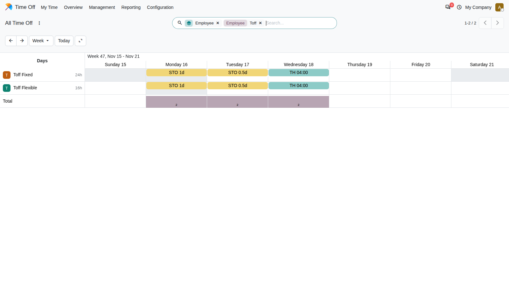

When every employee of the page is grey for a whole column and no pill touches
it (the weekends, usually), the run of columns folds, and the folding is worked
out at each load, as in the attendance views.

## The hours label

Next to each employee's name the leave view shows a short label, such as "168h".
It is in the muted colour, has no bar under it and no tooltip, and shows for
internal users only. The report view has none. The number is rounded to the
nearest whole hour, and it counts the period on screen (the days of the week,
month or quarter).

**The label has two meanings, depending on the employee's schedule.**

| Schedule | The label shows | Example, November, standard schedule |
|---|---|---|
| **Fixed** (hours on set days) | the **hours to work in the period, less leave**: the schedule's working hours, less validated leaves and company-wide leaves | 168h for an employee with no leave (21 working days of 8 hours); 80h for one who is out for 11 days |
| **Flexible** (no fixed hours, or hours per week without set days) | the **hours of approved leave** that overlap the period | 16h for two approved days of 8 hours |

The meaning follows the employee's current schedule. For a flexible schedule a
leave that crosses the edge of the period counts with all its hours, not just the
part inside. A request that waits for approval or is refused counts in neither
case. The two meanings are intended: a flexible schedule has no hours to work, so
the label tells how much leave the employee has taken instead. Read a row's label
with the employee's schedule in mind.

The period is the same calendar days for every employee, read in the browser's
time zone, whatever the time zone of the employee.


## The employee card

A click on an avatar (on a screen 768 px wide or more) opens the card of the
Community's employee, with a **leave band** under its body, and without the
card's footer. Nothing opens on a phone. The card closes on a click elsewhere
or Escape. It is the same in both views.


The band has:

- **The schedule button**, for everyone: a calendar icon and the hours per week
  of the employee's schedule ("40 h / Week"), or "Time Off" when the schedule has
  no hours. It has the focus when the card opens. A click opens the employee's
  time-off dashboard, on the Week range of the view if it shows a week, on the
  Month range if it shows a month, and on the year for every other range.
- **The leave lines**, for Employees officers only: one line for each leave type
  that is valid in the company's country (or has no country) and for which the
  employee has time allocated or taken. A line reads the type, the time taken in
  bold and, for a type that needs an allocation, the time left in muted text
  ("Legal leave employee: 11 days / 9 days"). The amounts are the Community's,
  added up over the employee's allocations of the type and computed with your own
  rights; they are in days or in hours by the type's unit of measure. A type that
  needs no allocation shows the time taken alone, with no slash. The lines are
  ordered by time left, the smallest first; types with the same time left keep
  the Community's order.
- **A pencil**, for Employees officers only: it asks for a date and creates a
  new version of the employee at that date, then opens the employee on it.
  Closing the date picker without a date does nothing.

An employee who is not an officer sees the band with the schedule button alone.

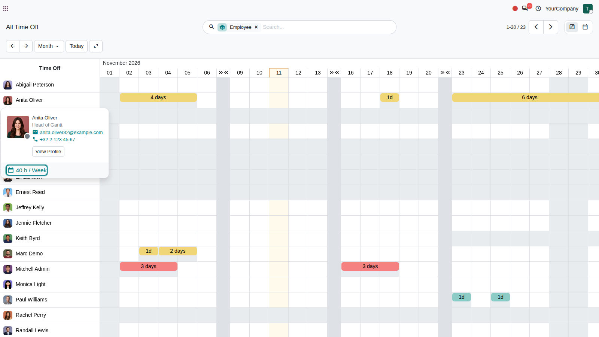

**When the employee is away.** While the employee is inside an **Approved** leave at
the server's real time, the card shows under the name the Community's line that says
when they are back ("back on" and the next working day). It shows for every role that
sees the card. The Community computes the date from the server's clock, not from the
period the view shows, so it depends on the day the server runs, not on the day the
browser shows.

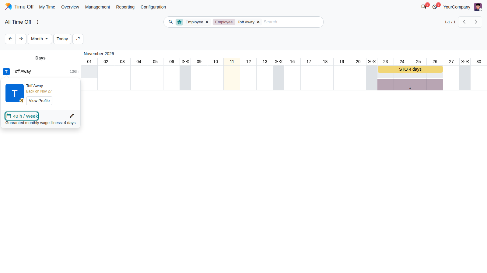

## Import and Export in the gear

On a screen 768 px wide or more, the gear beside the title of the leave view
offers two entries. They are not there in the report view, and not on a phone.

- **Import** opens the Community's import screen for time off requests. Its
  breadcrumb comes back to the view.
- **Export**, for users of the Community's export group, downloads at once, with
  no dialog, a spreadsheet (xlsx) of the requests of the current search (the
  action's filters included), without grouping, the latest start first, with one
  header line and five columns in this order: the request's external identifier
  (made by the export for a request that has none), the employee's name, the
  type's external identifier, the start date and the end date. The header line
  reads "External ID (update only)", "Employee", "Time Type/External ID",
  "Request Start Date" and "Request End Date" (translatable, in the user's
  language). The export group
  is not implied by any Time Off group: an Officer or Administrator who is not in
  it sees Import alone.


An Approver in Management > Time Off, who is not in the export group, gets Import
alone.

## When nothing shows

When no employee matches the search, both views show **one empty row with no
name** and the total row, without helper text and without a layer, on a phone
too. A row of an employee who has no leave is a normal row. With requests
elsewhere but none in the period, the rows are drawn as usual. The report's
sample data is the Gantt view's own sample mode: it shows only at the view's
first load, when none of the employees of the first page has a request in the
opening period under the search (a request of an employee on a later page, or
outside the period, does not prevent it), for every role. The view leaves it at
the first later load that holds a request, and never comes back to it: a later
load without a request shows the real rows, empty, with no sample and no helper.


## The control bar and the phone

On a wide screen the control bar of the leave view is a fixed 58 px tall, with
its controls 4.5 px below its top and the grid right under it.

Below the small-screen breakpoint both views take the phone layout of the Gantt
view: a narrow row header with the avatar, the cut name and the label, and the
search facets behind the search button. There is no card and no gear entry.
The leave view's control bar follows the phone layout of the Gantt view as the
report view's does: two lines with a separator between them, and the grid
**below** the bar, so no control lies over the grid. The separator is the text
colour at a quarter opacity over the transparent bar, a faint grey line (about
`rgb(194, 195, 197)` in light and `rgb(82, 82, 85)` in dark on the page's
background). It is the Gantt view's own phone line, the same as the attendance views'.

The phone's grid opens scrolled sideways so that today lies at the middle of the
visible part of the grid (the part right of the row header column). On the Month
range today's column starts at that middle; choosing the Week range from there
keeps today near it, and Next keeps the scroll position.


## Time zones

- Today, the days of the period and the drawing of pills follow the **browser's**
  time zone.
- The hours of an employee's schedule, which the grey cells show, are read in
  the employee's own time zone and placed at the same clock time in the
  browser's zone, so a working day of 8 to 17 greys no cell of the day whatever
  the zone of the browser.
- The label counts the same calendar days for every employee (see above).
- The leave intervals of flexible schedules follow the employee's time zone.
- The dates in the long pill text are those of the request.

The browser sends its zone with each load of the data, and with the writes of a
move, a resize, a copy and the popover's buttons.

## The leave popover

A click on a pill (a tap on a touch screen) opens the popover of its request,
after a short delay of 200 ms, in both views. It sits against the pill, under it
when the window has room, otherwise over it, otherwise beside it. One popover is
open at a time: a click on another pill replaces it, and a click on the pill whose
popover is open leaves it as it is.

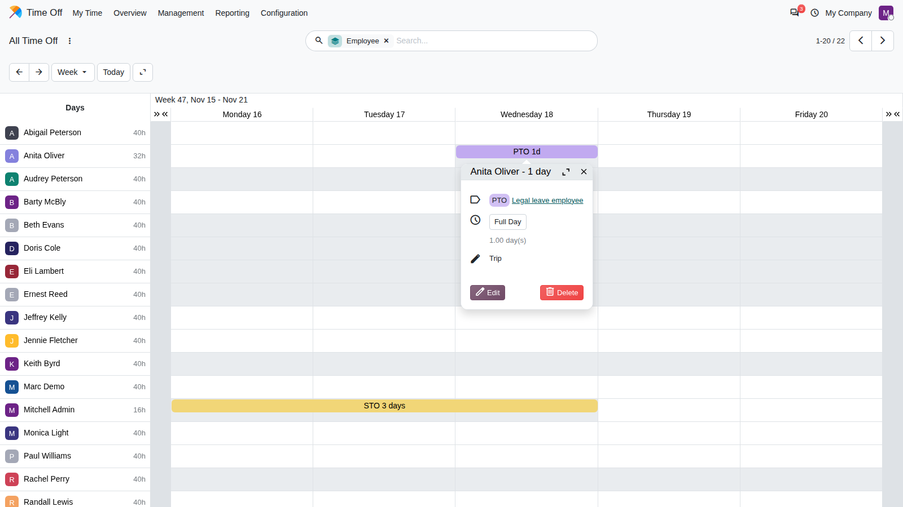

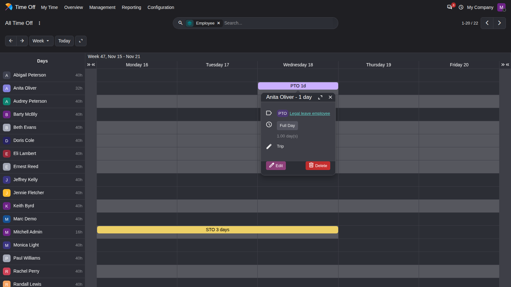

**Closing.** The close icon, a click anywhere outside it (the grid, the control bar
and the control panel), and Escape close it. A pending change is **dropped without
a question** when the popover closes: save it or discard it with the footer
first. Closing alone does not reload the view. A press that starts a move, a resize
or a copy closes the popover too. When the pill of an open popover leaves the view
(a request refused in the Overview), the popover stays where the pill was until you
close it; scrolling the grid does not carry it to another pill. A reload of the
page brings the view back, without the popover.

**The header** holds the employee's name, a hyphen and the request's duration, with
the expand and the close icons at its right. It is grey for every request and takes
no colour of the type.

**The body** has one line per field, each with an icon (its tooltip names the
field):

- **The type**: a badge with the type's code in its colour (an empty badge, still in
  the type's colour, when the type has no code), then its name. In read
  mode the name links to the type. When the popover is editable it is a field whose
  drop-down offers the types the employee may take and Time Off lets people choose.
- **The dates**, as the type's unit asks:
  - *half day*, a request of several days: the half of the first day and the half of
    the last, "Morning → Afternoon";
  - *half day*, a request of one day: the choice Full Day, Morning or Afternoon;
  - *hours*: the number of hours written "4h" ("4h30" with minutes), with a small
    question mark that explains the field;
  - *days*: the icon alone.
- **The number of days**, in muted text ("1.00 day(s)"), for every request that is
  not counted in hours and is not a half day of a half-day type.
- **The allocation warning**, in a red box under the dates, when the Community finds
  that the balance does not cover the request.
- **The description**. A user who is neither an Officer, nor the employee of the
  request, nor its approver sees it masked, as the Community masks it.

The popover is **editable** in the leave view for a request To Approve, and
read-only in every other case. The report view's popover is never editable. A
change is not written until Save (or Approve or Refuse) is pressed.

When the type is changed in an editable popover, the Community's own rules
recompute the days and the choices offered.

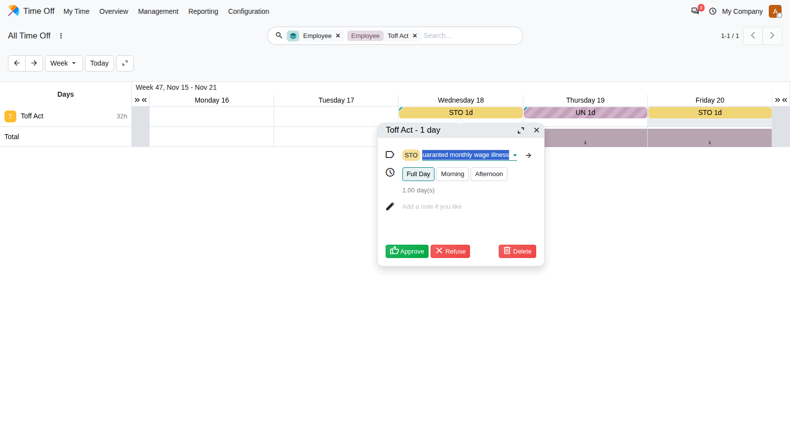

### The buttons

The footer shows, from the left, the buttons that the request's state and the
Community's rules for the reading user allow. A button that does not apply is
**absent**, not disabled.

| Button | Shown when | What it does |
|---|---|---|
| Edit | the user may send the request back to approval and the request is not To Approve | sends it back to approval; the popover becomes editable and the pill gets its stripes (an Approved request stops greying its days) |
| Save | there is a pending change and the user may neither approve nor refuse | writes the change |
| Approve | the request is To Approve and the user may approve it | writes a pending change first, then approves; Officers and Administrators approve to Approved at once, an approver of a type that needs two approvals gives the first one (Second Approval) |
| Refuse | the request is To Approve and the user may refuse it | refuses it |
| Discard | there is a pending change | drops it, the stored values come back |
| Delete | no pending change (every state, every role that opens the popover) | deletes the request |

There is **no Approve at Second Approval**: an Officer or an Administrator gives the
final approval by pressing Edit, then Approve. Delete is always shown; the
Community decides whether it accepts (see [Who may do what](#who-may-do-what)), and
when it refuses, its error dialog shows over the popover, which stays open and
nothing changes. Every button that writes reloads the view, and the popover stays
open on its request.

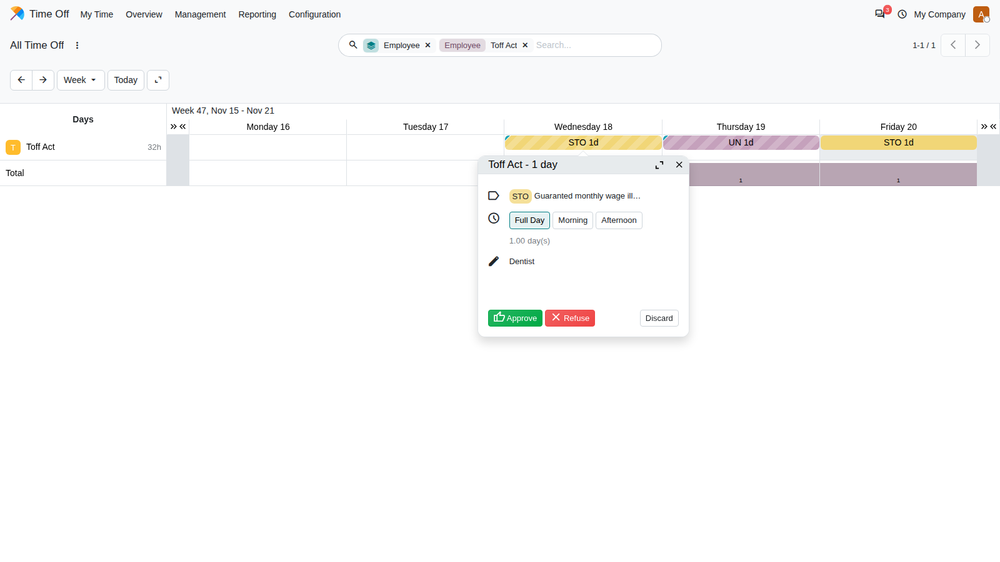

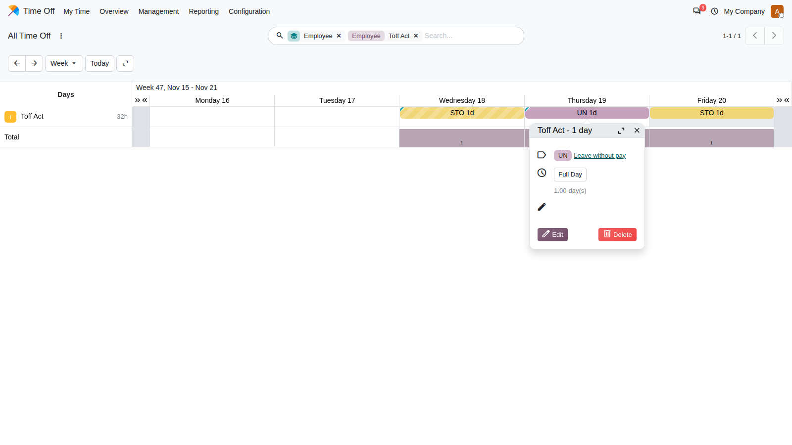

### Expand, the dialog and the report view

The expand icon opens the request's Community form in the current window, with the
breadcrumb "All Time Off", which leads back to the same Gantt view in its state
(range and search). The browser's **Back** button goes to the list of Management >
Time Off instead: that is the web client's own history.

A **double click** on a pill (two clicks within 200 ms on the same pill) opens the
request's record dialog instead of the popover; Escape closes it as it does in the
other Gantt views.

The **report view's popover** has the same frame. Its body is the report's form
(employee, status, dates, duration), always read-only, and its footer holds
**Delete** alone for every role: it is how an Employee removes their own pending
request from the Overview. The Community protects every other request, so
deleting another person's request shows its access error.

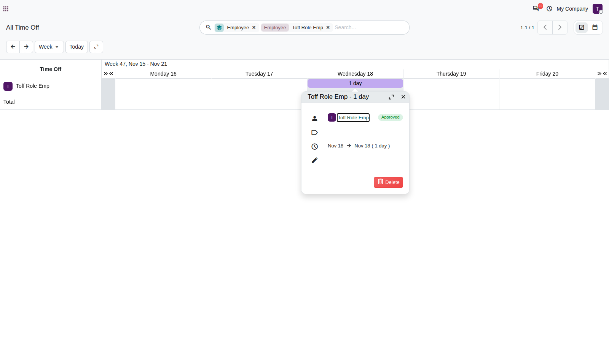

### Who may do what

The Community's groups and record rules decide; the module adds no right. "Own"
means the request of the user's own employee. The table is what the Community
answers with the prepared users of [Verifying with demo data](#verifying-with-demo-data).

| Role | Sees in the leave view | Popover | Move, resize, copy | Split | Delete accepted |
|---|---|---|---|---|---|
| Employee, Manager | own requests | To Approve: editable, Delete; every other state: read-only, Delete | own To Approve | no | own To Approve and Second Approval, starting on or after today (the server's day) |
| Approver | own and their employees' requests | another employee's To Approve: editable, Approve and Refuse for a type approved by the manager or twice, Delete; read-only in other states | their employees' and own To Approve | no | as Employee, **own** requests only |
| Officer | every request | To Approve: editable, Approve, Refuse, Delete; Second Approval, Approved, Refused: read-only, Edit, Delete; Cancelled: read-only, Delete | To Approve, Refused, Cancelled | yes | To Approve and Cancelled |
| Administrator | every request | as Officer | as Officer | yes | every state |

An Employee, a Manager or an Approver cannot delete their own Approved, Refused or
Cancelled request: the Community answers that they may not delete such records. A
request that starts before today can be deleted only from the Officer role up. The
server's day is the UTC date of the server's clock, so around midnight it can differ
from the day of the browser. In the report view the rows of the table hold for
**Delete** only; nothing else is writable there.

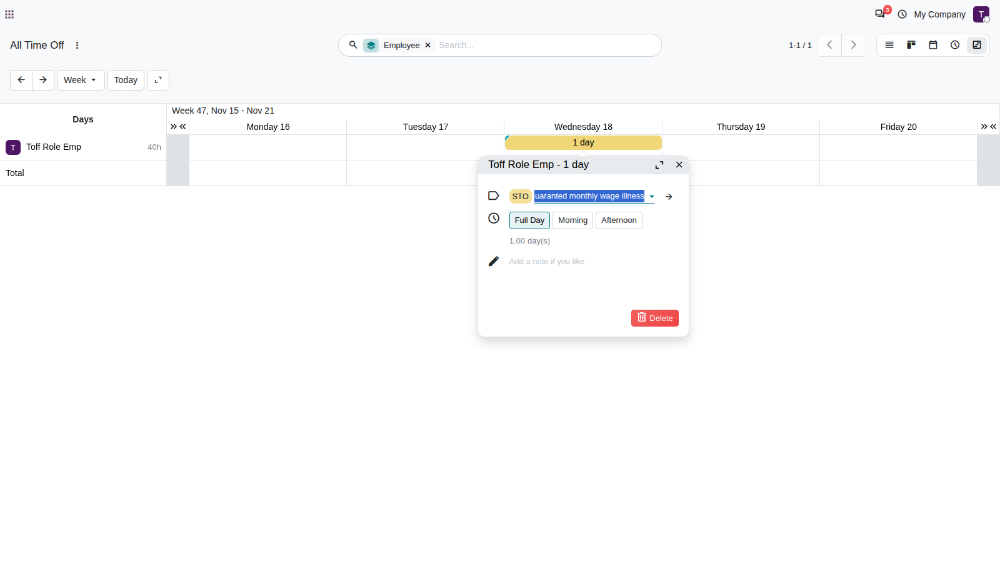

## Moving, resizing and copying

In the **leave view** the pills of the requests To Approve, Refused and Cancelled
move by a drag, resize by their ends and copy with Ctrl; the pointer shows the
hand, the resize arrows and the copy shape. The rules are those of the Gantt view
([Gantt View](gantt_view.md)), at the precision of whole days.

- A move or resize shifts the request's start and end by whole days. The Community
  keeps a half day a half day and the hours of an hour request, and recomputes the
  days, the hours and the balance of the allocation. A request To Approve stays To
  Approve; a move never approves. A drop on another employee's row moves the request
  to that employee.
- The Community's checks apply and show its own error when they refuse: an overlap
  with another request of the employee, a balance that no longer covers the days,
  days without working time, a request the user may not write. Nothing is written and
  the pill returns to its day.
- A notification offers **Undo**, which writes the former dates (and employee) back
  through the Community, with the same checks.
- **Second Approval and Approved pills are locked** for every user, an Administrator
  too: pressing or dragging one lifts it in place with the lock icon and the
  not-allowed pointer, writes nothing and opens nothing, and it shows no resize
  handles. Send the request back to approval with Edit first. A click, a double click
  and the split tool still work on it. A pill cut by the edge of the period is
  locked as well, and has no handle at the cut end.
- **Copy** (Ctrl with a drag) is refused by the Community for every request except a
  Refused or a Cancelled one (the Community's error shows and nothing is created).
  The copy of such a request is a new request on the new days; it is created as the
  Community creates a new request for the user, which is Approved at once for an
  Officer or Administrator and a type that Officers approve.
- The days are those of the **browser's** time zone: a request moved by one day lands
  on the next day of the browser's calendar, whatever the zone of the user's
  preferences.
- In the report view every pill is locked and nothing moves.

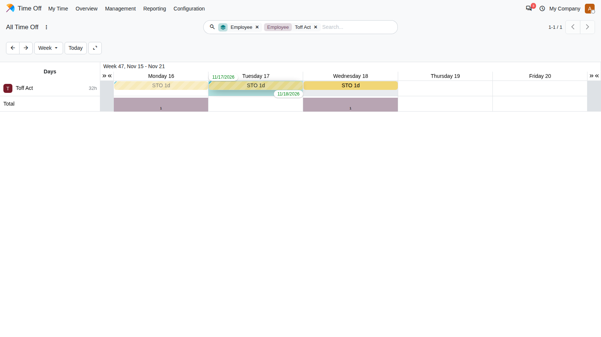

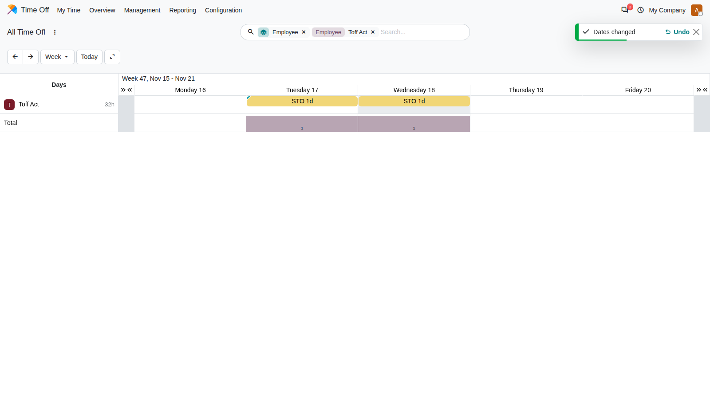

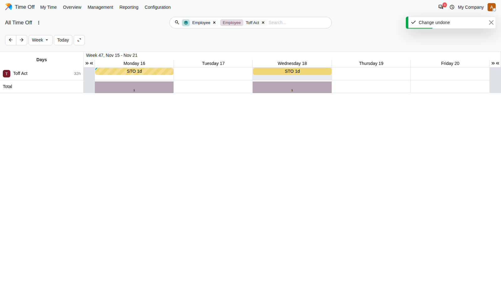

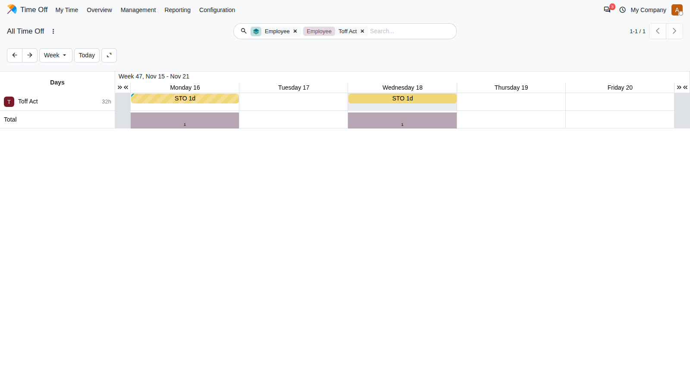

## On the phone

Below the small-screen breakpoint a tap on a pill opens the popover as the Gantt
view's **bottom sheet**: the same header, body and footer, with the fields stacked
and the close icon in the header. It closes with the close icon, a tap outside it,
the device's Back and Escape, and drops a pending change as the desktop popover
does. Two taps on one pill within 200 ms open the record dialog. A hold of 300 ms
starts a move or a resize, as in the Gantt view; Second Approval and Approved pills
are locked as on the desktop. There is **no split tool** on a phone.

The stacked fields are boxes of their own on one background, the sheet's: a
bordered box for each label icon and each value, 16 px apart, with 16 px of space
at the sides of the form. A value box is light grey while the request is read-only
and takes the view's background while it can be edited; the box that holds the
focus (the type's, when the popover opens) has its border in the colour of a
focused input.

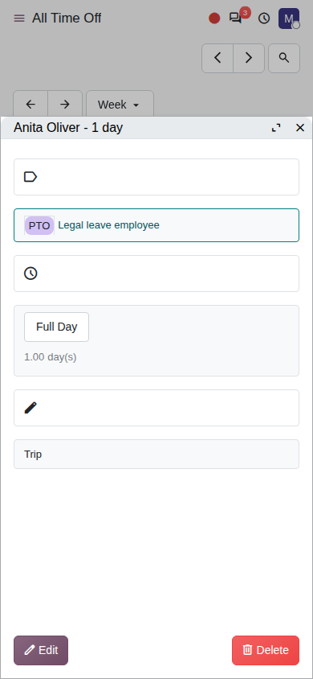

## The split tool

In the leave view, for a user of the Time Off group "Officer: Manage all requests"
or above, on the desktop: with the pointer within 8 px of a day border inside a
pill, a dashed line and scissors show on that border, and a click there (no move)
splits the request at the first day after the border, read in the browser's zone (a
click elsewhere on the pill opens the popover as before). The border at a pill's
first or last edge, a one-day pill, a border beside a folded column and the report
view show no tool; neither does a phone or an Employee, a Manager or an Approver.
The tool's area is 16 px wide and as tall as the pill's whole box, its 1 px inset
included. Where a day column is narrower than 16 px the column's end border is
taken. In a right-to-left language the line still lies on the border that is split.

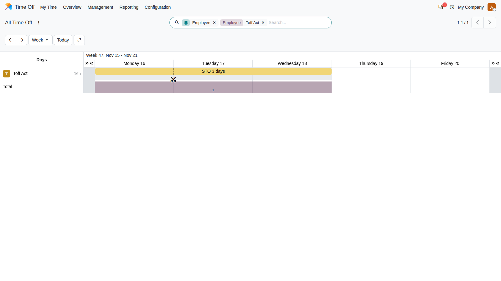

The split calls `hhg_cut_request`. The request keeps its days before the border; a
new request **in the same state**, with the same name and type, covers the rest. A
notification says that the time off was divided in two and offers **Undo**; a later
split closes the earlier notification. While the call runs the tool is off; it is back
once the call has answered, also after the Community's error.


- **Approved requests keep a leave for each part.** Each part has its own leave over
  exactly its days, so refusing, deleting or sending back one part frees only its
  days. A request at Second Approval has no leave yet; neither part gets one until
  its own final approval. The parts of an hour request get leaves over their own
  hours.
- **Undo** (`hhg_rejoin_request`) joins the parts again: one request with one leave
  over all its days, and a notification that says so. It removes **only the parts that
  this split made**. It works for everyone who may split, an Officer's Undo of an
  Approved split included. When the request is gone meanwhile, a notification says the
  split could not be undone.


The code is in `time_off_split_tool.js` (the border math), `time_off_editor.js` (the
two calls) and the renderer; see [For developers](#for-developers).

## What Time Off changes in the attendance views

With this module and Time Off installed, the attendance views change in three
places; they are described in
[Attendances Timeline](attendance_gantt.md#what-time-off-changes-in-the-attendance-views).

## Uninstalling

Uninstalling the module gives the Overview menu the Community's time-off
dashboard action, and gives that action and Management > Time Off their
Community view modes (calendar for the first; list, kanban, form, calendar and
activity for the second). Uninstalling the Employees timeline module uninstalls
this one too.

**Checking an uninstall.** The container's start-up script adds the database
connection to the command line, which the `module` command does not take, so give
the connection through the `PG*` variables of the shell the verifier runs. With
`docker/.env` created, in a shell that has its `POSTGRES_USER` and
`POSTGRES_PASSWORD` as `USER` and `PASSWORD`, on a database `DB` where the module is installed:

```
podman compose --env-file docker/versions.env --env-file docker/.env -f docker/compose.yaml run --rm -e PGHOST=db -e PGUSER=USER -e PGPASSWORD=PASSWORD odoo odoo module uninstall -d DB hr_holidays_gantt
```

Then check, as the administrator, that:

- Time Off > Overview opens the Community's dashboard action
  (`hr_holidays.action_hr_holidays_dashboard`) and the menu works;
- that dashboard action has the view mode `calendar` alone;
- Management > Time Off (`hr_holidays.hr_leave_action_action_approve_department`)
  has the view modes `list,kanban,form,calendar,activity`, with no Gantt view.

## Who sees what

The module adds no group, access right or record rule. The Community's Time Off
groups decide. Where a role may not act, an element is **absent**, not
disabled.

| | No role | Employee, Manager | Approver | Officer, Admin |
|---|---|---|---|---|
| Overview | access error | report view | report view | leave view |
| Management > Time Off | not there | not there | yes | yes |
| Pill text on Month and Quarter, one day or less | n/a | duration | duration | duration |
| Pill text otherwise | n/a | duration | duration | type code and duration |
| Hours label | n/a | none | none (report) | yes |
| Card lines and pencil | n/a | no | no | yes |
| Gear | n/a | none | Import (no export group) | Import and Export |

A Manager who is not an approver does not see Management > Time Off. If they
open it by its address they get the same view as an Approver, with the
Community's read rules on requests applied. An Approver in Management > Time
Off sees the label, since the hours are read with their own rights.

What a user may do with a pill follows the same groups (the table in
[Who may do what](#who-may-do-what) has the details):

| | No role | Employee, Manager | Approver | Officer, Admin |
|---|---|---|---|---|
| Opens the popover of a pill | n/a | yes | yes | yes |
| Moves, resizes, copies | n/a | own To Approve | own and their employees' To Approve | To Approve, Refused, Cancelled |
| Splits a request | n/a | no | no | yes |
| Approves, refuses | n/a | no | requests of their employees, as the type allows | yes |

## Known differences

- **The leave view lies 3 px lower on a wide screen.** Where the control panel shows
  no view switcher, the search field sets the height of its row. The field is 37 px
  tall on Complete and 34 px in the reference look, so the control bar and the grid
  of the leave view lie 3 px lower. The field belongs to the shell (`web_enterprise`);
  a later change of the shell can correct it.
- **The sample rows.** With no request on the first page in the opening period, the
  report view shows the Gantt view's sample rows: two rows named "Sample 1" and
  "Sample 2". The reference look shows five rows with person names and a pager. The
  sample mode is the Gantt view's own (`web_gantt`); a later polish batch can change it.
- **Where Complete differs on purpose.** In the leave view, a request of one day or
  less reads its duration alone on the Month and Quarter ranges, whatever the search
  holds. On a phone, the leave view's control bar takes two lines and no control lies
  over the grid. And until the release that creates leaves from the cells, the
  pointer keeps its default shape over an empty cell and nothing happens there.
- **The popover keeps its place on the phone with the search bar open.** The phone
  sheet is the Gantt view's own and keeps its place whatever the search bar does;
  with the bar open in the leave view it covers the lowest 32 px of the control
  panel. The screen above it is dimmed while it is open. This is kept on purpose.
- **Back after Expand.** The browser's Back button, after Expand, goes to the list of
  Management > Time Off and not to the Gantt view; the breadcrumb leads back to the
  Gantt view. It is the web client's own history.
- **Escape and a click outside drop a pending change** without a question; Save and
  Discard are in the footer.
- **No Approve at Second Approval, no Cancel in the popover.** The final approval is
  Edit, then Approve; cancelling stays in My Time.
- **Locked pills.** Second Approval and Approved pills do not start a move, a resize or
  a copy, and show no handles, for every role, instead of letting the Community refuse
  the write afterwards.
- **Hover on a striped pill.** A pill with stripes (To Approve, Second Approval) keeps
  them under the pointer and darkens them: the stripes are the pill's full colour
  and that colour lightened a little, for every colour of the type, grey included,
  in both schemes.
- **Shell and theme.** Four differences of the shell and the theme are not corrected
  here: the search field 3 px taller (every value of the popover and the grid on a
  wide screen lies 3 px lower), the phone dialogs without the 1 px line at their left,
  the tooltips outside the Gantt view (the field icons of the popover) in another
  shape, and the Community's overview card with another text colour in the dark
  scheme.
- **What this release leaves out.** The marks and the action of Payroll on pills, the
  leave overlap warning of Planning (their applications are not part of Complete
  yet), and every input on an empty cell (the next release).

## Verifying with demo data

The Community's Time Off demo leaves are placed around the day of installation, so
the database that shows the same days every time is created while the server's
clock reads Wednesday 11 November 2026, 10:00 UTC. The tool
[`tools/odoo_at_instant.py`](../../tools/odoo_at_instant.py) does that; how it
works, why it runs in the project's container only and how to stop the server are
told in
[The demo database at the project's instant](attendance_gantt.md#the-demo-database-at-the-projects-instant).
Every command below is one plain `podman compose` command from the root of the
repository, after `docker/.env` has been created. Replace `DB` with `demo002e`.

**Scheduled jobs off.** Every command that starts the server carries Odoo's option
`--max-cron-threads=0`, which runs no scheduled job. The Time Off application's job
that generates public holidays would add the company country's holidays of the year
as company-wide days off (in this database 11 and 26 November 2026): those days turn
grey for every employee and a demo leave that crosses them is recounted (Anita
Oliver's 23 to 30 November becomes 5 days instead of 6, and her November label
"72h" instead of "80h"). The other jobs (accruals, time rules, cancelling invalid
requests) may change allocations and requests too. The values of the demo table hold
only without them. The three commands below that only read or change prepared records
(`check-demo`, `prepare`, `unprepare`) open the database without starting the server.

Create the database with the modules of this part and the demo data (the skills
module fills the employee card):

```
podman compose --env-file docker/versions.env --env-file docker/.env -f docker/compose.yaml run --rm -v ./tools:/mnt/instant:ro odoo python3 /mnt/instant/odoo_at_instant.py --at 2026-11-11T10:00:00 -- -d DB -i web_enterprise,test_web_gantt,hr_gantt,hr_attendance_gantt,hr_holidays_gantt,hr_skills --with-demo --max-cron-threads=0 --stop-after-init
```

Check the attendance demo data of the earlier part, then the leaves of this one:

```
podman compose --env-file docker/versions.env --env-file docker/.env -f docker/compose.yaml run --rm -v ./tools:/mnt/instant:ro odoo python3 /mnt/instant/odoo_at_instant.py check-demo -d DB
```

```
podman compose --env-file docker/versions.env --env-file docker/.env -f docker/compose.yaml run --rm -v ./tools:/mnt/instant:ro odoo python3 /mnt/instant/odoo_at_instant.py --at 2026-11-11T10:00:00 -- -d DB --max-cron-threads=0 --test-tags hr_holidays_gantt_demo_check --stop-after-init
```

The second command runs one test class that no normal run picks up. It writes one
line `DEMO-LEAVE ...` per leave of Anita Oliver, Mitchell Admin, Marc Demo, Ronnie
Hart, Sharlene Rhodes and Paul Williams (the type, its display code, its country,
its colour, the state and the first and last day in Europe/Brussels) and one for
Anita Oliver's allocation. It fails when a day, a type or a state differs from the
table of the acceptance scenarios (every leave Approved; Anita Oliver: 20 days of
Legal leave employee, 11 taken, 9 left) and is skipped in a database without the
Time Off demo data. It changes nothing.

**The attendance part's prepared records.** `prepare` and `unprepare` of the
attendance part work as told there; this part's scenarios that use the attendance
view (the ones that show time off in it) use the same database:

```
podman compose --env-file docker/versions.env --env-file docker/.env -f docker/compose.yaml run --rm -v ./tools:/mnt/instant:ro odoo python3 /mnt/instant/odoo_at_instant.py prepare -d DB
```

```
podman compose --env-file docker/versions.env --env-file docker/.env -f docker/compose.yaml run --rm -v ./tools:/mnt/instant:ro odoo python3 /mnt/instant/odoo_at_instant.py unprepare -d DB
```

**Starting and stopping the server.** Start it under the same clock, published on
the machine's own address only, in the background or in its own terminal:

```
podman compose --env-file docker/versions.env --env-file docker/.env -f docker/compose.yaml run --rm -p 127.0.0.1:8069:8069 -v ./tools:/mnt/instant:ro odoo python3 /mnt/instant/odoo_at_instant.py --at 2026-11-11T10:00:00 -- -d DB --max-cron-threads=0
```

It answers at `http://127.0.0.1:8069`. `podman ps` lists the run container (a
name such as `docker-odoo-run-c38678dc7f23`); `podman stop CONTAINER` stops it and
`--rm` removes it.

**Which values depend on the server's clock.** None, while the server runs: no
value reads the server's clock at run time. The "flexible today" check of the
hours label, which decides whether an employee's schedule in effect **today** is
flexible, takes today from the **browser**: the view sends the browser's day in
the context of each data call (the key `hhg_today`), and the server uses it. Only
a call that carries no such day (a script, an old client) falls back to the
server's instant read in the zone the browser sends in `tz`; the views of this
part always send it, so the browser's clock (11 November, set as told below)
decides and the server needs no particular clock to show the same values. The
clock still matters when the database is created, because of the demo data and
the dates it computes from it.

**Values of 002d2 and 002d3 in this database (A81).** The earlier parts' probes
and tours hold in a database that also has Time Off installed. In the database
`DB` of this section (it has the attendance and Time Off modules), run their
probes and tours with their own test tags as their guides tell, for instance
`--test-tags /hr_attendance_gantt` under the clock above; they must pass as in a
database without Time Off. The slice's CI configuration runs their suites with
Time Off installed.

**From a visual scenario to its probes.** The probes of the table run as classes
of `tests/test_probes.py`:

| Scenario | Probe class |
|---|---|
| A6, A9, A10, A11 (the Overview, a search on the request, the Week and Quarter ranges) | `TestTimeOffProbesDemo` |
| A21 (Import and Export), A23 (the empty leave view) | `TestTimeOffProbesDemo` |
| A44 (the leave view on the phone) | `TestTimeOffProbesDemo` (phone) |
| A12 (the report view), A25 (the empty report view) | `TestTimeOffProbesRoles` |
| A47 (the report view on the phone) | `TestTimeOffProbesRoles` (phone) |

### The role users and the prepared records

The administrator is Mitchell Admin (login `admin`), a Time Off administrator. The
acceptance scenarios need six **role users** and four sets of **prepared
records**. Create them as the administrator through the screens, as the
acceptance scenarios describe, or with the module's functions from an Odoo shell,
which makes them the same way every time. Start the shell under the clock:

```
podman compose --env-file docker/versions.env --env-file docker/.env -f docker/compose.yaml run --rm -v ./tools:/mnt/instant:ro odoo python3 /mnt/instant/odoo_at_instant.py --at 2026-11-11T10:00:00 -- shell -d DB
```

In the shell (the functions take the shell's `env`; `env.cr.commit()` keeps what
they made):

```python
from odoo.addons.hr_holidays_gantt.tests import time_off_fixtures as fx
fx.make_role_users(env)      # the six role users, their employees and "Toff Peer"
fx.make_flexible(env)        # "Toff Flex", "Toff Hours", "Toff Flexible", "Toff Fixed" and their leaves
fx.make_states(env)          # "Toff States": one request in each state
fx.make_bulk(env)            # "Toff Bulk 00" to "Toff Bulk 29"
fx.make_tokyo(env)           # "Toff Split" and "Toff Tokyo"
env.cr.commit()
```

Each function creates its records only; `make_role_users` first removes every
earlier prepared record, so call it first, once. To remove everything the
functions made (and anything left by an earlier run: the requests and allocations
of the employees whose name begins with "Toff ", those employees, the users whose
login begins with "toff_", the schedules and leave types named "Toff ..."):

```python
fx.drop_time_off_records(env)
env.cr.commit()
```

Records are found by name. The six role users have the login as their password:

| Login = password | Role |
|---|---|
| `toff_none` | internal user only |
| `toff_emp` | Time Off Employee |
| `toff_approver` | Employee, time off approver of "Toff Peer" |
| `toff_manager` | Employee, manager of "Toff Peer" |
| `toff_officer` | Officer, and the export group |
| `toff_admin` | Administrator, and the export group |

Their groups are **set explicitly**, replacing the ones a new user gets by
default, and each user has the time zone Europe/Brussels and an employee of the
same name. Check them after the setup, in the user's form or from the shell: for
instance `toff_approver` holds "Time Off Responsible" and `toff_manager` does not,
and only the officer and the administrator hold "Export / Allowed".

### The records of the actions part

The scenarios of 002e2 use more prepared records, made by the same module
(`tests/time_off_fixtures.py`), by name. Make the role users first, then the state a
scenario needs; the tests and the tours make their own records and need none of this.
Each function makes its records and returns them; call each state once, and use
`drop_time_off_records` to start again.

| Function | Records |
|---|---|
| `make_split_state` | "Toff Act" with an Approved request from Monday 16 to Wednesday 18 November (the split) |
| `make_units_state` | "Toff Act" with a half-day request (Monday afternoon to Wednesday morning) and an hours request on Thursday 19, 9:00 to 13:00 (the dates by unit; type "Toff Hours") |
| `make_act_state` | "Toff Act" with one request in each of To Approve (Wednesday 18), Second Approval (Thursday 19) and Approved (Friday 20) |
| `make_move_state` | "Toff Act" with a request To Approve on Monday 16 and an Approved one on Wednesday 18 (the moves) |
| `make_alloc_state` | "Toff Act" with a 2-day allocation, a request that uses the whole balance and an Approved one |
| `make_emp_state`, `make_types_state`, `make_matrix_state`, `make_past_state` | records for the role users: requests of "Toff Role Emp" and "Toff Peer" in several states, types that need one or two approvals, a request in the past |
| `make_away_state` | "Toff Away", Approved around the server's real day, for the card's "back on" line |

The role-user states need `make_role_users` first. The *past* and *away* records
follow the **server's** day (its UTC date), because the Community deletes and the
card reads by it; the other records are dated in November 2026.

The browser's state of the scenarios is the one of [The browser](#the-browser): the
clock at Wednesday 11 November 2026, 11:00 in Europe/Brussels **running on**. The
card's "back on" line is the one value that reads the server's real clock, so a
database made at the package's instant shows no such line for Anita Oliver, while
"Toff Away" shows it at any time.

### The browser

Set the browser to the state the scenarios assume before each one:

- the clock at Wednesday 11 November 2026, 11:00, running on, and the time zone
  Europe/Brussels (for example with the browser's developer tools);
- one active language, US English (weeks start on Sunday), and fresh browser
  storage, because the range is remembered;
- a window of 1600 × 900 for the desktop, 390 × 844 with touch for the phone;
- the user's theme preference System, light or dark by the browser's colour
  scheme;
- the menus by role: Time Off > Overview for everyone (the leave view for the
  Officer and the Administrator, the report view for the others), and Management >
  Time Off for the Approver, the Officer and the Administrator.

## For developers

**View variants.** Two client variants of the Gantt view, both built on the
employee variant of `hr_gantt`, are registered in the `views` registry:

| `js_class` | View |
|---|---|
| `hr_holidays_gantt_manager_hr_leave` | the leave view, `hr_holidays_gantt.hr_leave_gantt_view`, model `hr.leave` |
| `hr_holidays_report_gantt` | the report view, model `hr.leave.report.calendar` |

They replace the card's content, the hours label and the context of the data call
(`group_by`, `tz`, and the scale), and make a named range one period.

**Inputs: `hhgInputs`.** The renderer of the leave variant lists, in a getter
`hhgInputs`, which inputs of the framework are switched on. Since this release the
four pill entries `pillClick`, `pillDoubleClick`, `pillHover` and `pillPress` are
`true` (the popover, the double click, the handles and the moves, the split tool);
`cellPress` and `multiSelect` are `false` until the next release, which adds the
selection of cells and its form option to the view and flips them. A value of
`true` hands the input back to the framework. A subclass flips entries by spreading
its parent's:

```js
get hhgInputs() {
    return { ...super.hhgInputs, cellPress: true, multiSelect: true };
}
```

Clicks on avatars and row headers, folding and the controls are not listed: they
stay.

The pointer shape of empty cells follows the entries: the grid's frame carries
`o_hhg_no_cell_cursor` while `cellPress` and `multiSelect` are both `false`, and the
stylesheet keeps the default pointer on empty cells under it. Pills keep the
framework's pointers.

**The popover.** `TimeOffLeavePopover` replaces the framework's popover in both
variants (the renderer's `hhgPopoverVariant` is `leave` for the leave view,
`report` for the report view). Its body is the form view `hr_holidays_gantt.hr_leave_gantt_multi_create_view`
(a form of `hr.leave`, named "time off popover form"), used by the popover now and
by the creation form of the next release. The hours line uses the field widget
`hhg_hours` ("4h"). The footer's buttons are in `time_off_popover.js`; each one runs
with the user's rights and sends the browser's zone in the context.

**Server: the split.** Two methods of `hr.leave` (`models/hr_leave_split.py`), for
the callers of the Officer group and above (anyone else gets an access error):

- `hhg_cut_request(split_day)`: `split_day` is the second part's first day,
  "YYYY-MM-DD". It answers `{"new_ids": [...], "end_day", "end_period", "end_hour"}`,
  the new requests and the request's **former** end. A malformed day is refused with a
  user error; a day on or before the request's first day, or after its last, changes
  nothing and answers an empty `new_ids`. The new part is made by the Community's own
  split, without tracking messages; for an Approved request each part then gets its
  own leave.
- `hhg_rejoin_request(new_ids, end_day, end_period, end_hour=None)`: answers `True`
  after it removed the named parts and wrote the former end back (and made the leave
  of the whole request again when it is Approved), `False` when the request no longer
  exists. It **refuses as a whole**, changing nothing, a call that names an existing
  request that is not a part cut from this request (another employee, type or state,
  or not linked to it), or a part that was cut again itself.

**The link of a split.** The field `hhg_split_source_id` ("Divided from", a many2one
to `hr.leave`, readable by the system group only, not copied, set to null when the
source is deleted) records which request each part was cut from. The server writes
it, not the caller, and the undo removes only parts that carry the link to the
request; the parts are removed by the Community's own deletion as the system user,
because the Community lets administrators alone delete an Approved request and the
parts are the ones this split made.

**The end the server recorded.** At each split the server records, per created part,
the former end of the request in the field `hhg_split_record` (system-only, next to
the link `hhg_split_source_id`). The undo writes back only those recorded values: it
refuses a call that names no recorded part or sends end values other than the
recorded ones (ruling R-C-11).

**Server.** A model holds the part both data calls share (`hhg.gantt.rows`, an
abstract model mixed into `hr.leave` and `hr.leave.report.calendar`):

- `get_gantt_data` is overridden on both models. It reads with the displayed scale
  in the context (`scale`) on both of its paths, so that the pill text follows
  the scale, and it asks for every employee's row only when the search concerns
  the employee alone (`user_domain`, `group_by` in the context). The report's
  job position and company conditions are converted to the employee's first.
- `_gantt_unavailability` answers for the employee field with the Community's
  unavailable intervals, read with system rights in the browser's zone (`tz`).
- `_gantt_progress_bar` of `hr.leave` gives the hours label of the rows to
  internal users.
- `hr.employee.public` gets two computed fields for the card, `avatar_leave_summary`
  and `avatar_hours_per_week`, and a method that opens an employee's time-off
  dashboard for any user.
- `resource.calendar._handle_flexible_leave_interval` is overridden for the leave
  intervals of flexible schedules (all views of employees).
- A method of `hr.leave` returns the action that the server action
  `hr_holidays_gantt.action_hr_holidays_overview` runs for the Overview menu;
  `uninstall_hook` writes the Community's view modes and menu action back.

**Extension point.** The client's `hhgInputs` getter is the extension point
that the module offers. The server side is extended by the usual inheritance of
the two models above.

**The Gantt view's unavailable parts.** One change was made to `web_gantt` for
this module; see [Gantt View](gantt_view.md#capacity-bars-unavailable-periods-and-folded-columns).
