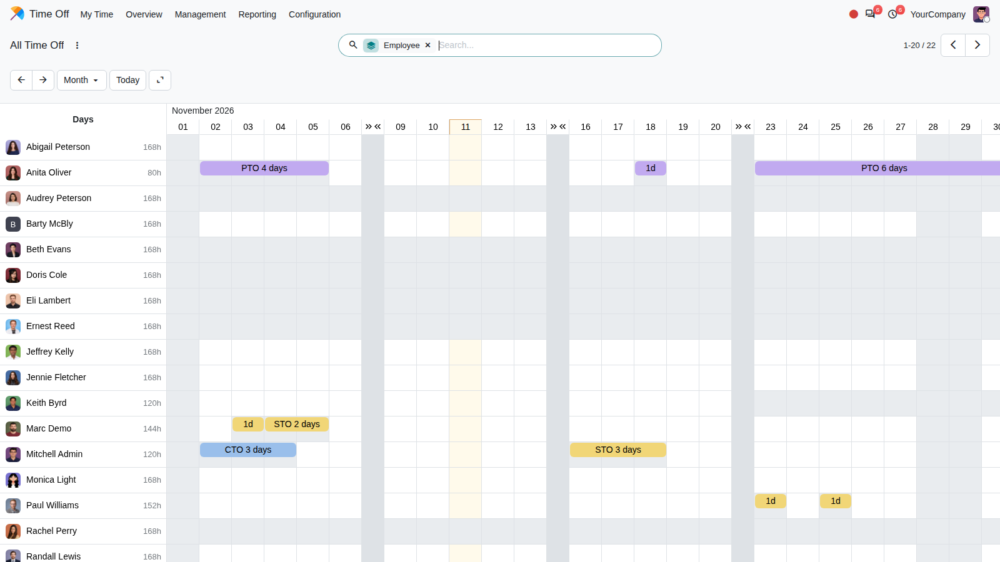
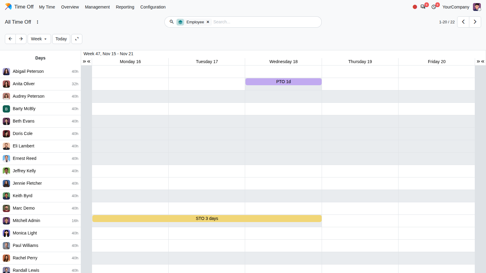
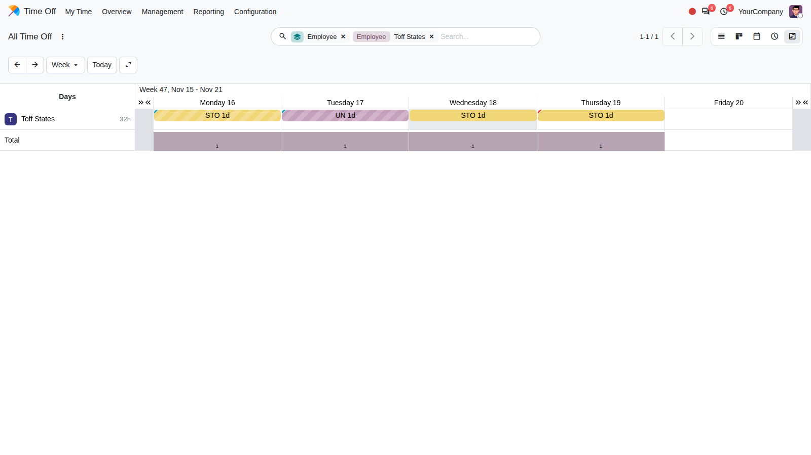
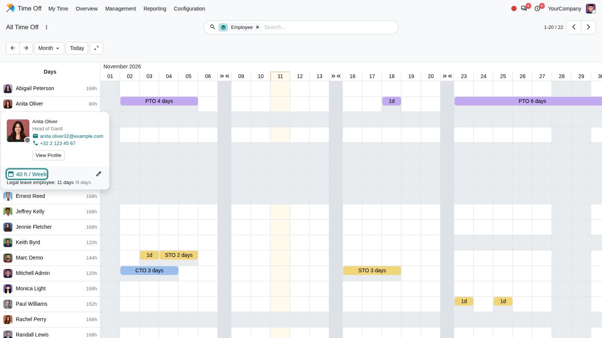
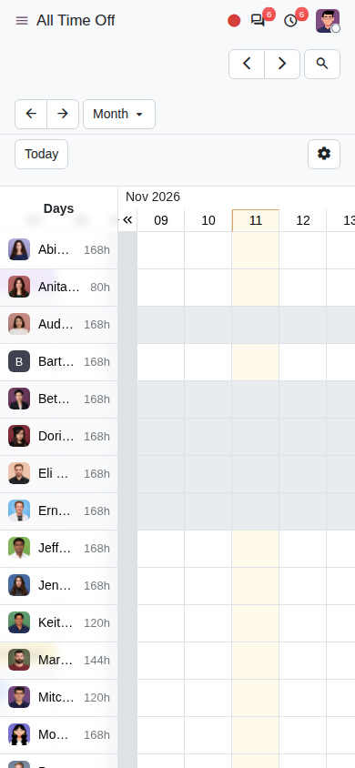

# Time Off Timeline

The module `hr_holidays_gantt` puts the time off of your employees on a time
grid: one row per employee, one pill per request. It is the bridge between the
Time Off application and the [Gantt View](gantt_view.md), and it builds on the
employee rows of the [Employees Timeline](employee_gantt.md). The grid, its
ranges, the control bar and the phone layout are those of the Gantt view; this
page tells what the time-off views add.

The module installs by itself when Time Off, Import and the Employees timeline
module are installed. It is not an application and adds no menu, group or
setting. Uninstalling it gives Time Off its old screens back (see
[Uninstalling](#uninstalling)).

Technical reference:
[`addons/hr_holidays_gantt/README.rst`](../../addons/hr_holidays_gantt/README.rst).




## In this release: reading, not editing

This release **shows** time off. A leave is still opened, changed, approved,
refused and created in the other views of Time Off (the list, the kanban, the
calendar, the request form and the Community dashboard). In the Gantt views
themselves these inputs do nothing yet: a click or a tap on a pill, a double
click, a drag or a resize of a pill, a click or a drag on empty cells, and the
selection of several cells. No popover opens, no dialog opens, nothing is
written and nothing is highlighted. The Gantt view takes these inputs in a later
release.

What does work in the views: the search and its filters, the grouping, the range
menu, the previous, next and Today buttons, the pager, the folding of columns,
the click on an avatar (the employee card), the click on a row header (it scrolls
to the first pill of the row) and the gear menu.

## Two views, and who reaches which

The module adds two Gantt views.

- **The leave view** shows time off requests, one pill per request.
- **The report view** shows the Community's time-off report, one pill per
  request too, and reads the same for every employee. It cannot write anything.

The menu **Time Off > Overview** chooses by role each time you click it.

| Your role | Overview opens | Also reached |
|---|---|---|
| Officer (Manage all requests) or Administrator | the leave view | Management > Time Off, with the Gantt button last in its switcher |
| Employee, Approver, or Manager of an employee | the report view, with Calendar as its second view | Approvers also have Management > Time Off, in which they see the requests they may read |
| No Time Off group | the Community's access error | Time Off is not in their home menu |

For an Officer or Administrator the Overview opens the leave view alone, with
the title "All Time Off", the grouping by employee as its only facet and no
other search default. Requests that are Refused or Cancelled are not listed
there. The page's address names the management action, and **a reload keeps this
reduced view**: the leave view alone, the title "All Time Off", the Employee
grouping as the only facet (no Waiting For Me) and the same rows, with no view
switcher. Management > Time Off is the Community list action with a Gantt view
added after its other views (List stays the default); its Gantt view lists every
state, and starts with the action's own filters (Waiting For Me and the current
year).


The report view and the leave view differ in a few more ways.

| | Leave view | Report view |
|---|---|---|
| Header over the row names | Days | Time Off |
| Ranges | Week, Month, Quarter, Custom | Day, Week, Month, Quarter, Year, Custom |
| Pill colour | the colour of the leave type | the colour of the employee |
| Marks on pills | striped with an info mark for requests waiting for approval; a danger mark for Refused; a secondary mark for Cancelled | none |
| Hours label | yes, for internal users | none |
| Gear: Import and Export | yes, on a wide screen | none |
| Sample data | none | when the report holds nothing at all |

The report view's Week range works by half days, so a leave of half a day is
drawn on half of its day there, and the lunch rounding of the attendance views
applies. When you have 50 employees or more to read, the report also opens with
the filter **My Team** (if you manage someone) or **My Department**, so that the
first page is not the whole company.

## Ranges

Like the attendance views, each named range shows **one period**: one week
(from the first day of your language's week), one calendar month, one quarter.
Previous and next move by one period, and Today brings back the period of
today. The leave view opens on the Month range. When today lies inside the
period on screen, choosing another range builds it around today. The custom
range works as in the Gantt view. The columns of the leave view are whole days;
no pill is rounded.




## The pills

A pill runs from the first to the last day of the request.

| Who reads | On the Month and Quarter ranges, a request of one day or less | Otherwise (for example on the Week range) |
|---|---|---|
| Officer, Administrator | the duration alone: "1d", "0.5d", or "04:00" for a request in hours | the type's code (its name when it has no code), a space and the duration: "PTO 4 days", "TH 04:00" |
| Anyone else | the duration alone | the duration alone: "4 days", "1 day" |

A request of one day or less therefore reads its duration alone on the Month
and Quarter ranges, **whatever the search holds**. This includes the searches
on the request itself, as the default filters of Management > Time Off (Waiting
For Me, a state, a type, a date). The view tells the server which range it shows
with every load, with or without such a condition, so a one-day request does not
change its text when you add a filter.

Without the grouping by employee (you removed it, or you chose another
grouping), the pill has the Community's long text instead: the employee, the type
and the dates; no avatar, label or unavailable cell is then drawn.

The colour of the leave view's pill is that of the leave type; the text is black.
The states that are shown:

| State | Overview (leave view) | Management > Time Off | Report view |
|---|---|---|---|
| To Approve, Second Approval | shown, striped, info mark | shown, striped, info mark | shown, plain |
| Approved | shown | shown | shown |
| Refused | not shown | shown, danger mark | not shown |
| Cancelled | not shown | shown, secondary mark | not shown |



## The rows

Which employees get a row depends on what you search.

- **A search on employees.** With the grouping by employee alone and a search
  that concerns only the employee (the name, the department, the manager, the
  schedule, My Team, My Department, or no search at all), **every matching
  employee has a row**, also one with no leave in the period. The rows are
  ordered by name, 20 to a page, and the pager counts employees ("1-20 / 22").
- **A search on the requests.** With a condition on the request itself (a state
  filter, Waiting For Me, Missing Document, a type, a date), or with another
  grouping, or several, **only the employees who have matching requests** get
  rows. The same is true in the report view for a search on the report's
  department, which belongs to the request, and not to the employee. A search
  on the report's job position or company is a search on the employee and keeps
  the empty rows.
- Only active employees have rows.
- What you may see: every employee with a Time Off group may read the list of
  employees, so the report view shows all of them. In Management > Time Off an
  Approver gets rows only for the employees whose requests the Community lets
  them read (the ones they approve, and themselves).

Grouping by something other than the employee alone (the type, the status)
gives plain rows with no avatar; grouping by the employee first and something
else after keeps the avatars. The search menu of the leave view does not offer
the Community's grouping by Date, because a Gantt view cannot be grouped by the
date it is laid out on.


## Unavailable days and flexible schedules

Days on which an employee is not available are grey, as in the attendance views.
The module takes them from the Community's own computation, which comprises:

- the days outside the employee's contracts (an employee with no contract is
  grey on the whole period);
- the days off and hours off of the working schedule;
- the company-wide leaves;
- the employee's **approved** leaves. A request that waits for approval, or that
  is refused, makes nothing grey.

Both leave views draw whole days: a day is grey only when the whole day is
unavailable, so a half day or a few hours of leave grey nothing there. The
report view does the same on its Month and Quarter ranges, and shows half days
on its Week range.

**Flexible schedules.** An employee whose working schedule has no fixed hours
has no grey day of their own, weekends included, but an approved leave still
greys what it covers. The module sets that by the request's unit, in the
employee's time zone:

- a leave in **half days** covers the morning or afternoon it names, up to the
  end of the last half day;
- a leave in **hours** covers the whole days when its hours equal the schedule's
  hours per day, the morning or the afternoon when they equal half of it, and
  otherwise the hours from its start to its end;
- a leave in **days** covers whole days.

This applies in every view of employees, the attendance views included (see
[What Time Off changes in the attendance views](attendance_gantt.md#what-time-off-changes-in-the-attendance-views)).


When every employee of the page is grey for a whole column and no pill touches
it (the weekends, usually), the run of columns folds, and the folding is worked
out at each load, as in the attendance views.

## The hours label

Next to each employee's name the leave view shows a short label, such as "168h".
It is in the muted colour, has no bar under it and no tooltip, and shows for
internal users only. The report view has none. The number is rounded to the
nearest whole hour, and it counts the period on screen (the days of the week,
month or quarter).

**The label has two meanings, depending on the employee's schedule.**

| Schedule | The label shows | Example, November, standard schedule |
|---|---|---|
| **Fixed** (hours on set days) | the **hours to work in the period, less leave**: the schedule's working hours, less validated leaves and company-wide leaves | 168h for an employee with no leave (21 working days of 8 hours); 80h for one who is out for 11 days |
| **Flexible** (no fixed hours, or hours per week without set days) | the **hours of approved leave** that overlap the period | 16h for two approved days of 8 hours |

The meaning follows the employee's current schedule. For a flexible schedule a
leave that crosses the edge of the period counts with all its hours, not just the
part inside. A request that waits for approval or is refused counts in neither
case. The two meanings are intended: a flexible schedule has no hours to work, so
the label tells how much leave the employee has taken instead. Read a row's label
with the employee's schedule in mind.

The period is the same calendar days for every employee, read in the browser's
time zone, whatever the time zone of the employee.


## The employee card

A click on an avatar (on a screen 768 px wide or more) opens the card of the
Community's employee, with a **leave band** under its body, and without the
card's footer. Nothing opens on a phone. The card closes on a click elsewhere
or Escape. It is the same in both views.



The band has:

- **The schedule button**, for everyone: a calendar icon and the hours per week
  of the employee's schedule ("40 h / Week"), or "Time Off" when the schedule has
  no hours. It has the focus when the card opens. A click opens the employee's
  time-off dashboard, on the Week range of the view if it shows a week, on the
  Month range if it shows a month, and on the year for every other range.
- **The leave lines**, for Employees officers only: one line for each leave type
  that is valid in the company's country (or has no country) and for which the
  employee has time allocated or taken. A line reads the type, the time taken in
  bold and, for a type that needs an allocation, the time left in muted text
  ("Legal leave employee: 11 days / 9 days"). The amounts are the Community's,
  added up over the employee's allocations of the type and computed with your own
  rights; they are in days or in hours by the type's unit of measure. A type that
  needs no allocation shows the time taken alone, with no slash. The lines are
  ordered by time left, the smallest first; types with the same time left keep
  the Community's order.
- **A pencil**, for Employees officers only: it asks for a date and creates a
  new version of the employee at that date, then opens the employee on it.
  Closing the date picker without a date does nothing.

An employee who is not an officer sees the band with the schedule button alone.


## Import and Export in the gear

On a screen 768 px wide or more, the gear beside the title of the leave view
offers two entries. They are not there in the report view, and not on a phone.

- **Import** opens the Community's import screen for time off requests. Its
  breadcrumb comes back to the view.
- **Export**, for users of the Community's export group, downloads at once, with
  no dialog, a spreadsheet (xlsx) of the requests of the current search (the
  action's filters included), without grouping, the latest start first, with one
  header line and five columns in this order: the request's external identifier
  (made by the export for a request that has none), the employee's name, the
  type's external identifier, the start date and the end date. The export group
  is not implied by any Time Off group: an Officer or Administrator who is not in
  it sees Import alone.


An Approver in Management > Time Off, who is not in the export group, gets Import
alone.

## When nothing shows

When no employee matches the search, both views show **one empty row with no
name** and the total row, without helper text and without a layer, on a phone
too. A row of an employee who has no leave is a normal row. With requests
elsewhere but none in the period, the rows are drawn as usual. The report's
sample data appears only when the report holds no record at all.


## The control bar and the phone

On a wide screen the control bar of the leave view is a fixed 58 px tall, with
its controls 4.5 px below its top and the grid right under it.

Below the small-screen breakpoint both views take the phone layout of the Gantt
view: a narrow row header with the avatar, the cut name and the label, and the
search facets behind the search button. There is no card and no gear entry.
The leave view's control bar follows the phone layout of the Gantt view as the
report view's does: two lines with a separator between them, and the grid
**below** the bar, so no control lies over the grid.

The phone's grid opens scrolled sideways so that today lies at the middle of the
visible part of the grid (the part right of the row header column). On the Month
range today's column starts at that middle; choosing the Week range from there
keeps today near it, and Next keeps the scroll position.



## Time zones

- Today, the days of the period and the drawing of pills follow the **browser's**
  time zone.
- The hours of an employee's schedule, which the grey cells show, are read in
  the employee's own time zone and placed at the same clock time in the
  browser's zone, so a working day of 8 to 17 greys no cell of the day whatever
  the zone of the browser.
- The label counts the same calendar days for every employee (see above).
- The leave intervals of flexible schedules follow the employee's time zone.
- The dates in the long pill text are those of the request.

The browser sends its zone with each load of the data.

## What Time Off changes in the attendance views

With this module and Time Off installed, the attendance views change in three
places; they are described in
[Attendances Timeline](attendance_gantt.md#what-time-off-changes-in-the-attendance-views).

## Uninstalling

Uninstalling the module gives the Overview menu the Community's time-off
dashboard action, and gives that action and Management > Time Off their
Community view modes (calendar for the first; list, kanban, form, calendar and
activity for the second). Uninstalling the Employees timeline module uninstalls
this one too.

**Checking an uninstall.** The container's start-up script adds the database
connection to the command line, which the `module` command does not take, so give
the connection through the `PG*` variables of the shell the verifier runs. With
`docker/.env` created, in a shell that has its `POSTGRES_USER` and
`POSTGRES_PASSWORD` as `USER` and `PASSWORD`, on a database `DB` where the module is installed:

```
podman compose --env-file docker/versions.env --env-file docker/.env -f docker/compose.yaml run --rm -e PGHOST=db -e PGUSER=USER -e PGPASSWORD=PASSWORD odoo odoo module uninstall -d DB hr_holidays_gantt
```

Then check, as the administrator, that:

- Time Off > Overview opens the Community's dashboard action
  (`hr_holidays.action_hr_holidays_dashboard`) and the menu works;
- that dashboard action has the view mode `calendar` alone;
- Management > Time Off (`hr_holidays.hr_leave_action_action_approve_department`)
  has the view modes `list,kanban,form,calendar,activity`, with no Gantt view.

## Who sees what

The module adds no group, access right or record rule. The Community's Time Off
groups decide. Where a role may not act, an element is **absent**, not
disabled.

| | No role | Employee, Manager | Approver | Officer, Admin |
|---|---|---|---|---|
| Overview | access error | report view | report view | leave view |
| Management > Time Off | not there | not there | yes | yes |
| Pill text on Month and Quarter, one day or less | n/a | duration | duration | duration |
| Pill text otherwise | n/a | duration | duration | type code and duration |
| Hours label | n/a | none | none (report) | yes |
| Card lines and pencil | n/a | no | no | yes |
| Gear | n/a | none | Import (no export group) | Import and Export |

A Manager who is not an approver does not see Management > Time Off. If they
open it by its address they get the same view as an Approver, with the
Community's read rules on requests applied. An Approver in Management > Time
Off sees the label, since the hours are read with their own rights.

## Verifying with demo data

The Community's Time Off demo leaves are placed around the day of installation, so
the database that shows the same days every time is created while the server's
clock reads Wednesday 11 November 2026, 10:00 UTC. The tool
[`tools/odoo_at_instant.py`](../../tools/odoo_at_instant.py) does that; how it
works, why it runs in the project's container only and how to stop the server are
told in
[The demo database at the project's instant](attendance_gantt.md#the-demo-database-at-the-projects-instant).
Every command below is one plain `podman compose` command from the root of the
repository, after `docker/.env` has been created. Replace `DB` with `demo002e`.

Create the database with the modules of this part and the demo data (the skills
module fills the employee card):

```
podman compose --env-file docker/versions.env --env-file docker/.env -f docker/compose.yaml run --rm -v ./tools:/mnt/instant:ro odoo python3 /mnt/instant/odoo_at_instant.py --at 2026-11-11T10:00:00 -- -d DB -i web_enterprise,test_web_gantt,hr_gantt,hr_attendance_gantt,hr_holidays_gantt,hr_skills --with-demo --stop-after-init
```

Check the attendance demo data of the earlier part, then the leaves of this one:

```
podman compose --env-file docker/versions.env --env-file docker/.env -f docker/compose.yaml run --rm -v ./tools:/mnt/instant:ro odoo python3 /mnt/instant/odoo_at_instant.py check-demo -d DB
```

```
podman compose --env-file docker/versions.env --env-file docker/.env -f docker/compose.yaml run --rm -v ./tools:/mnt/instant:ro odoo python3 /mnt/instant/odoo_at_instant.py --at 2026-11-11T10:00:00 -- -d DB --test-tags hr_holidays_gantt_demo_check --stop-after-init
```

The second command runs one test class that no normal run picks up. It writes one
line `DEMO-LEAVE ...` per leave of Anita Oliver, Mitchell Admin, Marc Demo, Ronnie
Hart, Sharlene Rhodes and Paul Williams (the type, its display code, its country,
its colour, the state and the first and last day in Europe/Brussels) and one for
Anita Oliver's allocation. It fails when a day, a type or a state differs from the
table of the acceptance scenarios (every leave Approved; Anita Oliver: 20 days of
Legal leave employee, 11 taken, 9 left) and is skipped in a database without the
Time Off demo data. It changes nothing.

**The attendance part's prepared records.** `prepare` and `unprepare` of the
attendance part work as told there; this part's scenarios that use the attendance
view (the ones that show time off in it) use the same database:

```
podman compose --env-file docker/versions.env --env-file docker/.env -f docker/compose.yaml run --rm -v ./tools:/mnt/instant:ro odoo python3 /mnt/instant/odoo_at_instant.py prepare -d DB
```

```
podman compose --env-file docker/versions.env --env-file docker/.env -f docker/compose.yaml run --rm -v ./tools:/mnt/instant:ro odoo python3 /mnt/instant/odoo_at_instant.py unprepare -d DB
```

**Starting and stopping the server.** Start it under the same clock, published on
the machine's own address only, in the background or in its own terminal:

```
podman compose --env-file docker/versions.env --env-file docker/.env -f docker/compose.yaml run --rm -p 127.0.0.1:8069:8069 -v ./tools:/mnt/instant:ro odoo python3 /mnt/instant/odoo_at_instant.py --at 2026-11-11T10:00:00 -- -d DB
```

It answers at `http://127.0.0.1:8069`. `podman ps` lists the run container (a
name such as `docker-odoo-run-c38678dc7f23`); `podman stop CONTAINER` stops it and
`--rm` removes it.

**Which values depend on the server's clock.** None, while the server runs: no
value reads the server's clock at run time. The "flexible today" check of the
hours label, which decides whether an employee's schedule in effect **today** is
flexible, takes today from the **browser**: the view sends the browser's day in
the context of each data call (the key `hhg_today`), and the server uses it. Only
a call that carries no such day (a script, an old client) falls back to the
server's instant read in the zone the browser sends in `tz`; the views of this
part always send it, so the browser's clock (11 November, set as told below)
decides and the server needs no particular clock to show the same values. The
clock still matters when the database is created, because of the demo data and
the dates it computes from it.

**Values of 002d2 and 002d3 in this database (A81).** The earlier parts' probes
and tours hold in a database that also has Time Off installed. In the database
`DB` of this section (it has the attendance and Time Off modules), run their
probes and tours with their own test tags as their guides tell, for instance
`--test-tags /hr_attendance_gantt` under the clock above; they must pass as in a
database without Time Off. The slice's CI configuration runs their suites with
Time Off installed.

**From a visual scenario to its probes.** The probes of the table run as classes
of `tests/test_probes.py`:

| Scenario | Probe class |
|---|---|
| A6, A9, A10, A11 (the Overview, a search on the request, the Week and Quarter ranges) | `TestTimeOffProbesDemo` |
| A21 (Import and Export), A23 (the empty leave view) | `TestTimeOffProbesDemo` |
| A44 (the leave view on the phone) | `TestTimeOffProbesDemo` (phone) |
| A12 (the report view), A25 (the empty report view) | `TestTimeOffProbesRoles` |
| A47 (the report view on the phone) | `TestTimeOffProbesRoles` (phone) |

### The role users and the prepared records

The administrator is Mitchell Admin (login `admin`), a Time Off administrator. The
acceptance scenarios need six **role users** and four sets of **prepared
records**. Create them as the administrator through the screens, as the
acceptance scenarios describe, or with the module's functions from an Odoo shell,
which makes them the same way every time. Start the shell under the clock:

```
podman compose --env-file docker/versions.env --env-file docker/.env -f docker/compose.yaml run --rm -v ./tools:/mnt/instant:ro odoo python3 /mnt/instant/odoo_at_instant.py --at 2026-11-11T10:00:00 -- shell -d DB
```

In the shell (the functions take the shell's `env`; `env.cr.commit()` keeps what
they made):

```python
from odoo.addons.hr_holidays_gantt.tests import time_off_fixtures as fx
fx.make_role_users(env)      # the six role users, their employees and "Toff Peer"
fx.make_flexible(env)        # "Toff Flex", "Toff Hours", "Toff Flexible", "Toff Fixed" and their leaves
fx.make_states(env)          # "Toff States": one request in each state
fx.make_bulk(env)            # "Toff Bulk 00" to "Toff Bulk 29"
fx.make_tokyo(env)           # "Toff Split" and "Toff Tokyo"
env.cr.commit()
```

Each function creates its records only; `make_role_users` first removes every
earlier prepared record, so call it first, once. To remove everything the
functions made (and anything left by an earlier run: the requests and allocations
of the employees whose name begins with "Toff ", those employees, the users whose
login begins with "toff_", the schedules and leave types named "Toff ..."):

```python
fx.drop_time_off_records(env)
env.cr.commit()
```

Records are found by name. The six role users have the login as their password:

| Login = password | Role |
|---|---|
| `toff_none` | internal user only |
| `toff_emp` | Time Off Employee |
| `toff_approver` | Employee, time off approver of "Toff Peer" |
| `toff_manager` | Employee, manager of "Toff Peer" |
| `toff_officer` | Officer, and the export group |
| `toff_admin` | Administrator, and the export group |

Their groups are **set explicitly**, replacing the ones a new user gets by
default, and each user has the time zone Europe/Brussels and an employee of the
same name. Check them after the setup, in the user's form or from the shell: for
instance `toff_approver` holds "Time Off Responsible" and `toff_manager` does not,
and only the officer and the administrator hold "Export / Allowed".

### The browser

Set the browser to the state the scenarios assume before each one:

- the clock at Wednesday 11 November 2026, 11:00, running on, and the time zone
  Europe/Brussels (for example with the browser's developer tools);
- one active language, US English (weeks start on Sunday), and fresh browser
  storage, because the range is remembered;
- a window of 1600 × 900 for the desktop, 390 × 844 with touch for the phone;
- the user's theme preference System, light or dark by the browser's colour
  scheme;
- the menus by role: Time Off > Overview for everyone (the leave view for the
  Officer and the Administrator, the report view for the others), and Management >
  Time Off for the Approver, the Officer and the Administrator.

## For developers

**View variants.** Two client variants of the Gantt view, both built on the
employee variant of `hr_gantt`, are registered in the `views` registry:

| `js_class` | View |
|---|---|
| `hr_holidays_gantt_manager_hr_leave` | the leave view, `hr_holidays_gantt.hr_leave_gantt_view`, model `hr.leave` |
| `hr_holidays_report_gantt` | the report view, model `hr.leave.report.calendar` |

They replace the card's content, the hours label and the context of the data call
(`group_by`, `tz`, and the scale), and make a named range one period.

**Inputs for the later parts: `hhgInputs`.** The renderer of the leave variant
lists the inputs of the framework that do nothing in this release, in a getter
`hhgInputs` that returns an object of booleans, all `false`: `pillClick`,
`pillDoubleClick`, `pillHover`, `pillPress`, `cellPress` and `multiSelect`. A
value of `true` hands the input back to the framework. A subclass flips entries
by spreading its parent's:

```js
get hhgInputs() {
    return { ...super.hhgInputs, pillClick: true };
}
```

A later part that adds the popover and the pill gestures assigns its popover in
`setup()` after `super.setup()` and sets the four pill entries; a part that adds
the selection of cells adds its form option to the view and sets `cellPress` and
`multiSelect`. Clicks on avatars and row headers, folding and the controls are
not listed: they stay.

**Server.** A model holds the part both data calls share (`hhg.gantt.rows`, an
abstract model mixed into `hr.leave` and `hr.leave.report.calendar`):

- `get_gantt_data` is overridden on both models. It reads with the displayed scale
  in the context (`scale`) on both of its paths, so that the pill text follows
  the scale, and it asks for every employee's row only when the search concerns
  the employee alone (`user_domain`, `group_by` in the context). The report's
  job position and company conditions are converted to the employee's first.
- `_gantt_unavailability` answers for the employee field with the Community's
  unavailable intervals, read with system rights in the browser's zone (`tz`).
- `_gantt_progress_bar` of `hr.leave` gives the hours label of the rows to
  internal users.
- `hr.employee.public` gets two computed fields for the card, `avatar_leave_summary`
  and `avatar_hours_per_week`, and a method that opens an employee's time-off
  dashboard for any user.
- `resource.calendar._handle_flexible_leave_interval` is overridden for the leave
  intervals of flexible schedules (all views of employees).
- A method of `hr.leave` returns the action that the server action
  `hr_holidays_gantt.action_hr_holidays_overview` runs for the Overview menu;
  `uninstall_hook` writes the Community's view modes and menu action back.

**Extension point.** The client's `hhgInputs` getter is the extension point
that the module offers. The server side is extended by the usual inheritance of
the two models above.

**The Gantt view's unavailable parts.** One change was made to `web_gantt` for
this module; see [Gantt View](gantt_view.md#capacity-bars-unavailable-periods-and-folded-columns).
