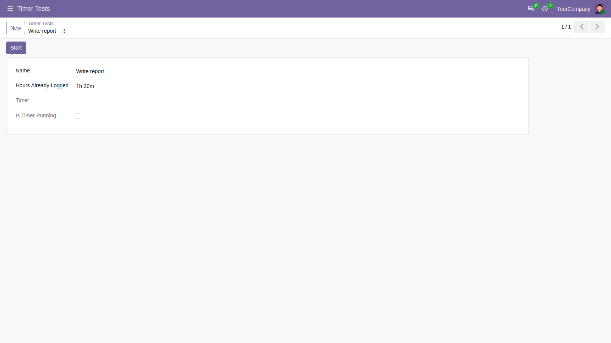
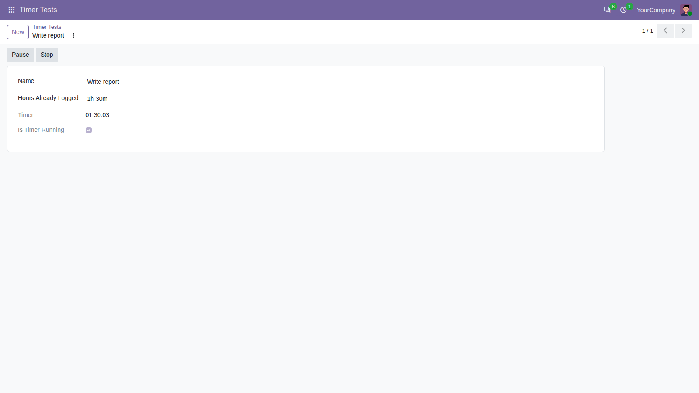
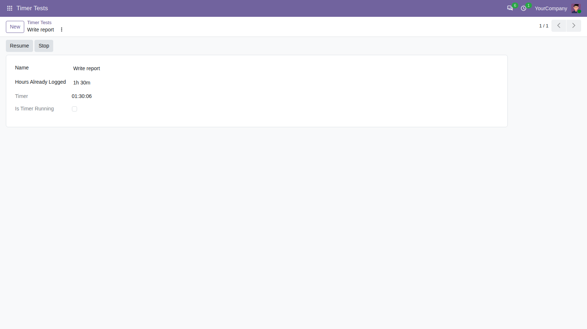
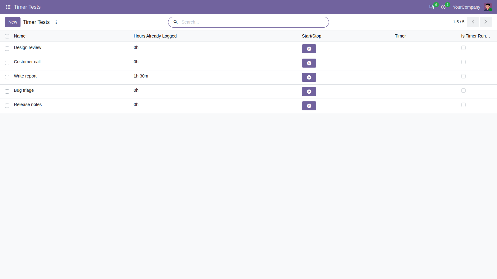
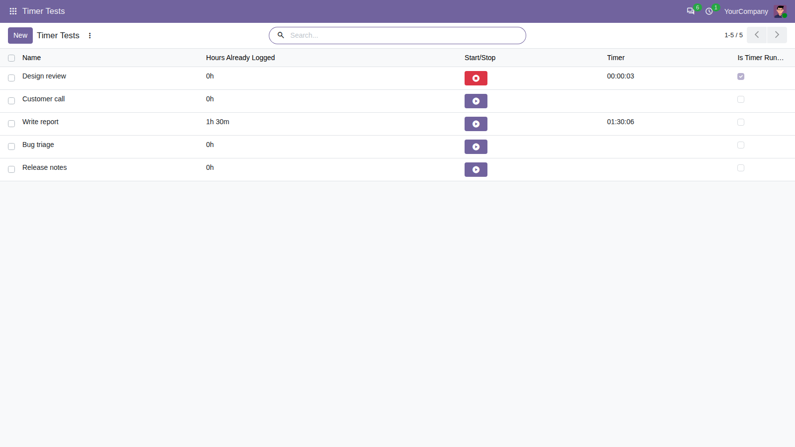
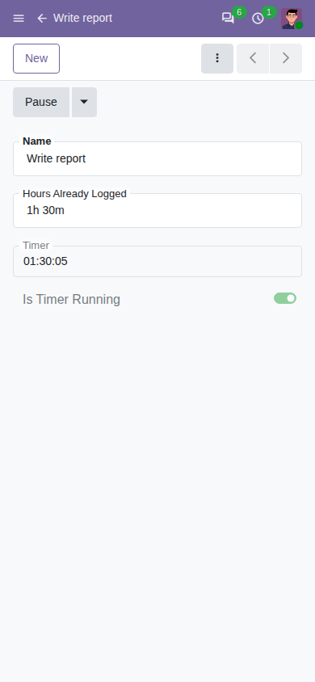
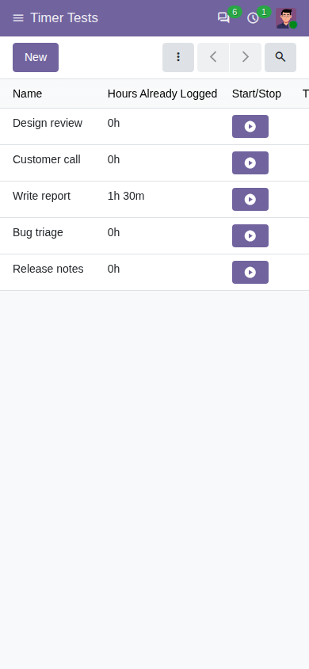

# Timer

The Timer module gives a document, such as a task, a ticket or a work order, a
personal stopwatch for each user. Applications that record time use it. Timer
itself adds no menu: you meet it on the screens of those applications, as a
running clock and a start/stop button.

Technical reference: [`addons/timer/README.md`](../../addons/timer/README.md).
The screenshots below show the "Timer Tests" screens of the hidden test
module [`test_timer`](../../addons/test_timer/README.md); a real application
places the clock and the buttons on its own screens in the same way.

## The running clock

The clock shows how long *your* timer on the document has been counting, as
hours, minutes and seconds (`HH:MM:SS`). Two people looking at the same
document each see their own timer.

| Your timer | The clock shows |
|---|---|
| none | nothing |
| running | the time so far, counting up every second |
| paused | the time up to the pause, frozen |
| stopped | nothing again |

When the application has a field for time already recorded, the clock starts
from that value: with 1.5 hours already recorded, a new timer starts at
`01:30:00`. Hours are not limited to 24: two full days show as `48:00:00`.

In a list, each row shows its own clock; rows without a timer stay empty.

## Starting and stopping

Applications offer the four actions as buttons, or as one start/stop button:

- **Start** starts your timer on the document. If you already have a running
  timer on another document, that one is paused first: you only ever have one
  running timer, even when you click Start in two browser tabs at the same
  moment: one of the two clicks is refused. Starting a paused timer resumes
  it. You can only start a timer on a document you can open.
- **Pause** freezes your timer. Pausing again changes nothing.
- **Resume** continues a paused timer from where it stopped; the paused time
  is not counted.
- **Stop** ends your timer. The application receives the time worked (for
  example to write a timesheet line) and the clock disappears.

The start/stop button is a small bar in the theme's main colour with a play icon (**Start**) or,
while your timer runs, a red bar with a stop icon (**Stop**). Clicking it in a list row does
not open the row. On a form with changes you have not saved yet, the button
saves them first; if the form cannot be saved (for example a required field
is empty), the timer does not start or stop. In the list above, the red button stops the running timer
of "Design review"; the other rows show the start button. On "Write report",
whose timer is paused, the start button resumes it.

## Who sees what

- Everyone with an internal user account can see all timers, but can start,
  pause, resume and stop only their own. Administrators follow the same rule.
- Portal and public users have no access to timers.
- When a document is deleted, every timer on it is removed, for all users.

## On a phone

The clock and the buttons work the same way on small screens. In a list,
scroll sideways to reach the clock column.

