# Web Theme

The Web Theme is the look of the web client, part of the same automatically
installed module as the [Web Shell](web_shell.md). It adds no menu and no
setting. You choose between the light and the dark look with the **Theme**
field in your preferences (System, Light or Dark); this page shows what each
one looks like.

Technical reference:
[`addons/web_enterprise/README.md`](../../addons/web_enterprise/README.md).

## Light and dark

Both looks use the same layout and the same colours for the same jobs: a brand
colour for primary buttons and the grid button, a teal for links and focus, a
red for counters and errors. The dark look is a full second version of the
screens, not a dimmed copy. Every page, menu, dialog and list is dark,
including the parts added by other applications.

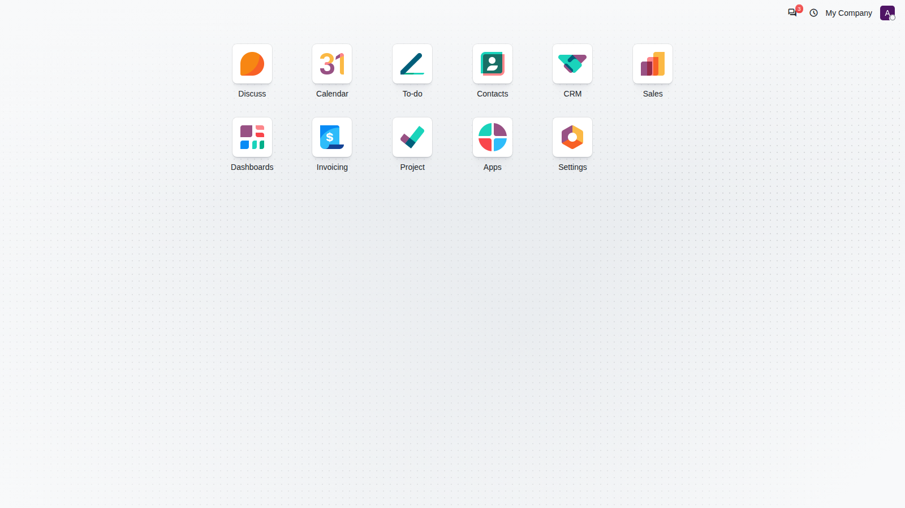

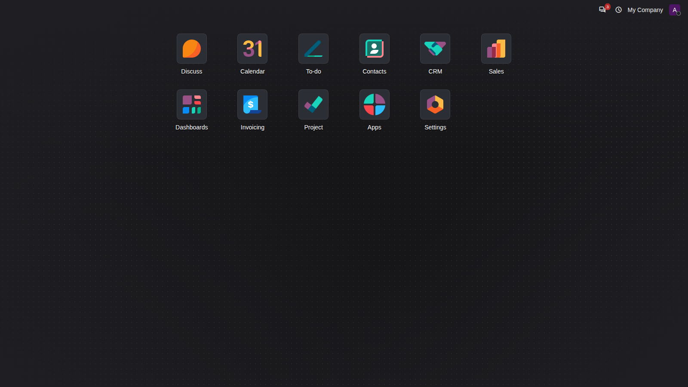

On a phone the same screens fit the narrow width.

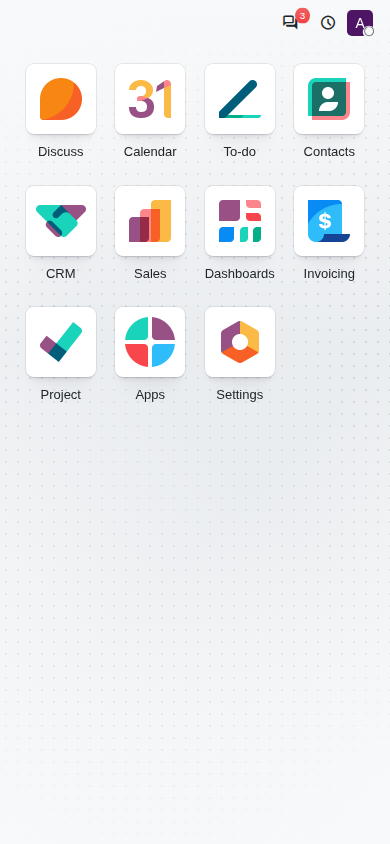

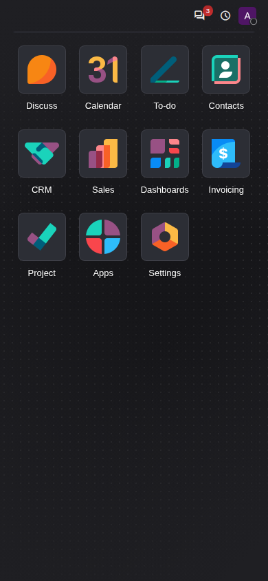

## Views

Kanban columns have cards with a soft border that darkens when you point at
them. The column header stays visible with a frosted background when you
scroll.

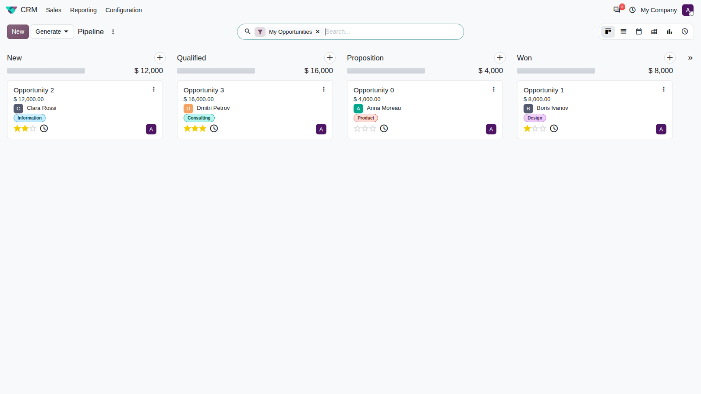

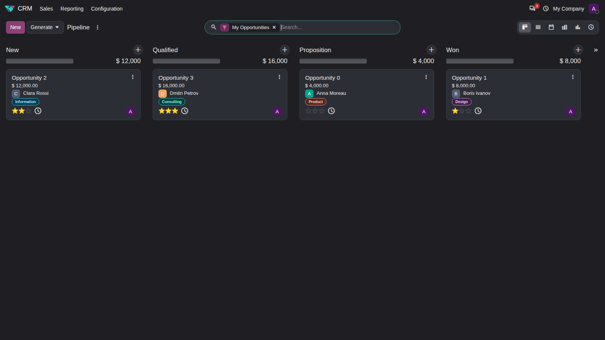

Cards carry small badges and tags with a semi-bold label. Lists have a quiet
header, a highlighted row under the pointer and a counter when rows are
selected, and they sit on a white (dark grey in the dark look) area.

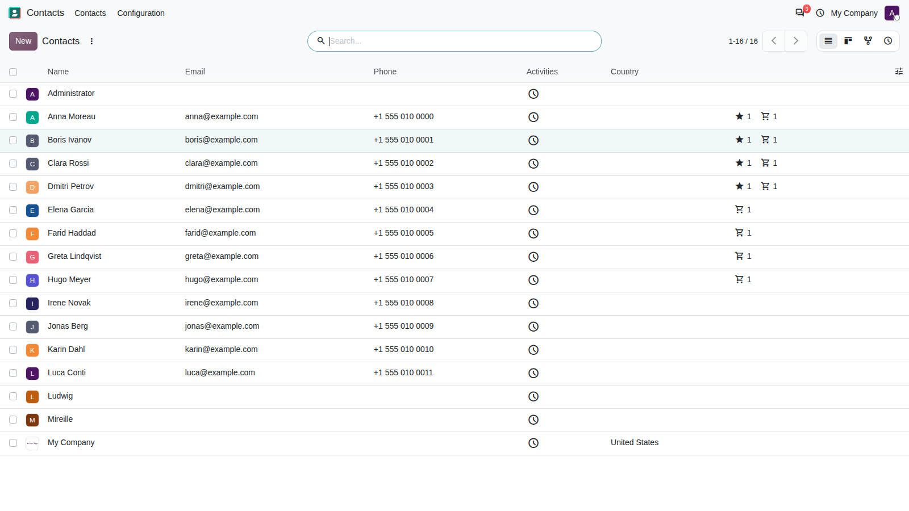

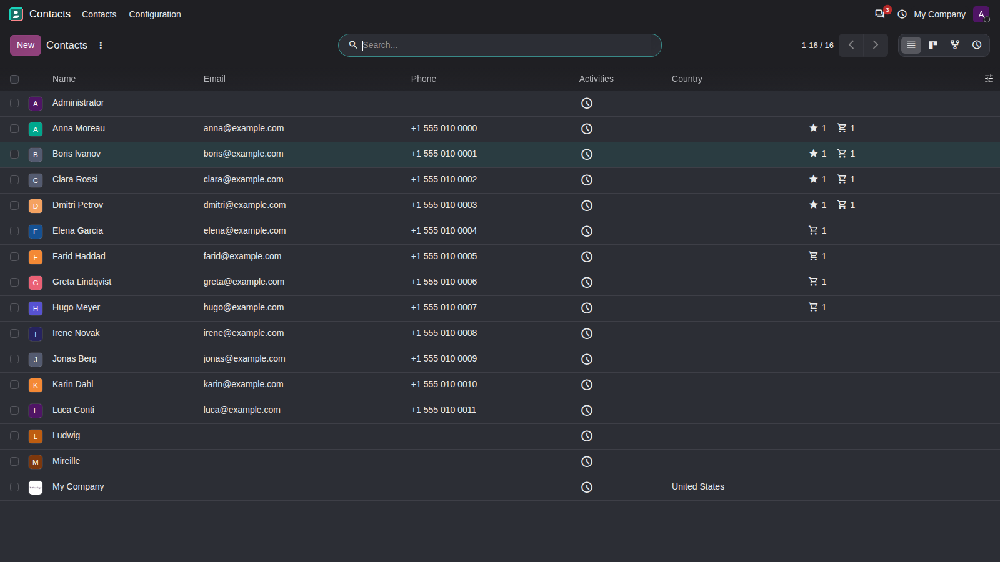

Forms show the record on a sheet over the page background, with a status bar
and a button box. The breadcrumbs have no fill of their own, and on a wide
screen the chatter sits beside the sheet, level with the header buttons.

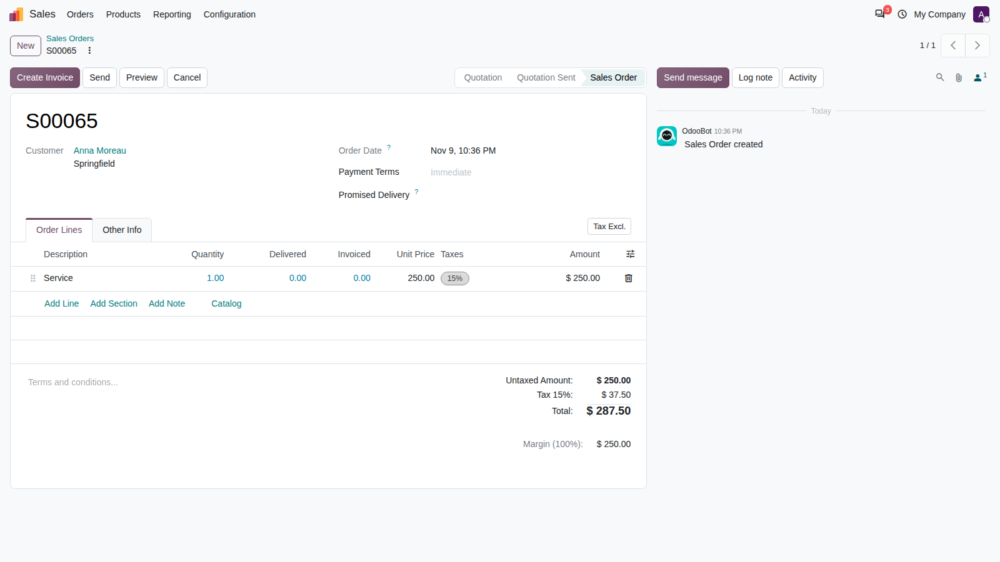

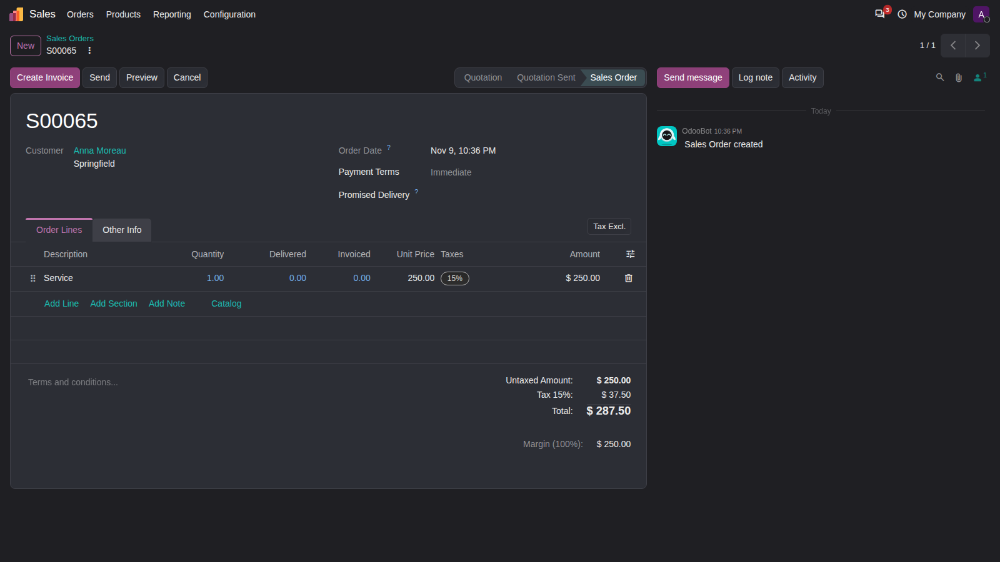

The settings page, the calendar and the graph view follow the same colours.
The settings search field is a little shorter than before (33 px high), and the filter
sections in the calendar side panel are closer together.

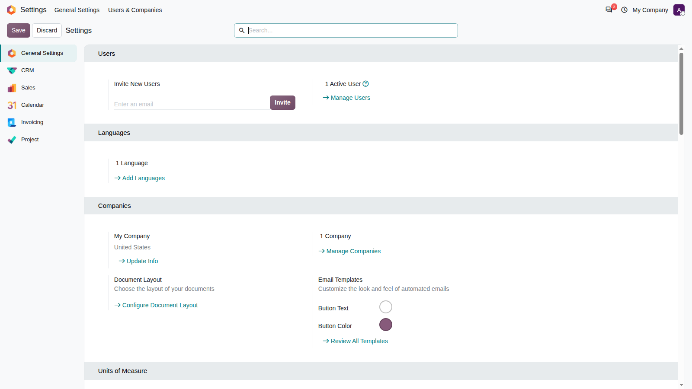

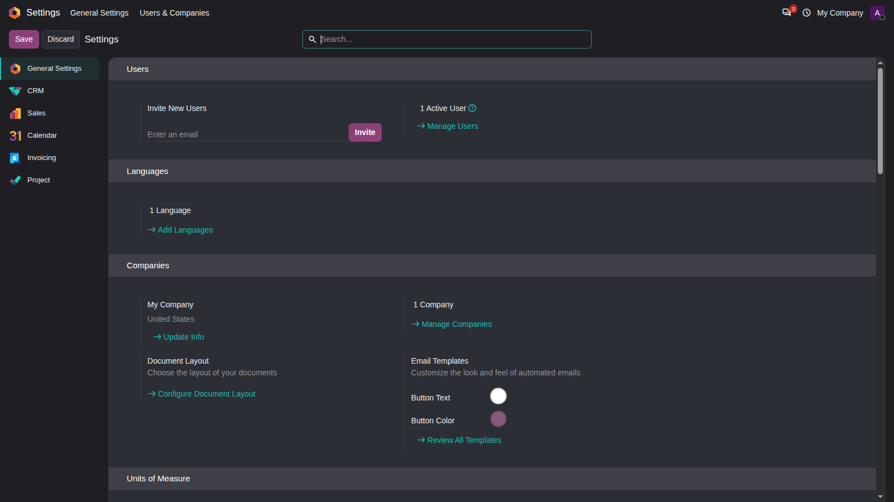

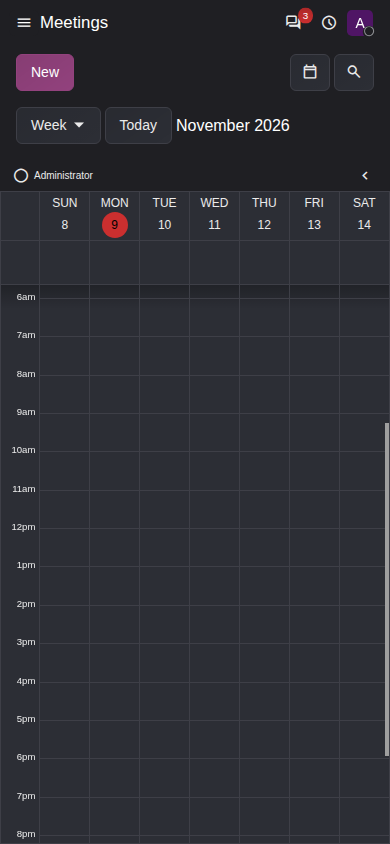

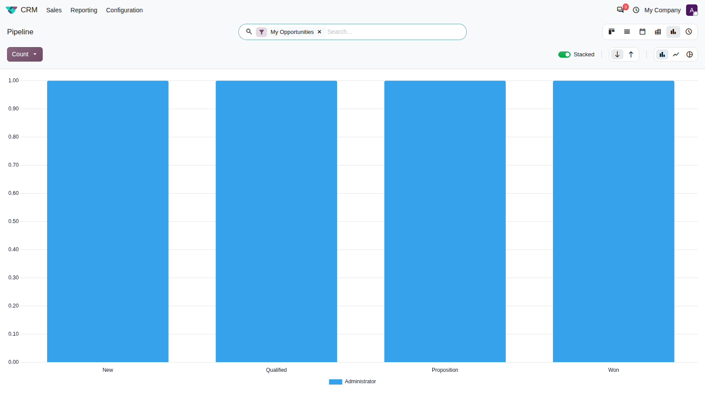

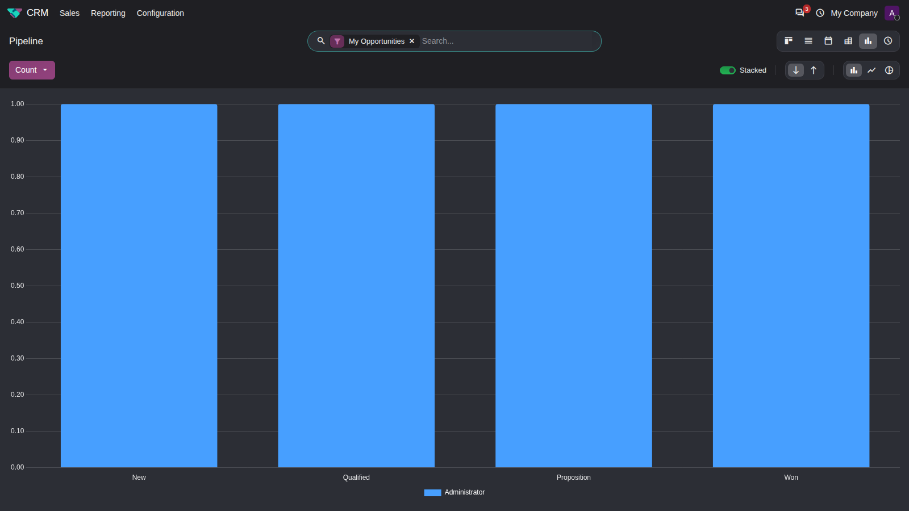

## Dialogs and menus

Dialogs, drop-down menus, pop-overs and the command palette sit on a slightly
lighter surface than the page, with a border, so they stand out in the dark
look.

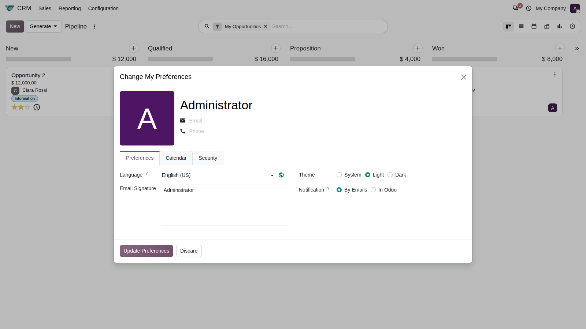

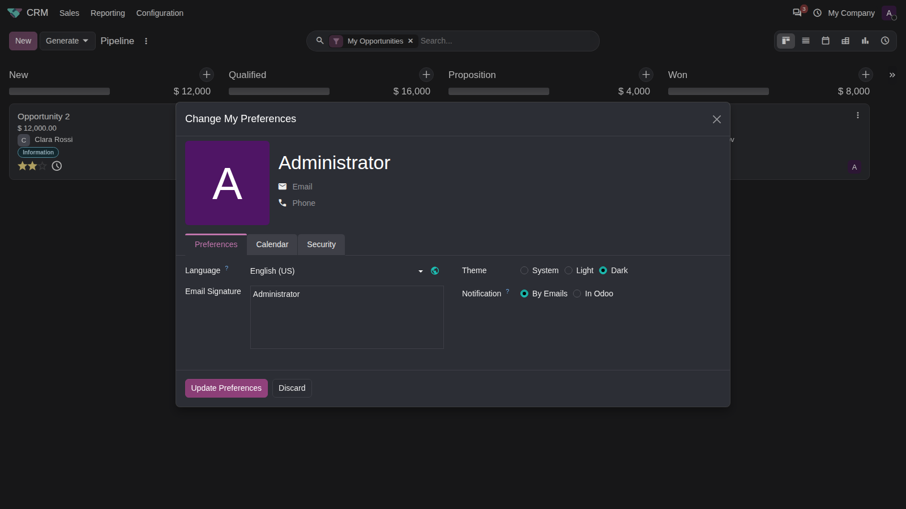

## The login page

The login page is public, so it is always shown in the light look, whatever
you chose.

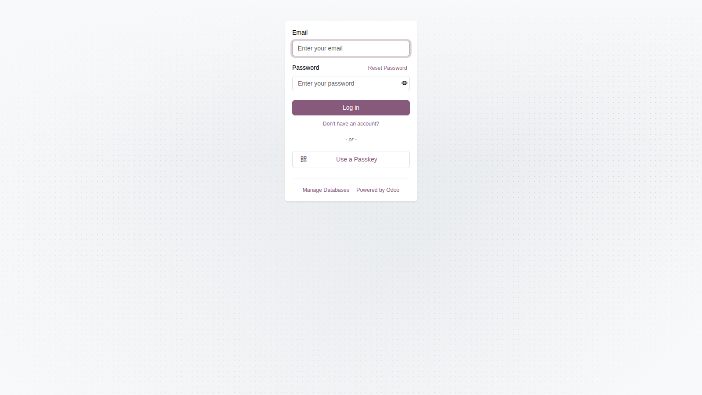

## Changes you may notice

- **Pressing a tile and moving away.** If you press a tile on the home menu and
  move the pointer away before the hold ends, the press is cancelled and
  letting go does not open the application.
- **The back arrow.** The arrow that returns from the home menu to your
  application is brand-coloured in the light look and white in the dark look,
  and turns black only when you point at it.
- **Top bar.** The entries of the tray are tighter, the avatar fills the bar's
  height, and in the dark look the application name is white.
- **Tooltips.** In the light look a tooltip is a black rounded label with light
  text.
- **Switchers.** The buttons of the view switcher and of other switchers show a
  hover state in every position, not only at the ends.
- **Tours.** If a guided tour is started while the home menu is shown, its
  "open the apps menu" step is skipped by itself and the tour goes on with the
  application tile. This is the only change to how tours run; every other step
  behaves as it does without the theme.
- **Switchers with nothing selected.** A small group of buttons with no active
  button, such as the sort buttons of a graph, shows the sliding highlight
  under its first button. In the dark look a hovered button keeps its grey text
  and the active one is white.
- **Ribbons, sliders and lists.** Ribbon bands carry a stronger shine than
  before, a slider thumb that is pressed shows the same shine as the other
  controls (black in the dark look), and selection lists such as the language
  field of the preferences are light grey in the light look. The list of
  matching records under a field such as the salesperson is light grey too,
  with a lighter shadow, while the search suggestions stay white. On a phone
  the language options open in a bottom sheet with a shadow, and the chosen
  option has an action-coloured border.
- **Calendar drop zone.** When a task is dragged in a calendar that allows
  unscheduling, the drop zone fills the side panel column from its top edge,
  and its colours follow the active look, including the dark one.
- **Scrolling the home menu.** The home menu scrolls over the whole window
  width, so its thin scroll bar sits at the window edge, while the tiles stay
  in a centred column.
- **Native controls.** Scroll bars, the browser's own date and time fields and
  the list of a native drop-down follow the look you chose, so in the dark look
  they are dark too.
- **Phone address bar.** On a phone the browser's toolbar takes the brand
  colour in the light look and a dark blue-grey in the dark look.

For the technical side, including how another module can change the colours,
see the README linked at the top.
